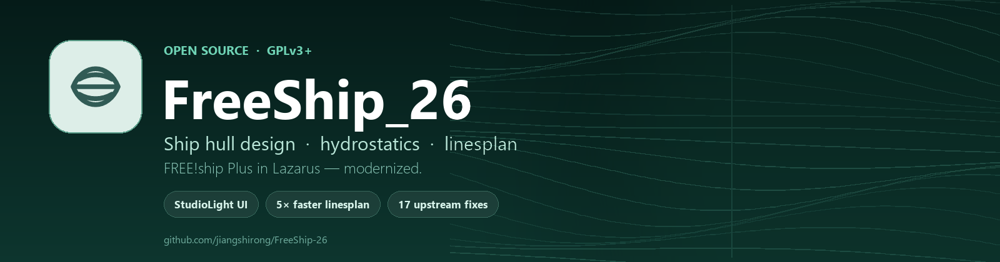
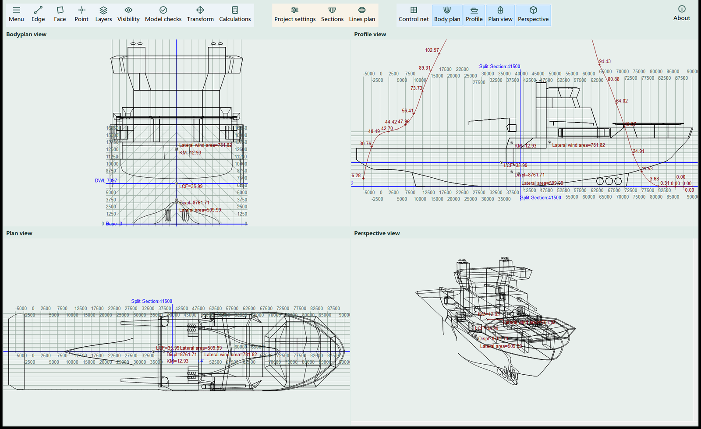
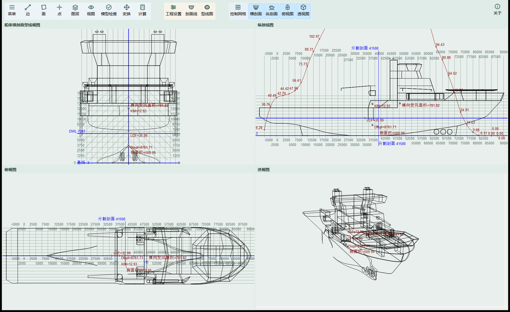
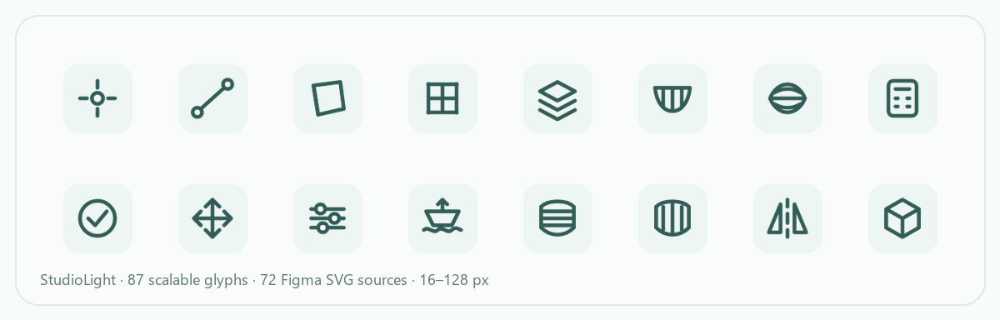
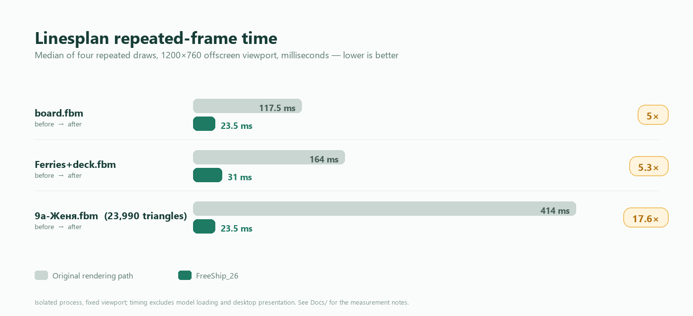
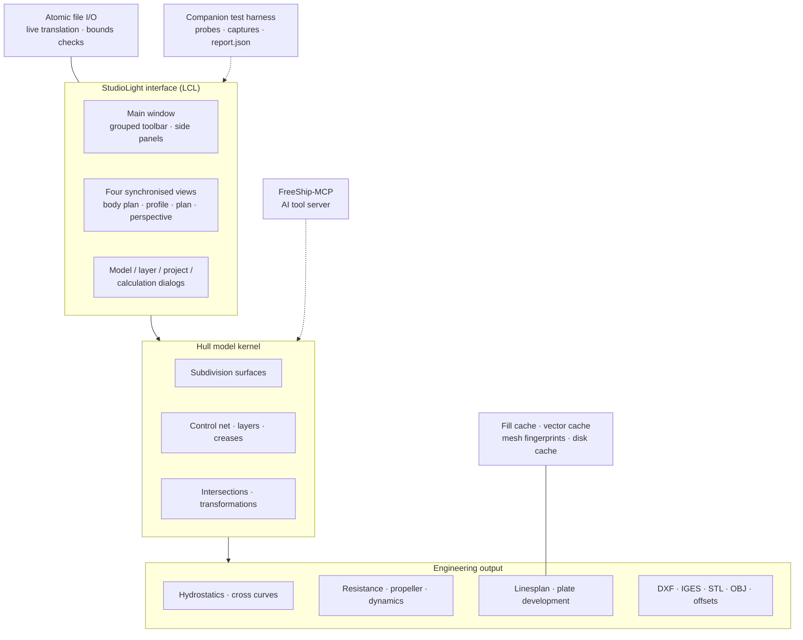

<a id="top"></a>

<div align="center">
  
  <h1>FreeShip_26</h1>
  <p><b>A hull-design workbench, rebuilt.</b><br>
  FREE!ship Plus in Lazarus — modern interface, measured rendering speed, crash-safe files, and a trilingual story.</p>

  <p>
    <b>English</b> ·
    <a href="README.zh-CN.md">简体中文</a> ·
    <a href="README.ru.md">Русский</a>
  </p>

  <p>
    <a href="COPYING"></a>
    <a href="https://github.com/jiangshirong/FreeShip-26/releases"></a>
    
    
    
    
  </p>
</div>

> **FreeShip_26** keeps everything FREE!ship Plus is good at — subdivision-surface hull modelling, hydrostatics, resistance and propulsion, linesplan and plate development — and rebuilds the experience around it. A new StudioLight interface, a rendering cache that removes most of the linesplan wait, atomic file writes that cannot eat your model, and a localization layer that switches language without overwriting the field you are editing.

This is an independent fork of [FREE!ship Plus in Lazarus](https://github.com/markmal/freeship-plus-in-lazarus), itself the Free Pascal / Lazarus port of FREE!ship Plus. It is **not** a re-release: the fork changes 140+ source files, adds 13 new units and ships its own icon system, theme, performance work, reliability fixes and test evidence.

---

## 📑 Table of contents

| | |
|---|---|
| [What is FreeShip_26?](#about) | [The workspace](#screenshot) |
| [Why this fork is different](#highlights) | [Performance, measured](#performance) |
| [Feature tour](#features) | [Reliability & the 17 upstream fixes](#reliability) |
| [Languages](#languages) | [AI-ready ecosystem](#mcp) |
| [Engineering & tests](#engineering) | [Architecture](#architecture) |
| [Build from source](#build) | [Quick start](#quickstart) |
| [Documentation](#docs) | [Roadmap](#roadmap) |
| [Credits & license](#credits) | [Project stats](#stats) |

---

<a id="about"></a>

## 🚀 What is FreeShip_26?

FreeShip_26 is a free, open-source **ship hull design and hydrostatics workbench** for Windows, written in Object Pascal on Lazarus / Free Pascal. It models a hull as a subdivision surface controlled by a lightweight control net, then derives the engineering deliverables from that same geometry:

- four synchronised views — body plan, profile, plan and perspective;
- hydrostatics, cross curves and hydrostatic features at any draft, trim and heel;
- resistance and propulsion estimates with the classic method families;
- a full linesplan with stations, buttocks, waterlines, diagonals, dimensions and DXF export;
- plate development, model checks and a broad set of CAD/CFD exchange formats.

The fork's goal is simple: **keep the engineering kernel, replace everything around it with something that feels 20 years newer** — and prove every claim with measurements.

| **🎨 StudioLight, inside and out** | **⚡ Fast where it used to hurt** |
|---|---|
| • Grouped icon-and-label toolbar instead of a wall of glyphs<br>• A new Figma-designed icon set: **87 scalable glyphs**, exported at **12 sizes** (16–128 px), with 4 dedicated toolbar sizes<br>• Light, calm palette; custom MDI view headers; hover hints and context menus<br>• Side panels for control points and layers, four-view and linesplan tabs | • Linesplan repeated redraw: **117.5 → 23.5 ms** (board), **164 → 31 ms** (ferries), **414 → 23.5 ms** (9a)<br>• Helper-line reveal animation: **5.56 → 2.42 ms** median frame<br>• Project settings reopen: **51–60 → 5.1–10.6 ms**<br>• Linesplan window appears in **3.4–4.7 ms**, content follows |
| **🛡️ Reliable by construction** | **🌍 Truly multilingual** |
| • **17 upstream defects fixed** across file safety, calculations, external solvers and legacy files<br>• Atomic save / restore of model files — a failed save no longer damages the project<br>• Loading a broken model keeps the current model intact<br>• Bounded, integrity-checked rendering cache (80 MB per entry, 256 MB total) | • **7 curated interface languages**: 简体中文, Русский, English, Français, Deutsch, Español, 日本語<br>• 14 translation catalogues in the repository<br>• Live language switching that never overwrites fields being edited<br>• Quick language toggle hotkey (Ctrl+Alt+L) for bilingual work |

---

<a id="screenshot"></a>

## 📸 The workspace

<p align="center">
  
</p>

<p align="center"><i>
The StudioLight workspace: grouped toolbar, four live views, and hydrostatic annotations drawn directly on the hull.
</i></p>

The same interface ships in every supported language — the Chinese edition is shown below.

<p align="center">
  
</p>

<p align="center">
  
</p>

<p align="center"><i>The new icon system: one visual language for modelling, visibility, calculations and export.</i></p>

---

<a id="highlights"></a>

## ✨ Why this fork is different

### 1. A real interface redesign, not a re-skin

The old upstream UI was a classic toolbar of tiny glyphs. FreeShip_26 replaces the shell with a **StudioLight** workspace:

- a **grouped action bar** — modelling (`Menu / Edge / Face / Point / Layers`), inspection (`Visibility / Model checks / Transform / Calculations`), project tools (`Project settings / Sections / Lines plan`), mode toggles and four view switches;
- a custom `TStudioSpeedButton` with multi-resolution images, labels that follow the language, and graceful overflow when the window gets narrow;
- **87 glyphs** drawn as a coherent line-icon family, packaged at 12 resolutions (16, 20, 22, 24, 25, 30, 32, 40, 48, 64, 96, 128 px) plus 23 toolbar PNGs and 72 editable SVG sources — **1,133 theme assets** in total;
- new view headers, side panels, hints, menus and dialogs that share the same spacing and colour language.

### 2. Performance work with numbers attached

Linesplan rendering was rebuilt rather than micro-tuned:

- the whole linesplan is composed from a **cached fill layer**; repeated draws reuse a pre-composed bitmap when the render state is unchanged;
- a **cache identity** derived from mesh fingerprint, layers, draft, colours, symmetry, lighting and renderer version decides when the cache is valid;
- a **cross-restart disk cache** (`%LOCALAPPDATA%\FreeShip26\LinesplanCache-v2`) with integrity checks, atomic replacement, per-entry and total size limits — safe to delete at any time;
- **section-level incremental intersections**: in the 9a sample, 13 of 22 sections are reused after a point edit and re-derived exactly when their inputs change;
- native Windows composition, double-buffered painting and batched GDI+ drawing remove flicker and per-segment object churn.

The measured result: interactive linesplan redraws drop by **5× to 17.6×**, with identical pixels, DXF output and engineering values. No subdivision level, curve sampling or export precision was reduced.

### 3. File safety as a first-class feature

The fork adds `FreeSafeFile` and a set of safety guards around the model lifecycle:

- save writes a complete sibling file, then atomically replaces the public name;
- a failed save leaves the previous project untouched; a failed load keeps the current model open;
- loading a corrupted model is bounds-checked instead of trusting the file;
- external calculation runs get explicit working directories, timeouts and exit-code handling;
- the linesplan cache is disposable: it never becomes the source of truth for a model or an export.

### 4. Localization that survives editing

Translation is applied through a live translator (`FreeSafeLanguage`) that updates menus, captions and panels in place — while deliberately **skipping edit boxes and combo boxes** so the text you are typing is never replaced. A quick-switch hotkey toggles between two chosen languages; the seven curated languages share one layout, one icon set and one set of accelerators.

### 5. Built and verified with an AI-assisted workflow

Every meaningful change in this repository was developed against a companion verification harness: isolated builds, hidden-window UI capture, fault injection, numeric comparisons and machine-readable `report.json` files with explicit `pass / fail / review / not_run` states. The engineering notes in [`Docs/`](Docs/FreeShip_26.md) record what was measured, what was not, and why — including the parts that were deliberately left undone.

---

<a id="performance"></a>

## ⚡ Performance, measured

<p align="center">
  
</p>

### Linesplan repeated redraw (median, 1200×760)

| Sample | Before | After | Speed-up |
|---|---:|---:|---:|
| `board.fbm` | 117.5 ms | 23.5 ms | **5.0×** |
| `Ferries+deck.fbm` | 164.0 ms | 31.0 ms | **5.3×** |
| `9a-Женя.fbm` (23,990 fill triangles) | 414.0 ms | 23.5 ms | **17.6×** |

First-frame preparation also improved where it matters — the 9a model drops from 484 ms to 391 ms, while repeated frames drop to the cost of a bitmap copy. Reusing a warm cache inside the process takes **31–34 ms**; a fresh process that reads the disk cache prepares the same view in about **359 ms**, and damaged caches fall back to a full rebuild instead of failing.

### Interaction and responsiveness

| Interaction | Before | After |
|---|---:|---:|
| Right-drag pan (1920×1140, 9a) | 29.04 ms | **18.97 ms** |
| Wheel zoom (1920×1140, 9a) | 37.49 ms | **26.07 ms** |
| Helper-line reveal, sustained frame median | 5.557 ms | **2.416 ms** |
| Helper-line reveal, P95 / max | 10.601 / 11.553 ms | **4.141 / 4.376 ms** |
| Project settings re-open | 51–60 ms | **5.1–10.6 ms** |
| Linesplan open request returns | — | **3.4–4.7 ms** |

<details>
<summary><b>Measurement scope and honesty notes</b></summary>

- Timings are from isolated, hidden-window processes with fixed viewports; they exclude model loading and real desktop presentation. They are **not** an FPS promise for every model or machine.
- The linesplan measurements keep subdivision precision, curve sampling and export precision unchanged; correctness was checked pixel-by-pixel against reference images and by comparing DXF records.
- The 3.4–4.7 ms figure is the time until the window and “generating…” state are shown; the complete linesplan still takes roughly 0.6 s on the 9a model and remains a target for future work.
- Full notes, per-model logs and report paths are in [`Docs/型线图性能优化_2026-10-30.md`](Docs/型线图性能优化_2026-10-30.md), [`Docs/型线图磁盘缓存与剖面增量-20261031.md`](Docs/型线图磁盘缓存与剖面增量-20261031.md) and [`Docs/扩散动画性能检查.md`](Docs/扩散动画性能检查.md).

</details>

---

<a id="features"></a>

## 🧭 Feature tour

The engineering kernel comes from FREE!ship Plus and remains available; the fork modernises how it is reached and presented.

| Area | What you can do |
|---|---|
| **Hull modelling** | Subdivision-surface hulls on a control net; move, align, lock, collapse, extrude and split points, edges and faces; layers, creases, control curves, mirrors, scale and rotate; Lackenby transformation; keel & rudder wizard; layer intersections |
| **Hydrostatics** | Design hydrostatics; hydrostatics at a draft, trim and heel; cross curves; hydrostatic features; report tables with unit-aware formatting |
| **Resistance** | KAPER, Delft yacht series, Holtrop, Hollenbach, van Oortmerssen, Fung–Leibman, OST 5.0181-75, high-speed round-bilge, planing and multihull methods |
| **Propulsion & dynamics** | Propeller tasks 1–5, reverse operation, manoeuvring, added mass, hydrodynamic position and rotation |
| **Linesplan** | Body plan, profile, plan and perspective; stations, buttocks, waterlines and diagonals; dimensions, labels and split sections; DXF export; bitmap and print output; disk-cached rendering |
| **Plate development** | Expanded plate development with tolerance and error reporting |
| **Import / export** | FBM / FTM models (fv335 and fv462); DXF 2D and 3D; IGES; STL; OBJ; VRML; GHS; Michlet; Carene and PolyCad import; offsets; image export |
| **Everyday UX** | Undo/redo history, preferences, recent files, file preview, themes, quick language switch, keyboard shortcuts |

---

<a id="reliability"></a>

## 🛡️ Reliability & the 17 upstream fixes

Three batches of upstream defects were reproduced against a pinned upstream commit, fixed, and verified with isolated builds, fault injection and numeric or binary comparisons.

<details>
<summary><b>All 17 upstream issues fixed in this fork</b></summary>

| # | Area | Fix |
|---|---|---|
| 01 | Save safety | A failed save no longer leaves the public file damaged; a sibling file replaces it only after a complete write |
| 02 | Load safety | A failed load no longer clears the model that is currently open |
| 03 | File I/O | File read/write loops get a zero-progress exit condition instead of spinning forever |
| 04 | Corrupt models | Bounds checks reject malformed model data instead of reading past the end |
| 05 | Units | Imperial density conversion bias corrected |
| 06 | Units | Intersection positions are converted when the project unit changes |
| 07 | Sections | Section placement no longer depends on the coordinate origin |
| 08 | Exceptions | A failed rebuild resets the editing state instead of leaving a half-broken model |
| 09 | Loading state | Loading status no longer shadowed by a local variable |
| 10 | Undo/redo | Cancelling an operation no longer truncates the redo history |
| 11 | External solvers | External calculations get timeouts and exit-code handling |
| 12 | Hydrostatics | The hydrostatics table no longer computes the end draft twice |
| 13 | STL export | STL export now respects layer symmetry |
| 14 | Background image | JPEG background properties are no longer read after the image is freed |
| 15 | Working directory | Hydrostatics no longer writes implicitly into the process working directory |
| 16 | Plates | Plate-expansion error units documented and corrected |
| 17 | Legacy files | Legacy FBM calculation-parameter layout is migrated instead of being misread |

</details>

The latest full verification batch reports **1,403 pass, 3 review, 3 not_run, 0 fail and 0 error**. `review` and `not_run` are kept visible on purpose: desktop mouse, focus and display acceptance remain manual, and the project does not claim otherwise.

Additional safety work that is not counted as an upstream defect: atomic save/restore, a disposable cache with integrity checking, safe external-solver directories, prevention of save-on-exit data loss, and guards against reloading a file while it is being edited.

---

<a id="languages"></a>

## 🌍 Languages & localization

| | |
|---|---|
| **Curated interface languages (7)** | 简体中文 · Русский · English · Français · Deutsch · Español · 日本語 |
| **Translation catalogues** | 14 `.po` catalogues: Chinese, Russian, English, French, German, Spanish, Japanese, Czech, Italian, Dutch, Norwegian, Finnish, Ukrainian, Vietnamese |
| **Chinese catalogue** | 3,333 entries, including menus, modelling, layers, project settings, control points, hydrostatics reports and prompts |
| **Russian catalogue** | 2,638 entries, with additional coverage for the new drop-downs and dynamic hints |
| **Switching** | Live, in-place translation of open windows; edit fields are protected; a quick-switch hotkey (`Ctrl+Alt+L`) toggles a chosen pair of languages |
| **Manuals** | PDF manuals in English, French, Russian, Spanish, Ukrainian and Vietnamese are preserved under [`Manuals/`](Manuals) |

Localization is verified programmatically for `.po` parsing, format arguments and language-menu mapping, and by loading, editing, saving and reopening models whose paths contain Chinese or Russian characters.

---

<a id="mcp"></a>

## 🤖 AI-ready ecosystem: FreeShip-MCP

[**FreeShip-MCP**](https://github.com/jiangshirong/FreeShip-MCP) is a companion, separately versioned MCP server that exposes the native FreeShip engine to AI agents on Windows:

- read and write FBM / FTM models, including fv335 and fv462;
- move, align and relax control points; split, extrude and crease edges; add or delete faces;
- apply scale and Lackenby transformations;
- generate stations, waterlines and buttocks;
- inspect topology, sampled curve quality and coordinate constraints;
- calculate hydrostatics at a draft or across a range;
- export linesplan DXF and CSV/XLSX reports with source manifests;
- 15 MCP tools over stdio, with a workspace boundary, SHA-256 edit guards and explicit target tolerances.

Together they form a complete chain: **human designers use FreeShip_26, agents use FreeShip-MCP, and both operate on the same native FreeShip engine family.** The MCP project is an independent GPL-3.0-or-later adapter with its own versioning, tests and documentation.

---

<a id="engineering"></a>

## 🧪 Engineering workflow & tests

This fork treats UI work as a measured engineering activity, not a visual guess.

- **Isolated test harness** — a companion FreeShip-Tests workspace builds instrumented copies of the working tree, so tests never touch the user's source, models or settings.
- **Evidence-first reports** — every suite writes a machine-readable `report.json` plus images/timing logs; statuses are `pass`, `fail`, `review`, `not_run` or `error`.
- **Probes instead of fragile UI scripts** — Pascal probes drive real forms, frames and view code in hidden windows; Python runners collect structure, state, actions, screenshots and timings.
- **Coverage that matches the change** — file safety, calculation contracts, unit conversion, hydrostatics, section generation, linesplan rendering, caching, localization, menus, shortcuts, themes and animation.
- **Documented gaps** — real desktop input, focus, display and printer behaviour are explicitly marked `not_run` rather than claimed as passing.

Representative suites: linesplan performance and pixel comparison, fill-layer regression, cache persistence and corruption fallback, incremental sections, dialog opening, units and input validation, STL symmetry, legacy FBM compatibility, unit-symbol checks, icon integration and multilingual text checks.

The `Docs/` folder contains 40+ engineering notes in Chinese, each recording the measured claim, the code paths touched, the verification method and the remaining limitations. [`Whatsnew.txt`](Whatsnew.txt) keeps the upstream changelog.

---

<a id="architecture"></a>

## 🧱 Architecture & tech stack



| Layer | Technology |
|---|---|
| Language | Object Pascal (Free Pascal 3.2.2, Delphi mode) |
| UI toolkit | Lazarus 3.2 LCL, custom drawn StudioLight controls, native Windows composition |
| Rendering | GDI / GDI+, cached fill layers, vector records, double buffering |
| Model format | FreeShip FBM / FTM text model, versions fv335 and fv462 |
| Localization | GNU gettext `.po` catalogues, live `TAbstractTranslator` update |
| Tests | Pascal probes + Python runners, hidden native windows, image and DXF comparison |
| Docs | Markdown engineering notes, Mermaid diagrams, `report.json` evidence |
| Platforms | Windows 10/11 x64 (primary, validated); the upstream GTK2/Linux build path is retained |

---

<a id="build"></a>

## 🛠️ Build from source

**Requirements:** Lazarus **3.2** with Free Pascal **3.2.2** on Windows 10/11 x64, plus a Git checkout of this repository.

```powershell
git clone https://github.com/jiangshirong/FreeShip-26.git
cd FreeShip-26
```

1. Open `FreeShip.lpi` in Lazarus 3.2.
2. Select a **Windows build mode** from Project Options (the project ships Debug and Release variants; Release is recommended).
3. Build the project — the executable is produced as `FreeShip.exe`.
4. Keep the runtime folders next to the executable: `Themes/`, `locale/`, `Languages/`, `Manuals/`, `Ships/`.
5. Run `FreeShip.exe`, open a sample model from `Ships/Database/`, and choose a language in **Preferences**.

The current x64 build needs no additional runtime DLLs. The upstream `build-HOWTO.txt`, `required-packages.sh` and `release.sh` scripts remain for packaging and cross-compilation reference.

> The legacy GTK2/Linux target is inherited from upstream and kept compiling where possible, but the new StudioLight UI, the native composition path and the performance work are validated on Windows first.

---

<a id="quickstart"></a>

## ⬇️ Quick start (users)

1. Download the latest Windows build from the [Releases page](https://github.com/jiangshirong/FreeShip-26/releases).
2. Extract the archive and run `FreeShip.exe`.
3. Open a model from `Ships/Database/` or create a new one from **Menu → New model**.
4. Switch the interface language in **Preferences → Language** (7 curated languages) or press the quick-language hotkey.
5. Explore the four views, then open **Lines plan** for the full drawing with dimensions and DXF export.

---

<a id="docs"></a>

## 📚 Documentation

| Document | What it covers |
|---|---|
| [`Docs/FreeShip_26.md`](Docs/FreeShip_26.md) | Fork statement, copyright and modification notice |
| [`Docs/上游问题记录/README.md`](Docs/上游问题记录/README.md) | The 17 upstream defects, priorities and verification scope |
| [`Docs/型线图性能优化_2026-10-30.md`](Docs/型线图性能优化_2026-10-30.md) | Linesplan cache design and benchmark method |
| [`Docs/型线图磁盘缓存与剖面增量-20261031.md`](Docs/型线图磁盘缓存与剖面增量-20261031.md) | Disk cache, incremental sections and startup budgets |
| [`Docs/多语言检查.md`](Docs/多语言检查.md) | Chinese and Russian localization audit |
| [`Docs/图标盘点/图标使用清单.md`](Docs/图标盘点/图标使用清单.md) | Icon inventory and the Figma delivery plan |
| [`Whatsnew.txt`](Whatsnew.txt) | Upstream changelog inherited by this fork |
| [`Manuals/`](Manuals) | PDF manuals in six languages |
| [`AGENTS.md`](AGENTS.md) | Repository instructions for AI-assisted development |

---

<a id="roadmap"></a>

## 🗺️ Roadmap

The project keeps a public list of directions, each with a rationale rather than a promise:

- **Recovery & backup** — automatic recovery, startup resilience, backup rotation.
- **Geometry diagnostics** — report which object and reason caused a check failure.
- **Reporting consistency** — draft, baseline and report conventions aligned across views and outputs.
- **Fabrication hand-off** — plate nesting, seam and mirror checks, export units and tolerance settings.
- **CAD surface quality** — seam continuity, shell thickness checks, print-closure validation.
- **Operating conditions** — reusable load cases, centres of gravity, inclined waterlines.
- **Large-model performance** — progress, cancellation and rendering budgets for heavy hulls.
- **Release automation** — reproducible builds, cross-platform packaging and CI.

---

<a id="stats"></a>

## 📊 Project stats

| Metric | Value |
|---|---:|
| Source files changed vs upstream | **140+** |
| New units added | **13** |
| Added lines of Object Pascal (tracked diff) | **≈7,800** |
| New theme and icon assets | **1,133 PNG + 72 SVG** |
| Upstream defects fixed | **17** |
| Verification assertions in the latest batch | **1,403 pass** (3 review, 3 not_run) |
| Interface languages | **7 curated**, 14 catalogues |
| Engineering notes under `Docs/` | **40+** |

---

<a id="credits"></a>

## 🤝 Credits, upstream & license

### This fork

**蒋世融 (Jiang Shirong)** — interface redesign, StudioLight icon system, performance and rendering work, file-safety and reliability fixes, localization, engineering documentation and the companion test workflow. Modifications © 2026.

### Upstream lineage

| Project | Author | Contribution |
|---|---|---|
| FREE!ship | Martijn van Engeland, © 2005 | Original subdivision-surface ship design program (GPL) |
| FREE!ship Plus | V.F. Timoshenko, © 2007–2010 | Hydrodynamics, resistance, propulsion and analysis extensions |
| FREE!ship Plus in Lazarus | Mark Malakanov, © 2015–2020 | Free Pascal / Lazarus port, packaging, Linux support |
| FreeShip_26 | Jiang Shirong, © 2026 | This modernized fork |
| FreeShip-MCP | Jiang Shirong | AI tool server around the native engine |

The pinned upstream revision used for defect verification is `1de17e99fb2b1cc559cdf27c5cafb595a627a641` (2026-02-09).

### License

This project is distributed under the **GNU General Public License v3.0 or later** — see [`COPYING`](COPYING). Original copyright notices, the GPL text and third-party notices are retained. As a modified version, this fork documents its changes in [`Docs/`](Docs/FreeShip_26.md) and in the Git history, and the corresponding source is provided in this repository.

If FreeShip_26 saves you time, a ⭐ on the repository is the best way to say thanks — and issues with a model file or a reproducible measurement are always welcome.

<p align="right"><a href="#top">⬆ back to top</a></p>
