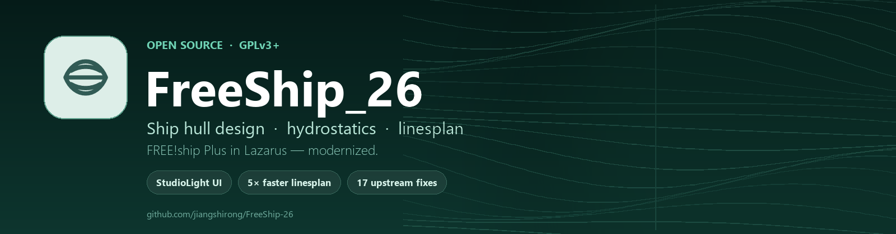
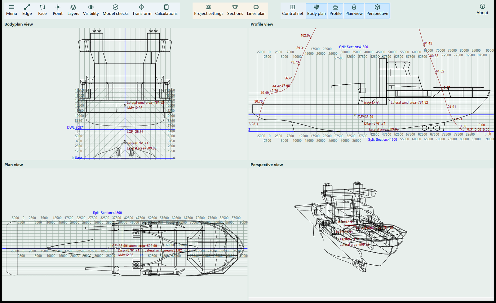
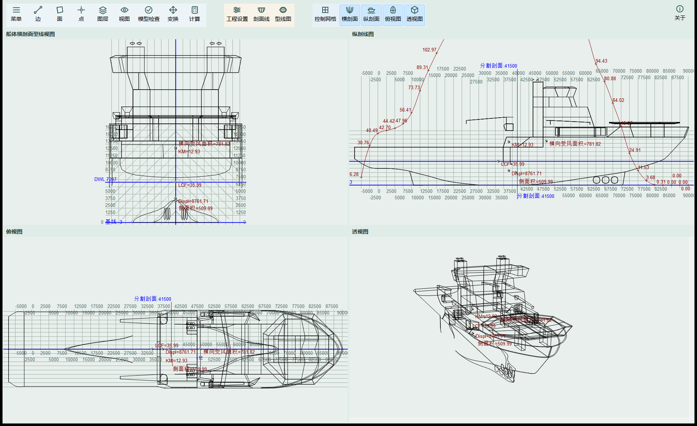
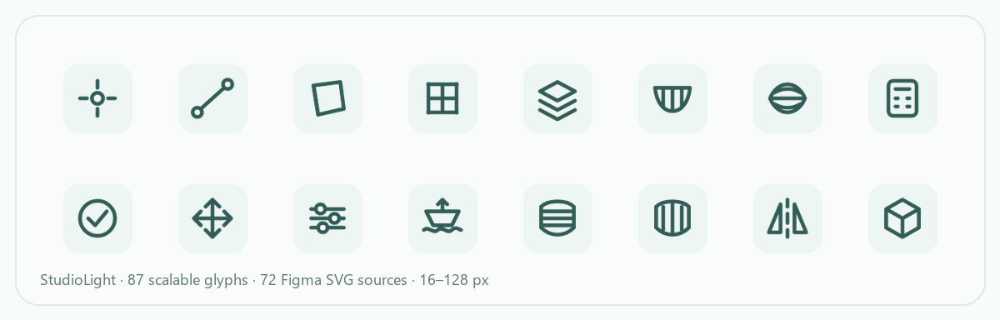
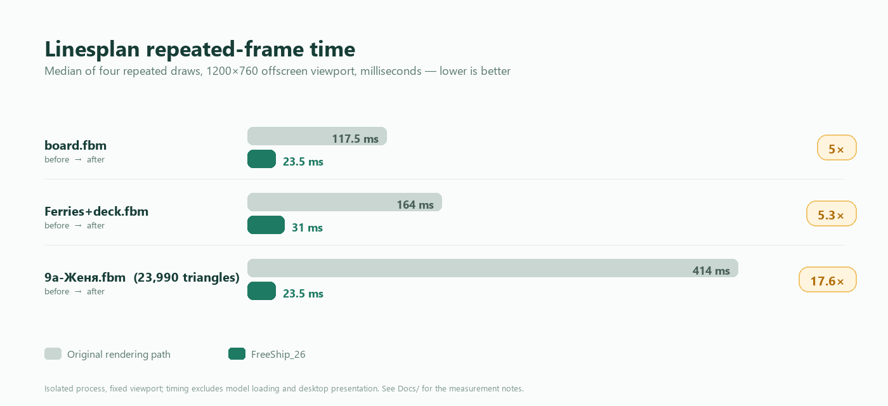
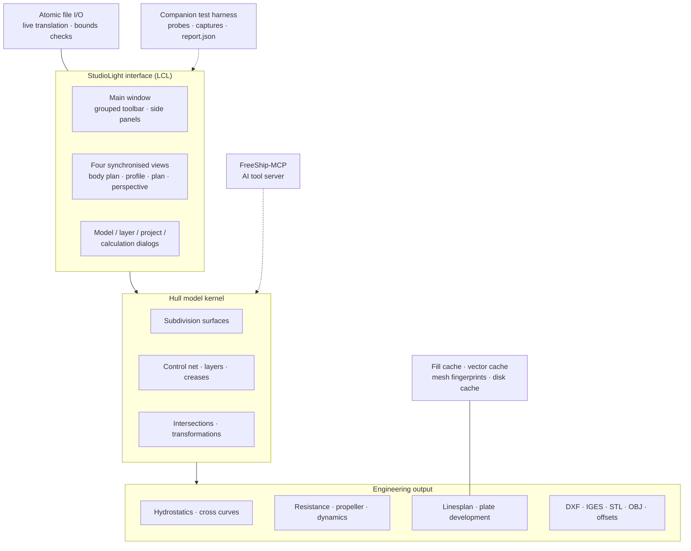

<a id="top"></a>

<div align="center">
  
  <h1>FreeShip_26</h1>
  <p><b>Верстак для проектирования корпуса — собран заново.</b><br>
  FREE!ship Plus на Lazarus — современный интерфейс, измеренная скорость отрисовки, устойчивое к сбоям сохранение файлов и документация на трёх языках.</p>

  <p>
    <a href="README.md">English</a> ·
    <a href="README.zh-CN.md">简体中文</a> ·
    <b>Русский</b>
  </p>

  <p>
    <a href="COPYING"></a>
    <a href="https://github.com/jiangshirong/FreeShip-26/releases"></a>
    
    
    
    
  </p>
</div>

> **FreeShip_26** сохраняет всё, в чём силён FREE!ship Plus — моделирование корпуса поверхностями подразделения, гидростатику, сопротивление и движитель, теоретический чертёж и развёртку листов обшивки — и заново выстраивает опыт вокруг них. Новый интерфейс StudioLight, кэш отрисовки, убирающий большую часть ожидания теоретического чертежа, атомарная запись файлов, которая не может «съесть» вашу модель, и слой локализации, переключающий язык без затирания поля, которое вы редактируете.

Это независимый форк [FREE!ship Plus in Lazarus](https://github.com/markmal/freeship-plus-in-lazarus), который сам является портом FREE!ship Plus на Free Pascal / Lazarus. Это **не** переиздание: форк меняет 140+ исходных файлов, добавляет 13 новых модулей и поставляет собственную систему иконок, тему, работу над производительностью, исправления надёжности и тестовые доказательства.

---

## 📑 Содержание

| | |
|---|---|
| [Что такое FreeShip_26?](#about) | [Рабочее пространство](#screenshot) |
| [Чем этот форк отличается](#highlights) | [Производительность, измеренная](#performance) |
| [Тур по возможностям](#features) | [Надёжность и 17 исправлений upstream](#reliability) |
| [Языки](#languages) | [Экосистема для ИИ](#mcp) |
| [Инженерный процесс и тесты](#engineering) | [Архитектура](#architecture) |
| [Сборка из исходников](#build) | [Быстрый старт](#quickstart) |
| [Документация](#docs) | [Дорожная карта](#roadmap) |
| [Благодарности и лицензия](#credits) | [Статистика проекта](#stats) |

---

<a id="about"></a>

## 🚀 Что такое FreeShip_26?

FreeShip_26 — свободная открытая **рабочая среда для проектирования корпуса судна и гидростатических расчётов** для Windows, написанная на Object Pascal в Lazarus / Free Pascal. Корпус моделируется как поверхность подразделения, управляемая лёгкой контрольной сетью, а инженерные результаты выводятся из той же геометрии:

- четыре синхронизированных вида — корпус, бок, план и перспектива;
- гидростатика, кривые остойчивости и гидростатические характеристики при любых значениях осадки, дифферента и крена;
- оценки сопротивления и движителя по классическим семействам методов;
- полный теоретический чертёж с теоретическими шпангоутами, батоксами, ватерлиниями, диагоналями, размерами и экспортом в DXF;
- развёртка листов обшивки, проверки модели и широкий набор форматов обмена с CAD/CFD.

Цель форка проста: **сохранить инженерное ядро, заменив всё вокруг него на то, что ощущается на 20 лет новее** — и подтвердить каждое утверждение измерениями.

| **🎨 StudioLight — снаружи и внутри** | **⚡ Быстро там, где раньше было больно** |
|---|---|
| • Сгруппированная панель инструментов с иконками и подписями вместо стены глифов<br>• Новый набор иконок, нарисованный в Figma: **87 масштабируемых глифов**, экспортированных в **12 размерах** (16–128 px), с 4 отдельными размерами для панели инструментов<br>• Светлая спокойная палитра; собственные заголовки MDI-видов; подсказки при наведении и контекстные меню<br>• Боковые панели контрольных точек и слоёв, вкладки четырёх видов и теоретического чертежа | • Повторная перерисовка теоретического чертежа: **117.5 → 23.5 мс** (board), **164 → 31 мс** (ferries), **414 → 23.5 мс** (9a)<br>• Анимация появления вспомогательных линий: **5.56 → 2.42 мс** — медианный кадр<br>• Повторное открытие настроек проекта: **51–60 → 5.1–10.6 мс**<br>• Окно теоретического чертежа появляется за **3.4–4.7 мс**, содержимое — следом |
| **🛡️ Надёжность, заложенная в конструкции** | **🌍 По-настоящему многоязычный** |
| • **Исправлено 17 дефектов upstream** — в надёжности файлов, расчётах, внешних решателях и устаревших файлах<br>• Атомарное сохранение / восстановление файлов модели — неудачное сохранение больше не портит проект<br>• Загрузка сломанной модели сохраняет текущую модель целой<br>• Ограниченный кэш отрисовки с проверкой целостности (80 МБ на запись, 256 МБ всего) | • **7 отобранных языков интерфейса**: 简体中文, Русский, English, Français, Deutsch, Español, 日本語<br>• 14 каталогов переводов в репозитории<br>• Переключение языка на лету, которое никогда не затирает редактируемые поля<br>• Горячая клавиша быстрого переключения языков (Ctrl+Alt+L) для двуязычной работы |

---

<a id="screenshot"></a>

## 📸 Рабочее пространство

<p align="center">
  
</p>

<p align="center"><i>
Рабочее пространство StudioLight: сгруппированная панель инструментов, четыре живых вида и гидростатические аннотации, нарисованные прямо на корпусе.
</i></p>

Тот же интерфейс поставляется на всех поддерживаемых языках — ниже показана китайская редакция.

<p align="center">
  
</p>

<p align="center">
  
</p>

<p align="center"><i>Новая система иконок: единый визуальный язык для моделирования, видимости, расчётов и экспорта.</i></p>

---

<a id="highlights"></a>

## ✨ Чем этот форк отличается

### 1. Настоящий редизайн интерфейса, а не косметика

Старый интерфейс upstream — классическая панель инструментов из крошечных глифов. FreeShip_26 заменяет оболочку рабочим пространством **StudioLight**:

- **сгруппированная панель действий** — моделирование (`Menu / Edge / Face / Point / Layers`), инспекция (`Visibility / Model checks / Transform / Calculations`), инструменты проекта (`Project settings / Sections / Lines plan`), переключатели режимов и четыре переключателя видов;
- собственный `TStudioSpeedButton` с изображениями в нескольких разрешениях, подписями, которые следуют за выбранным языком, и аккуратным переполнением при сужении окна;
- **87 глифов**, нарисованных как цельное семейство линейных иконок и представленных в 12 разрешениях (16, 20, 22, 24, 25, 30, 32, 40, 48, 64, 96, 128 px) плюс 23 PNG для панели инструментов и 72 редактируемых исходника SVG — всего **1,133 ресурса темы**;
- новые заголовки видов, боковые панели, подсказки, меню и диалоги, разделяющие одни и те же отступы и цветовой язык.

### 2. Работа над производительностью с цифрами в руках

Отрисовку теоретического чертежа не подкручивали — её переписали:

- весь теоретический чертёж собирается из **кэшированного слоя заливки**; повторные отрисовки переиспользуют заранее скомпонованный растр, пока состояние рендера не изменилось;
- **идентичность кэша**, вычисляемая по отпечатку сетки, слоям, осадке, цветам, симметрии, освещению и версии рендерера, решает, когда кэш валиден;
- **дисковый кэш, переживающий перезапуск** (`%LOCALAPPDATA%\FreeShip26\LinesplanCache-v2`) с проверками целостности, атомарной заменой, лимитами на запись и на общий объём — его можно безопасно удалить в любой момент;
- **инкрементальные пересечения на уровне сечений**: в образце 9a 13 из 22 сечений переиспользуются после правки точки и пересчитываются заново ровно тогда, когда меняются их входные данные;
- нативная композиция Windows, двойная буферизация отрисовки и пакетная отрисовка GDI+ убирают мерцание и постоянное создание объектов на каждый сегмент.

Измеренный результат: интерактивные перерисовки теоретического чертежа дают ускорение **5×–17.6×** при идентичных пикселях, выводе DXF и инженерных значениях. Ни степень subdivision, ни шаг дискретизации кривых, ни точность экспорта не были снижены.

### 3. Безопасность файлов как полноценная функция

Форк добавляет `FreeSafeFile` и набор защитных механизмов вокруг жизненного цикла модели:

- сохранение пишет полный соседний файл, а затем атомарно подменяет им публичное имя;
- неудачное сохранение оставляет предыдущий проект нетронутым; неудачная загрузка сохраняет открытой текущую модель;
- загрузка повреждённой модели проверяется по границам, а не доверяет файлу;
- внешние расчётные запуски получают явные рабочие каталоги, тайм-ауты и обработку кодов выхода;
- кэш теоретического чертежа одноразовый: он никогда не становится источником истины для модели или экспорта.

### 4. Локализация, которая переживает редактирование

Перевод применяется через живой транслятор (`FreeSafeLanguage`), который обновляет меню, подписи и панели на месте — при этом намеренно **пропуская поля ввода и выпадающие списки**, чтобы набираемый текст никогда не подменялся. Горячая клавиша быстрого переключения переводит интерфейс между двумя выбранными языками; семь отобранных языков используют одну компоновку интерфейса, один набор иконок и один набор сочетаний клавиш.

### 5. Собран и проверен при участии ИИ

Каждое значимое изменение в этом репозитории разрабатывалось с опорой на сопутствующий стенд проверки: изолированные сборки, захват интерфейса в скрытых окнах, инъекция сбоев, числовые сравнения и машиночитаемые файлы `report.json` с явными состояниями `pass / fail / review / not_run`. Инженерные заметки в [`Docs/`](Docs/FreeShip_26.md) фиксируют, что было измерено, а что нет — и почему, включая те части, которые сознательно оставили незавершёнными.

---

<a id="performance"></a>

## ⚡ Производительность, измеренная

<p align="center">
  
</p>

### Повторная перерисовка теоретического чертежа (медиана, 1200×760)

| Образец | До | После | Ускорение |
|---|---:|---:|---:|
| `board.fbm` | 117.5 мс | 23.5 мс | **5.0×** |
| `Ferries+deck.fbm` | 164.0 мс | 31.0 мс | **5.3×** |
| `9a-Женя.fbm` (23,990 треугольников заливки) | 414.0 мс | 23.5 мс | **17.6×** |

Подготовка первого кадра тоже улучшилась там, где это важно: модель 9a сокращается с 484 мс до 391 мс, а повторные кадры сводятся к стоимости копирования растрового изображения. Переиспользование тёплого кэша внутри процесса занимает **31–34 мс**; свежий процесс, читающий дисковый кэш, готовит тот же вид примерно за **359 мс**, а повреждённые кэши откатываются к полной пересборке вместо сбоя.

### Отклик и интерактивность

| Взаимодействие | До | После |
|---|---:|---:|
| Панорамирование перетаскиванием правой кнопкой (1920×1140, 9a) | 29.04 мс | **18.97 мс** |
| Масштабирование колесом (1920×1140, 9a) | 37.49 мс | **26.07 мс** |
| Появление вспомогательных линий, медиана устойчивого кадра | 5.557 мс | **2.416 мс** |
| Появление вспомогательных линий, P95 / макс | 10.601 / 11.553 мс | **4.141 / 4.376 мс** |
| Повторное открытие настроек проекта | 51–60 мс | **5.1–10.6 мс** |
| Возврат запроса на открытие теоретического чертежа | — | **3.4–4.7 мс** |

<details>
<summary><b>Область измерений и честные оговорки</b></summary>

- Замеры сделаны в изолированных процессах со скрытыми окнами и фиксированными областями просмотра; они исключают загрузку модели и реальное представление на рабочем столе. Это **не** обещание FPS для любой модели или машины.
- Измерения теоретического чертежа сохраняют степень subdivision, шаг дискретизации кривых и точность экспорта неизменными; корректность проверялась попиксельно по эталонным изображениям и сравнением записей DXF.
- Цифра 3.4–4.7 мс — это время до появления окна и состояния «генерация…»; полный теоретический чертёж на модели 9a по-прежнему занимает около 0.6 с и остаётся целью будущей работы.
- Полные заметки, журналы по каждой модели и пути к отчётам — в [`Docs/型线图性能优化_2026-10-30.md`](Docs/型线图性能优化_2026-10-30.md), [`Docs/型线图磁盘缓存与剖面增量-20261031.md`](Docs/型线图磁盘缓存与剖面增量-20261031.md) и [`Docs/扩散动画性能检查.md`](Docs/扩散动画性能检查.md).

</details>

---

<a id="features"></a>

## 🧭 Тур по возможностям

Инженерное ядро происходит из FREE!ship Plus и остаётся доступным; форк модернизирует то, как к нему получают доступ и как его представляют.

| Область | Что можно делать |
|---|---|
| **Моделирование корпуса** | Корпуса как поверхности подразделения на контрольной сети; перемещение, выравнивание, блокировка, схлопывание, выдавливание и разделение точек, рёбер и граней; слои, складки, контрольные кривые, зеркала, масштаб и поворот; преобразование Лакенби; мастер киля и руля; пересечения слоёв |
| **Гидростатика** | Проектная гидростатика; гидростатика при заданных осадке, дифференте и крене; кривые остойчивости; гидростатические характеристики; отчётные таблицы с учётом единиц |
| **Сопротивление** | KAPER, серия Delft для яхт, Holtrop, Hollenbach, van Oortmerssen, Fung–Leibman, OST 5.0181-75, методы для быстроходных круглоскулых, глиссирующих и многокорпусных судов |
| **Движитель и динамика** | Задачи по гребному винту 1–5, работа на заднем ходу, маневрирование, присоединённые массы, гидродинамическое положение и вращение |
| **Теоретический чертёж** | Корпус, бок, план и перспектива; теоретические шпангоуты, батоксы, ватерлинии и диагонали; размеры, подписи и разделённые сечения; экспорт DXF; растровый вывод и печать; отрисовка с дисковым кэшем |
| **Развёртка листов обшивки** | Расширенная развёртка листов с допуском и отчётом об ошибках |
| **Импорт / экспорт** | Модели FBM / FTM (fv335 и fv462); DXF 2D и 3D; IGES; STL; OBJ; VRML; GHS; Michlet; импорт Carene и PolyCad; оффсеты (таблицы ординат); экспорт изображений |
| **Повседневный UX** | История отмены/повтора, настройки, недавние файлы, предпросмотр файлов, темы, быстрое переключение языка, сочетания клавиш |

---

<a id="reliability"></a>

## 🛡️ Надёжность и 17 исправлений upstream

Три серии дефектов upstream были воспроизведены на закреплённой upstream-ревизии, исправлены и проверены изолированными сборками, инъекцией сбоев и числовыми или бинарными сравнениями.

<details>
<summary><b>Все 17 проблем upstream, исправленных в этом форке</b></summary>

| # | Область | Исправление |
|---|---|---|
| 01 | Безопасность сохранения | Неудачное сохранение больше не повреждает публичный файл; соседний файл заменяет его только после полной записи |
| 02 | Безопасность загрузки | Неудачная загрузка больше не очищает открытую в данный момент модель |
| 03 | Файловый ввод-вывод | Циклы чтения/записи файлов получают условие выхода при нулевом прогрессе вместо бесконечного цикла |
| 04 | Повреждённые модели | Проверки границ отвергают некорректные данные модели вместо чтения за пределы данных |
| 05 | Единицы | Скорректировано систематическое отклонение при пересчёте имперской плотности |
| 06 | Единицы | Позиции пересечений пересчитываются при смене единиц проекта |
| 07 | Сечения | Размещение сечений больше не зависит от начала координат |
| 08 | Исключения | Неудачная пересборка сбрасывает состояние редактирования вместо оставления недособранной модели |
| 09 | Состояние загрузки | Статус загрузки больше не перекрывается локальной переменной |
| 10 | Отмена/повтор | Отмена операции больше не обрезает историю повтора |
| 11 | Внешние решатели | Внешние расчёты получают тайм-ауты и обработку кодов выхода |
| 12 | Гидростатика | Таблица гидростатики больше не вычисляет конечную осадку дважды |
| 13 | Экспорт STL | Экспорт STL теперь учитывает симметрию слоёв |
| 14 | Фоновое изображение | Свойства фона JPEG больше не читаются после освобождения изображения |
| 15 | Рабочий каталог | Гидростатика больше не пишет неявно в рабочий каталог процесса |
| 16 | Листы | Единицы ошибки расширения листов задокументированы и исправлены |
| 17 | Устаревшие файлы | Раскладка параметров расчёта в устаревших FBM-файлах мигрируется, а не читается неверно |

</details>

Последняя полная серия проверки сообщает **1,403 pass, 3 review, 3 not_run, 0 fail и 0 error**. `review` и `not_run` намеренно оставлены на виду: приёмка на реальном рабочем столе — мышь, фокус и отображение — по-прежнему выполняется вручную, и проект не утверждает обратного.

Дополнительная работа по надёжности, не учтённая в числе дефектов upstream: атомарное сохранение/восстановление, одноразовый кэш с проверкой целостности, безопасные каталоги внешних решателей, предотвращение потери данных при сохранении на выходе и защита от перезагрузки файла во время его редактирования.

---

<a id="languages"></a>

## 🌍 Языки и локализация

| | |
|---|---|
| **Отобранные языки интерфейса (7)** | 简体中文 · Русский · English · Français · Deutsch · Español · 日本語 |
| **Каталоги переводов** | 14 каталогов `.po`: китайский, русский, английский, французский, немецкий, испанский, японский, чешский, итальянский, нидерландский, норвежский, финский, украинский, вьетнамский |
| **Китайский каталог** | 3,333 записи, включая меню, моделирование, слои, настройки проекта, контрольные точки, гидростатические отчёты и подсказки |
| **Русский каталог** | 2,638 записей с дополнительным покрытием новых выпадающих списков и динамических подсказок |
| **Переключение** | Живой перевод открытых окон на месте; поля ввода защищены; горячая клавиша быстрого переключения (`Ctrl+Alt+L`) переключает выбранную пару языков |
| **Руководства** | PDF-руководства на английском, французском, русском, испанском, украинском и вьетнамском сохранены в [`Manuals/`](Manuals) |

Локализация проверяется программно — разбором `.po`, аргументами формата и отображением языкового меню, — а также загрузкой, редактированием, сохранением и повторным открытием моделей, в путях которых есть китайские или русские символы.

---

<a id="mcp"></a>

## 🤖 Экосистема для ИИ: FreeShip-MCP

[**FreeShip-MCP**](https://github.com/jiangshirong/FreeShip-MCP) — сопутствующий, отдельно версионируемый сервер MCP, который открывает нативный движок FreeShip ИИ-агентам на Windows:

- чтение и запись моделей FBM / FTM, включая fv335 и fv462;
- перемещение, выравнивание и релаксация контрольных точек; разделение, выдавливание и создание складок рёбер; добавление и удаление граней;
- применение масштаба и преобразований Лакенби;
- генерация теоретических шпангоутов, ватерлиний и батоксов;
- инспекция топологии, качества дискретизованных кривых и ограничений координат;
- расчёт гидростатики при заданной осадке или по диапазону;
- экспорт теоретического чертежа в DXF, а также отчётов CSV/XLSX с манифестами источников;
- 15 инструментов MCP через stdio, с границей рабочего пространства, защитой правок по SHA-256 и явными допусками на целевые значения.

Вместе они образуют полную цепочку: **люди-проектировщики используют FreeShip_26, агенты — FreeShip-MCP, и оба работают с одним и тем же семейством нативного движка FreeShip.** Проект MCP — независимый адаптер GPL-3.0-or-later со своим версионированием, тестами и документацией.

---

<a id="engineering"></a>

## 🧪 Инженерный процесс и тесты

Для этого форка работа над UI — измеряемая инженерная деятельность, а не визуальная догадка.

- **Изолированный стенд тестов** — сопутствующее рабочее пространство FreeShip-Tests собирает инструментированные копии рабочего дерева, поэтому тесты никогда не касаются исходников, моделей или настроек пользователя.
- **Отчёты, построенные на доказательствах** — каждый набор тестов пишет машиночитаемый `report.json` плюс изображения и журналы таймингов; состояния — `pass`, `fail`, `review`, `not_run` или `error`.
- **Пробы вместо хрупких UI-скриптов** — Pascal-пробы приводят в действие реальные формы, фреймы и код представлений в скрытых окнах; Python-раннеры собирают структуру, состояние, действия, скриншоты и тайминги.
- **Покрытие, соответствующее изменению** — безопасность файлов, контракты расчётов, преобразование единиц, гидростатика, генерация сечений, отрисовка теоретического чертежа, кэширование, локализация, меню, сочетания клавиш, темы и анимация.
- **Задокументированные пробелы** — реальный ввод с рабочего стола, фокус, отображение и поведение принтера явно помечены `not_run`, а не выданы за пройденные.

Характерные наборы: производительность и попиксельное сравнение теоретического чертежа, регрессия слоя заливки, сохранность кэша и откат при повреждении, инкрементальные сечения, открытие диалогов, единицы и валидация ввода, симметрия STL, совместимость с устаревшими FBM, проверки символов единиц, интеграция иконок и проверки многоязычного текста.

В папке `Docs/` — 40+ инженерных заметок на китайском, каждая фиксирует измеренное утверждение, затронутые пути кода, метод проверки и оставшиеся ограничения. [`Whatsnew.txt`](Whatsnew.txt) хранит changelog upstream.

---

<a id="architecture"></a>

## 🧱 Архитектура и стек



| Слой | Технология |
|---|---|
| Язык | Object Pascal (Free Pascal 3.2.2, режим Delphi) |
| UI-инструментарий | Lazarus 3.2 LCL, собственные отрисовываемые контролы StudioLight, нативная композиция Windows |
| Рендеринг | GDI / GDI+, кэшированные слои заливки, векторные записи, двойная буферизация |
| Формат модели | Текстовый формат модели FreeShip FBM / FTM, версии fv335 и fv462 |
| Локализация | Каталоги GNU gettext `.po`, живое обновление `TAbstractTranslator` |
| Тесты | Pascal-пробы + Python-раннеры, скрытые нативные окна, сравнение изображений и DXF |
| Документация | Инженерные заметки Markdown, диаграммы Mermaid, доказательства `report.json` |
| Платформы | Windows 10/11 x64 (основная, проверенная); путь сборки upstream GTK2/Linux сохранён |

---

<a id="build"></a>

## 🛠️ Сборка из исходников

**Требования:** Lazarus **3.2** с Free Pascal **3.2.2** на Windows 10/11 x64 плюс Git-копия этого репозитория.

```powershell
git clone https://github.com/jiangshirong/FreeShip-26.git
cd FreeShip-26
```

1. Откройте `FreeShip.lpi` в Lazarus 3.2.
2. Выберите **режим сборки Windows** в параметрах проекта (проект поставляет варианты Debug и Release; рекомендуется Release).
3. Соберите проект — исполняемый файл создаётся как `FreeShip.exe`.
4. Держите рабочие папки рядом с исполняемым файлом: `Themes/`, `locale/`, `Languages/`, `Manuals/`, `Ships/`.
5. Запустите `FreeShip.exe`, откройте образец модели из `Ships/Database/` и выберите язык в **Preferences**.

Текущей сборке x64 не требуются дополнительные DLL. Скрипты upstream `build-HOWTO.txt`, `required-packages.sh` и `release.sh` сохранены для упаковки и справочных материалов по кросс-компиляции.

> Устаревшая цель GTK2/Linux унаследована от upstream и, где возможно, сохраняет собираемость, но новый интерфейс StudioLight, путь нативной композиции и работа над производительностью в первую очередь проверены на Windows.

---

<a id="quickstart"></a>

## ⬇️ Быстрый старт (для пользователей)

1. Скачайте последнюю сборку для Windows со [страницы релизов](https://github.com/jiangshirong/FreeShip-26/releases).
2. Распакуйте архив и запустите `FreeShip.exe`.
3. Откройте модель из `Ships/Database/` или создайте новую через **Menu → New model**.
4. Смените язык интерфейса в **Preferences → Language** (7 отобранных языков) или нажмите горячую клавишу быстрого языка.
5. Изучите четыре вида, затем откройте **Lines plan** — полный чертёж с размерами и экспортом в DXF.

---

<a id="docs"></a>

## 📚 Документация

| Документ | Что описывает |
|---|---|
| [`Docs/FreeShip_26.md`](Docs/FreeShip_26.md) | Заявление о форке, авторские права и уведомление об изменениях |
| [`Docs/上游问题记录/README.md`](Docs/上游问题记录/README.md) | 17 дефектов upstream, приоритеты и объём проверки |
| [`Docs/型线图性能优化_2026-10-30.md`](Docs/型线图性能优化_2026-10-30.md) | Дизайн кэша теоретического чертежа и методика бенчмарков |
| [`Docs/型线图磁盘缓存与剖面增量-20261031.md`](Docs/型线图磁盘缓存与剖面增量-20261031.md) | Дисковый кэш, инкрементальные сечения и бюджеты запуска |
| [`Docs/多语言检查.md`](Docs/多语言检查.md) | Аудит китайской и русской локализации |
| [`Docs/图标盘点/图标使用清单.md`](Docs/图标盘点/图标使用清单.md) | Инвентаризация иконок и план поставки из Figma |
| [`Whatsnew.txt`](Whatsnew.txt) | Changelog upstream, унаследованный этим форком |
| [`Manuals/`](Manuals) | PDF-руководства на шести языках |
| [`AGENTS.md`](AGENTS.md) | Инструкции репозитория для разработки с помощью ИИ |

---

<a id="roadmap"></a>

## 🗺️ Дорожная карта

Проект ведёт публичный список направлений, каждое — с обоснованием, а не обещанием:

- **Восстановление и резервные копии** — автоматическое восстановление, устойчивость запуска, ротация резервных копий.
- **Диагностика геометрии** — сообщать, какой объект и по какой причине вызвал провал проверки.
- **Согласованность отчётов** — единые соглашения об осадке, базовой линии и отчётах во всех видах и выводах.
- **Передача в производство** — раскрой листов (nesting), проверки швов и зеркальности, единицы экспорта и настройки допусков.
- **Качество поверхностей CAD** — непрерывность швов, проверки толщины оболочки, валидация замкнутости для печати.
- **Условия эксплуатации** — переиспользуемые расчётные случаи нагрузки, центры тяжести, наклонные ватерлинии.
- **Производительность больших моделей** — прогресс, отмена и бюджеты отрисовки для тяжёлых корпусов.
- **Автоматизация релизов** — воспроизводимые сборки, кроссплатформенная упаковка и CI.

---

<a id="stats"></a>

## 📊 Статистика проекта

| Метрика | Значение |
|---|---:|
| Исходных файлов изменено относительно upstream | **140+** |
| Добавлено новых модулей | **13** |
| Добавлено строк Object Pascal (учтённый дифф) | **≈7,800** |
| Новых ресурсов темы и иконок | **1,133 PNG + 72 SVG** |
| Исправлено дефектов upstream | **17** |
| Проверочных утверждений в последней серии | **1,403 pass** (3 review, 3 not_run) |
| Языков интерфейса | **7 отобранных**, 14 каталогов |
| Инженерных заметок в `Docs/` | **40+** |

---

<a id="credits"></a>

## 🤝 Благодарности, upstream и лицензия

### Этот форк

**蒋世融 (Jiang Shirong)** — редизайн интерфейса, система иконок StudioLight, работа над производительностью и рендерингом, исправления надёжности и безопасности файлов, локализация, инженерная документация и сопутствующий тестовый процесс. Изменения © 2026.

### Наследие upstream

| Проект | Автор | Вклад |
|---|---|---|
| FREE!ship | Martijn van Engeland, © 2005 | Оригинальная программа проектирования судов на поверхностях подразделения (GPL) |
| FREE!ship Plus | V.F. Timoshenko, © 2007–2010 | Расширения по гидродинамике, сопротивлению, движителю и анализу |
| FREE!ship Plus in Lazarus | Mark Malakanov, © 2015–2020 | Порт на Free Pascal / Lazarus, упаковка, поддержка Linux |
| FreeShip_26 | Jiang Shirong, © 2026 | Этот модернизированный форк |
| FreeShip-MCP | Jiang Shirong | Сервер ИИ-инструментов вокруг нативного движка |

Закреплённая ревизия upstream, использованная для проверки дефектов, — `1de17e99fb2b1cc559cdf27c5cafb595a627a641` (2026-02-09).

### Лицензия

Проект распространяется под **GNU General Public License v3.0 or later** — см. [`COPYING`](COPYING). Оригинальные уведомления об авторских правах, текст GPL и уведомления третьих сторон сохранены. Как изменённая версия, этот форк документирует свои изменения в [`Docs/`](Docs/FreeShip_26.md) и в истории Git, а соответствующий исходный код предоставлен в этом репозитории.

Если FreeShip_26 экономит вам время, ⭐ на репозитории — лучший способ сказать спасибо, а issue с файлом модели или воспроизводимым замером всегда приветствуется.

<p align="right"><a href="#top">⬆ наверх</a></p>
