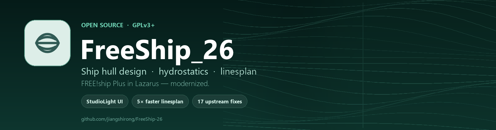
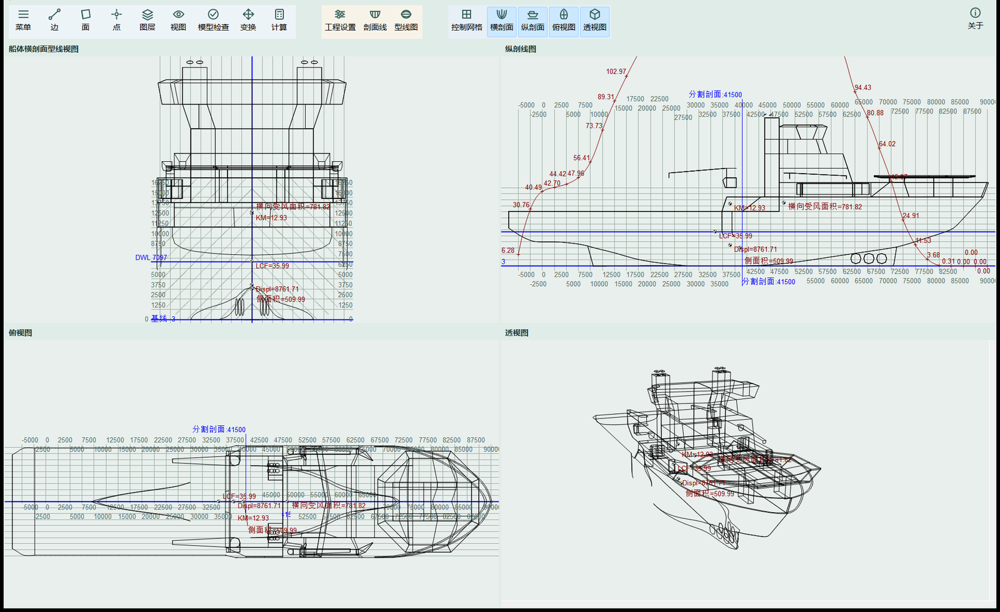
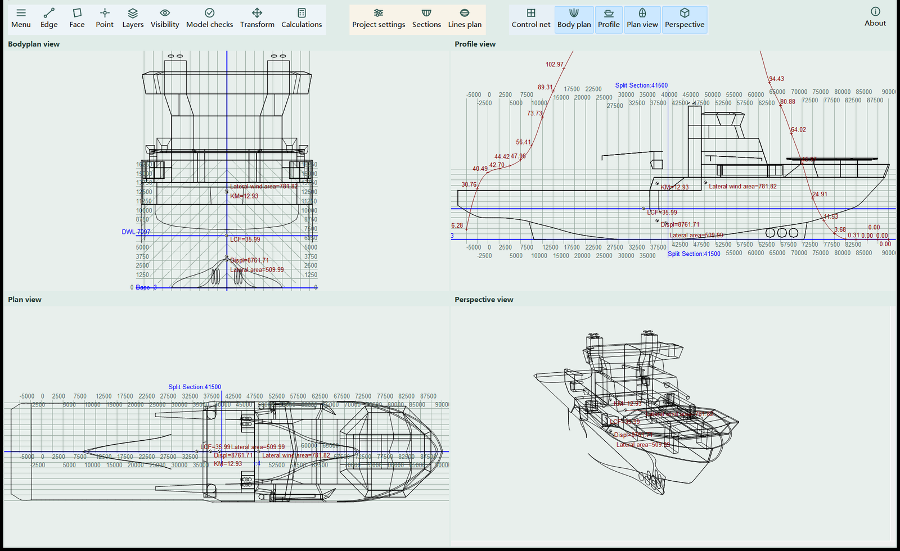
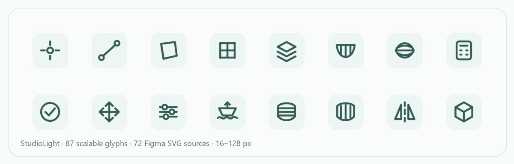
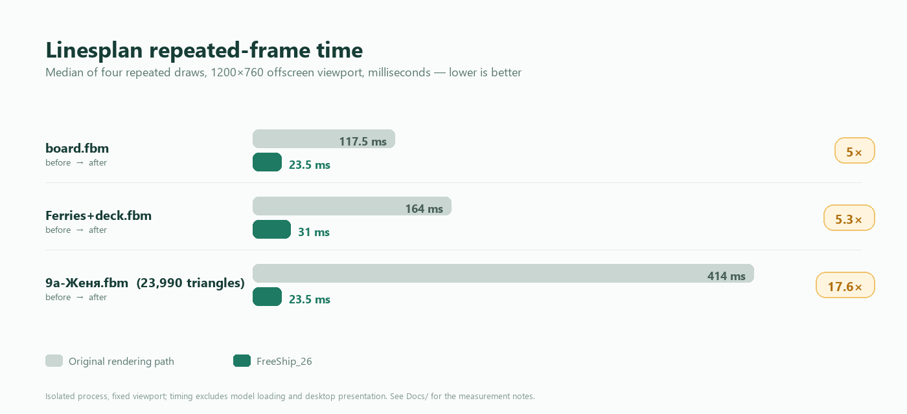
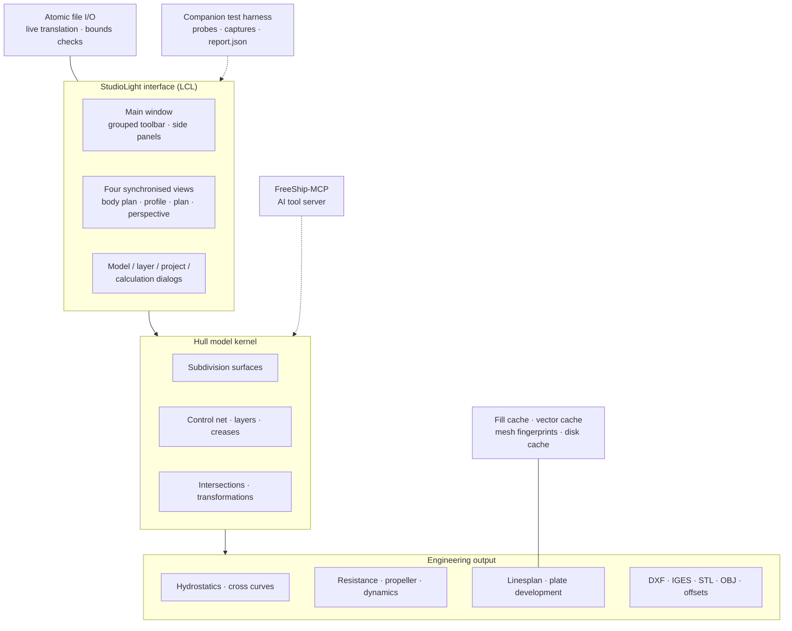

<a id="top"></a>

<div align="center">
  
  <h1>FreeShip_26</h1>
  <p><b>一套重新打造的船体设计工作台。</b><br>
  Lazarus 中的 FREE!ship Plus —— 现代界面、可度量的渲染速度、崩溃安全的文件写入，以及中、英、俄三语文档。</p>

  <p>
    <a href="README.md">English</a> ·
    <b>简体中文</b> ·
    <a href="README.ru.md">Русский</a>
  </p>

  <p>
    <a href="COPYING"></a>
    <a href="https://github.com/jiangshirong/FreeShip-26/releases"></a>
    
    
    
    
  </p>
</div>

> **FreeShip_26** 保留了 FREE!ship Plus 擅长的一切 —— 细分曲面船体建模、静水力、阻力与推进、型线图与板材展开 —— 并围绕这些能力重建了整个使用体验。全新的 StudioLight 界面、一套消掉大部分型线图等待时间的渲染缓存、不会再吃掉你模型的原子文件写入，以及一套在切换语言时不会覆盖你正在编辑字段的本地化机制。

本项目是 [FREE!ship Plus in Lazarus](https://github.com/markmal/freeship-plus-in-lazarus) 的独立分支，而后者本身是 FREE!ship Plus 的 Free Pascal / Lazarus 移植。它**不是**一次简单的重新发布：该分支改动了 140+ 个源文件，新增 13 个单元，并自带一整套图标体系、主题、性能工作、可靠性修复与测试证据。

---

## 📑 目录

| | |
|---|---|
| [FreeShip_26 是什么？](#about) | [工作区](#screenshot) |
| [这个分支为何不同](#highlights) | [性能实测](#performance) |
| [功能总览](#features) | [可靠性与 17 项上游修复](#reliability) |
| [多语言与本地化](#languages) | [AI 就绪生态](#mcp) |
| [工程化与测试](#engineering) | [架构与技术栈](#architecture) |
| [从源码构建](#build) | [快速上手](#quickstart) |
| [文档](#docs) | [路线图](#roadmap) |
| [致谢与许可](#credits) | [项目数据](#stats) |

---

<a id="about"></a>

## 🚀 FreeShip_26 是什么？

FreeShip_26 是一款免费、开源的 **船体设计与静水力工作台**，面向 Windows，以 Object Pascal 在 Lazarus / Free Pascal 上编写。它把船体建模为受轻量控制网格驱动的细分曲面，再从同一份几何中推导出各项工程交付物：

- 四个同步视图 —— 横剖面型线图、纵剖线图、俯视图与透视图；
- 任意吃水、纵倾与横倾状态下的静水力、稳性横截曲线与静水力特征；
- 基于经典方法族的阻力与推进估算；
- 完整的型线图，含站线、纵剖线、水线、对角线、标注尺寸与 DXF 导出；
- 板材展开、模型检查，以及一整套 CAD/CFD 交换格式。

这个分支的目标很简单：**保留工程内核，把周边的一切换成看起来年轻 20 岁的东西**——并用实测数据证明每一句主张。

| **🎨 StudioLight，由内而外** | **⚡ 在曾经最痛的地方提速** |
|---|---|
| • 分组的「图标 + 文字」工具栏，取代一整墙的细碎符号<br>• 全新 Figma 设计的图标集：**87 个可缩放字形**，导出 **12 种尺寸**（16–128 px），另有 4 种专用工具栏尺寸<br>• 明亮、克制的配色；自定义 MDI 视图标题栏；悬停提示与右键菜单<br>• 控制点与图层侧边面板，四视图与型线图标签页 | • 型线图重复重绘：**117.5 → 23.5 ms**（board）、**164 → 31 ms**（ferries）、**414 → 23.5 ms**（9a）<br>• 辅助线展开动画：**5.56 → 2.42 ms** 帧中位数<br>• 项目设置重新打开：**51–60 → 5.1–10.6 ms**<br>• 型线图窗口 **3.4–4.7 ms** 出现，内容随后跟上 |
| **🛡️ 可靠来自构造本身** | **🌍 真正的多语言** |
| • **修复 17 项上游缺陷**，涵盖文件安全、计算、外部求解器与旧版文件<br>• 模型文件的原子保存 / 恢复 —— 保存失败不再损坏工程<br>• 载入损坏模型时，当前模型保持完好<br>• 有容量上限、带完整性校验的渲染缓存（单条目 80 MB，总计 256 MB） | • **7 种精选界面语言**：简体中文、Русский、English、Français、Deutsch、Español、日本語<br>• 仓库内含 14 套翻译目录<br>• 实时切换语言，绝不覆盖正在编辑的字段<br>• 面向双语工作的快速语言切换热键（Ctrl+Alt+L） |

---

<a id="screenshot"></a>

## 📸 工作区

<p align="center">
  
</p>

<p align="center"><i>
StudioLight 工作区：分组工具栏、四个实时视图，以及直接绘制在船体上的静水力标注。
</i></p>

同一套界面覆盖全部受支持的语言 —— 下面是英文版界面。

<p align="center">
  
</p>

<p align="center">
  
</p>

<p align="center"><i>全新的图标体系：建模、可见性、计算与导出共用一套视觉语言。</i></p>

---

<a id="highlights"></a>

## ✨ 这个分支为何不同

### 1. 真正的界面重构，而不是换皮

旧版上游 UI 是那种布满细小符号的经典工具栏。FreeShip_26 用一个 **StudioLight** 工作区替换掉整个外壳：

- **分组动作栏** —— 建模（`Menu / Edge / Face / Point / Layers`）、检查（`Visibility / Model checks / Transform / Calculations`）、项目工具（`Project settings / Sections / Lines plan`）、模式开关与四个视图切换；
- 自定义 `TStudioSpeedButton`，支持多分辨率图像、随语言变化的文字标签，以及窗口变窄时的优雅溢出；
- **87 个字形**组成统一的线性图标家族，打包为 12 种分辨率（16、20、22、24、25、30、32、40、48、64、96、128 px），外加 23 张工具栏 PNG 与 72 个可编辑 SVG 源文件 —— 合计 **1,133 个主题资源**；
- 新的视图标题栏、侧边面板、提示、菜单与对话框共享同一套间距与配色语言。

### 2. 带着数字的性能工作

型线图渲染是重写，而不是微调：

- 整张型线图由**缓存填充层**合成；渲染状态未变时，重复绘制直接复用预先合成好的位图；
- **缓存标识**由网格指纹、图层、吃水、颜色、对称性、光照与渲染器版本共同决定，据此判断缓存是否有效；
- **跨重启的磁盘缓存**（`%LOCALAPPDATA%\FreeShip26\LinesplanCache-v2`），带完整性校验、原子替换、单条目与总容量上限 —— 随时可安全删除；
- **剖面级增量求交**：在 9a 样例中，改点之后 22 个剖面里有 13 个被复用，其余剖面在输入变化时精确重新推导；
- 原生 Windows 合成、双缓冲绘制与批处理 GDI+ 绘制，消除闪烁与逐段对象创建销毁的开销。

实测结果：交互式型线图重绘提速 **5× 至 17.6×**，而像素、DXF 输出与工程数值完全一致。没有降低任何细分级别、曲线采样或导出精度。

### 3. 把文件安全当作一等特性

这个分支引入了 `FreeSafeFile` 以及一组围绕模型生命周期的安全护栏：

- 保存时先写出完整的同目录副本文件，再原子替换正式文件名；
- 保存失败不会改动原工程；载入失败则保持当前模型继续打开；
- 载入损坏模型时进行边界检查，而不是盲信文件内容；
- 外部计算任务获得明确的工作目录、超时与退出码处理；
- 型线图缓存是可丢弃的：它永远不会成为模型或导出的真实来源。

### 4. 不打断编辑的本地化

翻译通过实时翻译器（`FreeSafeLanguage`）就地更新菜单、标题与面板 —— 同时刻意**跳过编辑框与组合框**，因此你正在输入的文本永远不会被替换。一个快速切换热键可在两种选定语言之间切换；七种精选语言共享同一套布局、同一套图标与同一套快捷键。

### 5. 以 AI 辅助流程构建并验证

本仓库每一次有实质意义的改动，都在配套的验证工具链上开发：隔离构建、隐藏窗口 UI 截图、故障注入、数值比对，以及带明确 `pass / fail / review / not_run` 状态的机器可读 `report.json`。工程笔记 [`Docs/`](Docs/FreeShip_26.md) 记录了测了什么、没测什么、为什么 —— 也包括那些被有意留下的未完成部分。

---

<a id="performance"></a>

## ⚡ 性能实测

<p align="center">
  
</p>

### 型线图重复重绘（中位数，1200×760）

| 样例 | 优化前 | 优化后 | 提速 |
|---|---:|---:|---:|
| `board.fbm` | 117.5 ms | 23.5 ms | **5.0×** |
| `Ferries+deck.fbm` | 164.0 ms | 31.0 ms | **5.3×** |
| `9a-Женя.fbm`（23,990 个填充三角形） | 414.0 ms | 23.5 ms | **17.6×** |

首帧准备同样在关键场景得到改善 —— 9a 模型从 484 ms 降到 391 ms，而重复帧的开销已经降到一次位图拷贝。在进程内复用热缓存仅需 **31–34 ms**；新进程读取磁盘缓存、准备同一视图约需 **359 ms**，而损坏的缓存会回退到完整重建，而不是直接失败。

### 交互与响应

| 交互 | 优化前 | 优化后 |
|---|---:|---:|
| 右键拖拽平移（1920×1140，9a） | 29.04 ms | **18.97 ms** |
| 滚轮缩放（1920×1140，9a） | 37.49 ms | **26.07 ms** |
| 辅助线展开，持续帧中位数 | 5.557 ms | **2.416 ms** |
| 辅助线展开，P95 / 最大值 | 10.601 / 11.553 ms | **4.141 / 4.376 ms** |
| 项目设置重新打开 | 51–60 ms | **5.1–10.6 ms** |
| 型线图打开请求返回 | — | **3.4–4.7 ms** |

<details>
<summary><b>测量范围与如实说明</b></summary>

- 计时来自隔离的隐藏窗口进程与固定视口；不包含模型载入与真实桌面呈现。它们**不是**对任意模型、任意机器都成立的 FPS 承诺。
- 型线图测量保持细分精度、曲线采样与导出精度不变；正确性通过参考图像逐像素比对与 DXF 记录比较来验证。
- 3.4–4.7 ms 指窗口与“正在生成…”状态出现所需的时间；完整的型线图在 9a 模型上仍需约 0.6 s，这仍是后续工作的目标。
- 完整说明、逐模型日志与报告路径见 [`Docs/型线图性能优化_2026-10-30.md`](Docs/型线图性能优化_2026-10-30.md)、[`Docs/型线图磁盘缓存与剖面增量-20261031.md`](Docs/型线图磁盘缓存与剖面增量-20261031.md) 与 [`Docs/扩散动画性能检查.md`](Docs/扩散动画性能检查.md)。

</details>

---

<a id="features"></a>

## 🧭 功能总览

工程内核来自 FREE!ship Plus，并完整可用；这个分支现代化的是访问与呈现它的方式。

| 领域 | 你可以做什么 |
|---|---|
| **船体建模** | 在控制网格上构建细分曲面船体；移动、对齐、锁定、合并、挤出与拆分点、边、面；图层、折痕、控制曲线、镜像、缩放与旋转；Lackenby 变换；龙骨与舵向导；图层求交 |
| **静水力** | 设计静水力；指定吃水、纵倾与横倾下的静水力；稳性横截曲线；静水力特征；单位感知格式的报告表格 |
| **阻力** | KAPER、Delft 游艇系列、Holtrop、Hollenbach、van Oortmerssen、Fung–Leibman、OST 5.0181-75、高速圆舭、滑行与多体船方法 |
| **推进与动力学** | 螺旋桨任务 1–5、倒车运行、操纵性、附加质量、水动力位置与旋转 |
| **型线图** | 横剖面型线图、纵剖线图、俯视图与透视图；站线、纵剖线、水线与对角线；标注尺寸、标签与剖面分割；DXF 导出；位图与打印输出；磁盘缓存渲染 |
| **板材展开** | 带容差与误差报告的展开板材计算 |
| **导入 / 导出** | FBM / FTM 模型（fv335 与 fv462）；DXF 2D 与 3D；IGES；STL；OBJ；VRML；GHS；Michlet；Carene 与 PolyCad 导入；型值表；图像导出 |
| **日常体验** | 撤销/重做历史、偏好设置、最近文件、文件预览、主题、快速语言切换、键盘快捷键 |

---

<a id="reliability"></a>

## 🛡️ 可靠性与 17 项上游修复

三批上游缺陷均针对已固定的上游提交复现、修复，并通过隔离构建、故障注入与数值或二进制比对完成验证。

<details>
<summary><b>本分支修复的全部 17 项上游问题</b></summary>

| # | 领域 | 修复 |
|---|---|---|
| 01 | 保存安全 | 保存失败不再损坏正式文件；只有完整写入之后，副本文件才会替换它 |
| 02 | 载入安全 | 载入失败不再清空当前已打开的模型 |
| 03 | 文件 I/O | 文件读写循环增加了零进度退出条件，而不是无限空转 |
| 04 | 损坏模型 | 边界检查拒绝畸形模型数据，而不是越界读取 |
| 05 | 单位 | 修正英制密度换算偏差 |
| 06 | 单位 | 工程单位变化时，同步换算求交位置 |
| 07 | 剖面 | 剖面放置不再依赖坐标原点 |
| 08 | 异常 | 重建失败时重置编辑状态，而不是留下半损坏的模型 |
| 09 | 载入状态 | 载入状态不再被局部变量遮蔽 |
| 10 | 撤销/重做 | 取消操作不再截断重做历史 |
| 11 | 外部求解器 | 外部计算获得超时与退出码处理 |
| 12 | 静水力 | 静水力表不再重复计算末端吃水 |
| 13 | STL 导出 | STL 导出现在遵守图层对称性 |
| 14 | 背景图像 | 不再在图像释放后读取 JPEG 背景属性 |
| 15 | 工作目录 | 静水力不再隐式写入进程工作目录 |
| 16 | 板材 | 记录并修正板材展开的错误单位 |
| 17 | 旧版文件 | 旧版 FBM 计算参数布局被迁移，而不是被误读 |

</details>

最新一轮完整验证报告为 **1,403 pass、3 review、3 not_run、0 fail、0 error**。`review` 与 `not_run` 被刻意保留可见：桌面鼠标、焦点与显示验收仍需人工完成，项目不会声称已覆盖。

另有不计入上游缺陷的安全工作：原子保存/恢复、带完整性校验的可丢弃缓存、安全的外部求解器目录、防止退出时保存导致的数据丢失，以及编辑期间重新载入文件的防护。

---

<a id="languages"></a>

## 🌍 多语言与本地化

| | |
|---|---|
| **精选界面语言（7）** | 简体中文 · Русский · English · Français · Deutsch · Español · 日本語 |
| **翻译目录** | 14 套 `.po` 目录：中文、俄文、英文、法文、德文、西班牙文、日文、捷克文、意大利文、荷兰文、挪威文、芬兰文、乌克兰文、越南文 |
| **中文目录** | 3,333 条目，覆盖菜单、建模、图层、项目设置、控制点、静水力报告与提示 |
| **俄文目录** | 2,638 条目，并额外覆盖新增的下拉菜单与动态提示 |
| **切换方式** | 对已打开窗口就地实时翻译；编辑字段受保护；快速切换热键（`Ctrl+Alt+L`）可在选定的一对语言之间切换 |
| **手册** | 英文、法文、俄文、西班牙文、乌克兰文与越南文的 PDF 手册保留在 [`Manuals/`](Manuals) 下 |

本地化以程序化方式验证 `.po` 解析、格式参数与语言菜单映射，并额外通过载入、编辑、保存、重新打开路径中含中文或俄文字符的模型来验证。

---

<a id="mcp"></a>

## 🤖 AI 就绪生态：FreeShip-MCP

[**FreeShip-MCP**](https://github.com/jiangshirong/FreeShip-MCP) 是一个配套的、独立版本化的 MCP 服务器，把原生 FreeShip 引擎开放给 Windows 上的 AI 代理：

- 读写 FBM / FTM 模型，包括 fv335 与 fv462；
- 移动、对齐与松弛控制点；分割、挤出与折痕边；增加或删除面；
- 应用缩放与 Lackenby 变换；
- 生成站线、水线与纵剖线；
- 检查拓扑、采样曲线质量与坐标约束；
- 计算指定吃水或吃水区间的静水力；
- 导出型线图 DXF 与 CSV/XLSX 报告，并附来源清单；
- 通过 stdio 提供 15 个 MCP 工具，带工作区边界、SHA-256 编辑校验与明确的目标容差。

两者合在一起构成完整链路：**人类设计师使用 FreeShip_26，AI 代理使用 FreeShip-MCP，而二者作用于同一个原生 FreeShip 引擎家族。** MCP 项目是一个独立的 GPL-3.0-or-later 适配器，拥有自己的版本管理、测试与文档。

---

<a id="engineering"></a>

## 🧪 工程化流程与测试

这个分支把 UI 工作当作可度量的工程活动，而不是凭视觉猜测。

- **隔离的测试工具链** —— 配套的 FreeShip-Tests 工作区会构建当前工作树的插桩副本，因此测试永远不会触及用户的源码、模型或设置。
- **证据优先的报告** —— 每个测试套件都会写出机器可读的 `report.json` 以及图像/计时日志；状态为 `pass`、`fail`、`review`、`not_run` 或 `error`。
- **用探针代替脆弱的 UI 脚本** —— Pascal 探针在隐藏窗口中驱动真实的窗体、框架与视图代码；Python 运行器收集结构、状态、动作、截图与计时。
- **与改动相匹配的覆盖面** —— 文件安全、计算契约、单位换算、静水力、剖面生成、型线图渲染、缓存、本地化、菜单、快捷键、主题与动画。
- **如实记录空白** —— 真实桌面输入、焦点、显示与打印行为被明确标记为 `not_run`，而不是声称为通过。

代表性测试套件：型线图性能与像素比对、填充层回归、缓存持久化与损坏回退、增量剖面、对话框打开、单位与输入校验、STL 对称性、旧版 FBM 兼容性、单位符号检查、图标集成与多语言文本检查。

`Docs/` 目录包含 40+ 篇中文工程笔记，每篇记录实测主张、涉及的代码路径、验证方法与仍存在的局限。[`Whatsnew.txt`](Whatsnew.txt) 保留上游变更日志。

---

<a id="architecture"></a>

## 🧱 架构与技术栈



| 层 | 技术 |
|---|---|
| 语言 | Object Pascal（Free Pascal 3.2.2，Delphi 模式） |
| UI 工具包 | Lazarus 3.2 LCL、自绘 StudioLight 控件、原生 Windows 合成 |
| 渲染 | GDI / GDI+、缓存填充层、矢量记录、双缓冲 |
| 模型格式 | FreeShip FBM / FTM 文本模型，版本 fv335 与 fv462 |
| 本地化 | GNU gettext `.po` 目录，`TAbstractTranslator` 实时更新 |
| 测试 | Pascal 探针 + Python 运行器、隐藏原生窗口、图像与 DXF 比对 |
| 文档 | Markdown 工程笔记、Mermaid 图、`report.json` 证据 |
| 平台 | Windows 10/11 x64（主力平台，已验证）；上游 GTK2/Linux 构建路径保留 |

---

<a id="build"></a>

## 🛠️ 从源码构建

**环境要求：** Windows 10/11 x64 上的 Lazarus **3.2** 与 Free Pascal **3.2.2**，以及本仓库的 Git 检出。

```powershell
git clone https://github.com/jiangshirong/FreeShip-26.git
cd FreeShip-26
```

1. 用 Lazarus 3.2 打开 `FreeShip.lpi`。
2. 在 Project Options 中选择一个 **Windows 构建模式**（项目提供 Debug 与 Release 变体；推荐 Release）。
3. 构建项目 —— 生成的可执行文件为 `FreeShip.exe`。
4. 把运行时目录放在可执行文件旁边：`Themes/`、`locale/`、`Languages/`、`Manuals/`、`Ships/`。
5. 运行 `FreeShip.exe`，从 `Ships/Database/` 打开一个样例模型，并在**首选项**中选择语言。

当前 x64 构建无需额外的运行时 DLL。上游的 `build-HOWTO.txt`、`required-packages.sh` 与 `release.sh` 脚本保留，供打包与交叉编译参考。

> 旧版 GTK2/Linux 目标继承自上游，并在可能的情况下保持可编译，但新的 StudioLight UI、原生合成路径与性能工作优先在 Windows 上验证。

---

<a id="quickstart"></a>

## ⬇️ 快速上手（用户）

1. 从 [Releases 页面](https://github.com/jiangshirong/FreeShip-26/releases) 下载最新的 Windows 构建。
2. 解压后运行 `FreeShip.exe`。
3. 从 `Ships/Database/` 打开一个模型，或通过**菜单 → 新建模型**新建一个。
4. 在**首选项 → 语言**中切换界面语言（7 种精选语言），或按下快速语言热键。
5. 浏览四个视图，然后打开**型线图**查看带标注尺寸与 DXF 导出的完整图纸。

---

<a id="docs"></a>

## 📚 文档

| 文档 | 内容 |
|---|---|
| [`Docs/FreeShip_26.md`](Docs/FreeShip_26.md) | 分支声明、版权与修改说明 |
| [`Docs/上游问题记录/README.md`](Docs/上游问题记录/README.md) | 17 项上游缺陷、优先级与验证范围 |
| [`Docs/型线图性能优化_2026-10-30.md`](Docs/型线图性能优化_2026-10-30.md) | 型线图缓存设计与基准测试方法 |
| [`Docs/型线图磁盘缓存与剖面增量-20261031.md`](Docs/型线图磁盘缓存与剖面增量-20261031.md) | 磁盘缓存、增量剖面与启动预算 |
| [`Docs/多语言检查.md`](Docs/多语言检查.md) | 中文与俄文本地化审计 |
| [`Docs/图标盘点/图标使用清单.md`](Docs/图标盘点/图标使用清单.md) | 图标盘点与 Figma 交付计划 |
| [`Whatsnew.txt`](Whatsnew.txt) | 本分支继承的上游变更日志 |
| [`Manuals/`](Manuals) | 六种语言的 PDF 手册 |
| [`AGENTS.md`](AGENTS.md) | 面向 AI 辅助开发的仓库说明 |

---

<a id="roadmap"></a>

## 🗺️ 路线图

项目维护一份公开的方向清单，每一项都给出理由，而不是承诺：

- **恢复与备份** —— 自动恢复、启动韧性、备份轮换。
- **几何诊断** —— 报告是哪个对象、因为什么原因导致检查失败。
- **报告一致性** —— 在各视图与输出之间统一吃水、基线与报告约定。
- **制造交付** —— 板材排样、接缝与镜像检查、导出单位与容差设置。
- **CAD 曲面质量** —— 接缝连续性、壳厚检查、打印闭合验证。
- **工况** —— 可复用的载荷工况、重心、倾斜水线。
- **大模型性能** —— 面向重型船体的进度、取消与渲染预算。
- **发布自动化** —— 可复现构建、跨平台打包与 CI。

---

<a id="stats"></a>

## 📊 项目数据

| 指标 | 数值 |
|---|---:|
| 相对上游改动的源文件 | **140+** |
| 新增单元 | **13** |
| 新增的 Object Pascal 代码行（受跟踪 diff） | **≈7,800** |
| 新增主题与图标资源 | **1,133 PNG + 72 SVG** |
| 修复的上游缺陷 | **17** |
| 最新一轮验证断言 | **1,403 pass**（3 review、3 not_run） |
| 界面语言 | **7 种精选**，14 套目录 |
| `Docs/` 下的工程笔记 | **40+** |

---

<a id="credits"></a>

## 🤝 致谢、上游与许可

### 本分支

**蒋世融（Jiang Shirong）** —— 界面重构、StudioLight 图标体系、性能与渲染工作、文件安全与可靠性修复、本地化、工程文档，以及配套的测试流程。修改 © 2026。

### 上游脉络

| 项目 | 作者 | 贡献 |
|---|---|---|
| FREE!ship | Martijn van Engeland，© 2005 | 最初的细分曲面船舶设计程序（GPL） |
| FREE!ship Plus | V.F. Timoshenko，© 2007–2010 | 水动力学、阻力、推进与分析扩展 |
| FREE!ship Plus in Lazarus | Mark Malakanov，© 2015–2020 | Free Pascal / Lazarus 移植、打包、Linux 支持 |
| FreeShip_26 | Jiang Shirong，© 2026 | 本现代化分支 |
| FreeShip-MCP | Jiang Shirong | 围绕原生引擎的 AI 工具服务器 |

用于缺陷验证的上游固定修订为 `1de17e99fb2b1cc559cdf27c5cafb595a627a641`（2026-02-09）。

### 许可

本项目依据 **GNU General Public License v3.0 or later** 分发 —— 参见 [`COPYING`](COPYING)。原始版权声明、GPL 文本与第三方声明均予保留。作为修改版本，本分支在 [`Docs/`](Docs/FreeShip_26.md) 与 Git 历史中记录其改动，并在本仓库中提供相应源码。

如果 FreeShip_26 为你节省了时间，给仓库点一个 ⭐ 是最好的感谢方式 —— 也欢迎附带模型文件或可复现测量的 issue。

<p align="right"><a href="#top">⬆ 回到顶部</a></p>
