

  <a href="README.zh-CN.md">简体中文</a> · <strong>English</strong> · <a href="README.ru.md">Русский</a>

  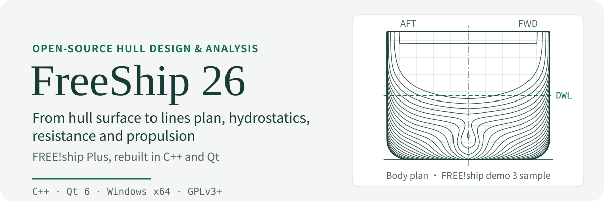

  
  
  

  <a href="#features"><b>Features</b></a> &nbsp;·&nbsp;
  <a href="#improvements"><b>What’s improved</b></a> &nbsp;·&nbsp;
  <a href="#start"><b>Quick start</b></a> &nbsp;·&nbsp;
  <a href="#develop"><b>Development and contributions</b></a> &nbsp;·&nbsp;
  <a href="#credits"><b>Credits and licensing</b></a>

  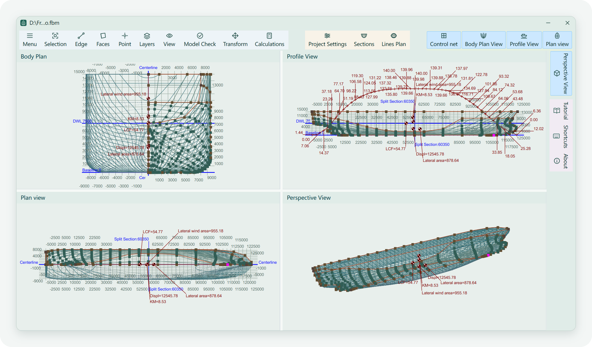

FreeShip 26 is open-source software for ship hull design. A lightweight control net defines the hull surface, which you can edit in four views. The same geometry generates lines plans, hydrostatic and stability data, resistance and propulsion estimates, plate developments and CAD files.

FreeShip 26 is a port of [FREE!ship Plus in Lazarus](https://github.com/markmal/freeship-plus-in-lazarus). The desktop interface uses Qt 6. Model documents, editing, subdivision surfaces, sectioning, lines plans and the main calculations are implemented in C++.

FREE!ship &nbsp;→&nbsp; FREE!ship Plus &nbsp;→&nbsp; FREE!ship Plus in Lazarus &nbsp;→&nbsp; <b>FreeShip 26</b>

  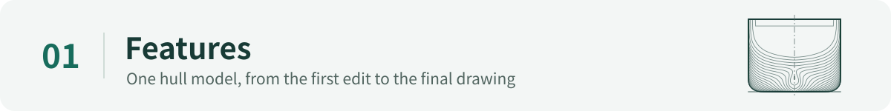

  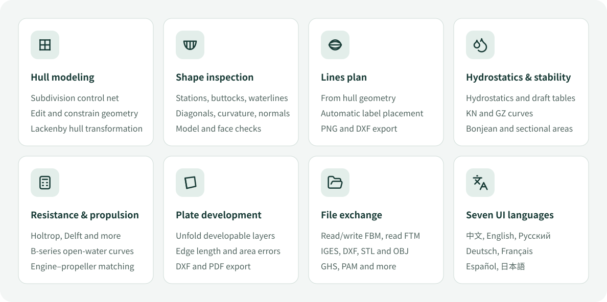

<b>Full feature list</b>

- **Hull modeling.** Edit points, edges and faces. Add creases, split edges, extrude and mirror. Use anchors, straight-line constraints and point groups. Manage layers. Create hulls, grid panels or cylinders. Move, rotate and scale geometry, apply the Lackenby hull transformation, or trace background images.
- **Shape inspection.** Display stations, buttocks, waterlines and diagonals. Inspect curvature combs and normals, check the model and correct face orientation.
- **Lines plans.** Open the full lines plan in a separate window with automatic label placement. Export to PNG and DXF.
- **Hydrostatics and stability.** Calculate design hydrostatics, draft tables, KN and GZ curves, Bonjean curves, sectional areas and weight. Export results to CSV, TXT, JSON or PDF.
- **Resistance and propulsion.** Use Delft, KAPER, Holtrop, van Oortmerssen, Hollenbach, Fung–Leibman and other methods. Calculate B-series open-water characteristics, size propellers and match them to engines.
- **Plate development.** Unfold developable layers, arrange plates and inspect edge-length and area errors.
- **File exchange.** Read and write FBM, read FTM, and work with OBJ, STL, FEF, FreeShip parts, VRML, IGES surfaces, DXF, offsets and coordinates, GHS, Archimedes, PAM, Michlet and other formats.
- **Interface languages.** 简体中文, English, Русский, Deutsch, Français, Español and 日本語. Language preferences persist, and a shortcut switches between languages.

See the [migration feature list](docs/migration/FEATURES.md) and the [user guide](docs/USAGE.md) for details.

  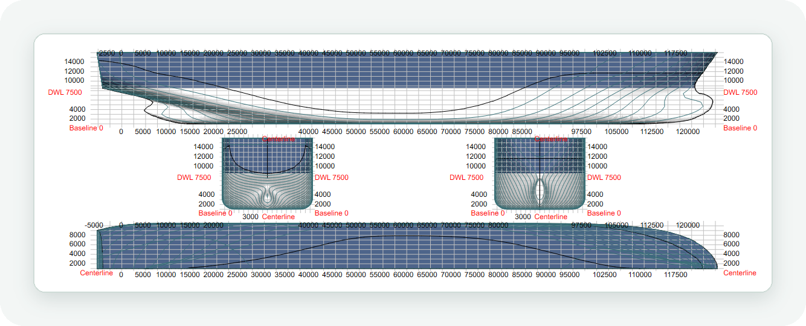
   <b>Lines plan</b> · Generated directly from hull geometry, with PNG and DXF export

  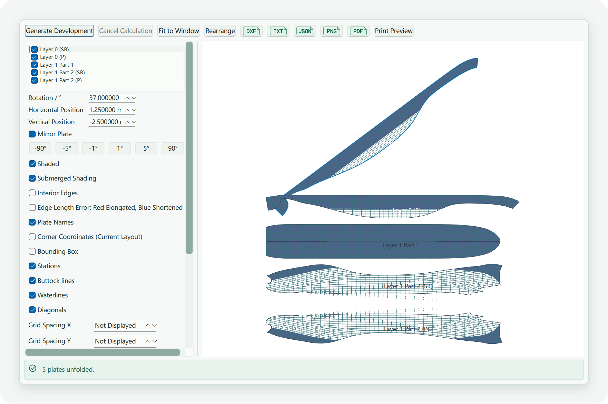
   <b>Plate development</b> · Position and rotate plates, inspect errors, and export to DXF, TXT, JSON, PNG or PDF

  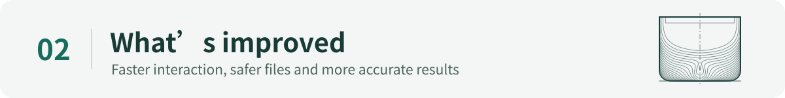

### Faster interaction with less hull recalculation

Panning and zooming leave the hull geometry intact. Moving a control point updates only the affected subdivision regions and sections. Lines plans, sections and surfaces can be cached locally and reused after a restart. These improvements preserve subdivision levels, curve sampling and export precision.

  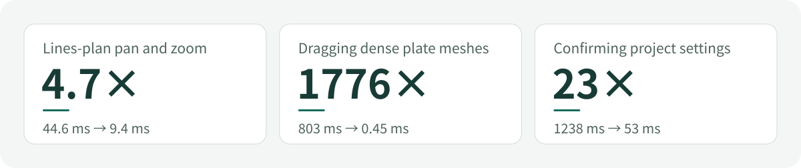

### Safer files and recovery of unsaved work

- **A failed save preserves the original file.** FreeShip writes a temporary file and replaces the original after the write succeeds. On failure, it retains the original and the unsaved state.
- **A failed open preserves the current model.** FreeShip switches to the new model only after it has read and validated the file.
- **Concurrent editing is safer.** Before saving, FreeShip checks whether the original file has changed or is in use.
- **Unsaved edits can be recovered.** FreeShip records committed edits in a recovery copy that you can restore after an unexpected exit.

### Fixes for upstream issues

The migration included a review of the upstream code. These issues are reproducible at [commit `1de17e99`](https://github.com/markmal/freeship-plus-in-lazarus/tree/1de17e99fb2b1cc559cdf27c5cafb595a627a641) of FREE!ship Plus in Lazarus.

| Trigger | Upstream behavior | FreeShip 26 |
| --- | --- | --- |
| A write fails while saving an existing project | The project file can be lost or left incomplete | Atomic replacement preserves the original · [01](docs/upstream-fixes/catalog.md#u01) |
| Switching between metric and imperial units | The hull is scaled, but section positions retain their old values | Section positions and related parameters convert together · [06](docs/upstream-fixes/catalog.md#u06) |
| A section has a moonpool or separate hull contours | Area, moments of inertia and metacentric values can be wrong | Signed integration over the actual hull geometry · [19](docs/upstream-fixes/catalog.md#u19) |
| Exporting an asymmetric layer to STL | An extra mirrored surface is exported | Export follows the layer’s symmetry setting · [13](docs/upstream-fixes/catalog.md#u13) |
| Exporting an imperial-unit model to PAM | The conversion runs in the wrong direction, producing a length error of about a factor of 10.76 | Correct conversion from feet to metres · [21](docs/upstream-fixes/catalog.md#u21) |
| An external solver stalls or fails | FreeShip keeps waiting or reads stale results | Per-job directories, timeouts and exit-code checks · [11](docs/upstream-fixes/catalog.md#u11) |

For example, a **10 × 6 m** waterplane with a **6 × 2 m** moonpool should have a waterplane area of **48 m²** and a transverse second moment of area of **176 m⁴**. The old algorithm produced about 36.0 m² and 360.0 m⁴. See the full [upstream issues and fixes](docs/upstream-fixes/README.md).

  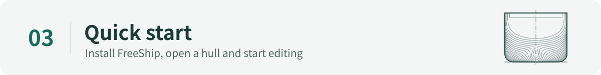

**1 · Install FreeShip** &nbsp; Download and run the Windows 10/11 x64 installer from [Releases](https://github.com/jiangshirong/FreeShip-26/releases). Once installed, the app can check for updates. The Linux port is in progress.

**2 · Open a hull** &nbsp; In the **File** menu, use **Open** to read FBM and FTM models. FTM models are saved as FBM. You can open a [sample hull](https://github.com/markmal/freeship-plus-in-lazarus/tree/master/Ships) from FREE!ship Plus, such as `FREE!ship demo 3+deck.fbm` used in the screenshots, or create a hull from its principal dimensions via **File → New Hull Form**.

**3 · Start editing**

| Task | How to do it |
| --- | --- |
| Select control points | Left-click a point. Use Ctrl or Shift to add to the selection. In an orthographic view, drag from empty space to select a rectangle. |
| Move control points | Drag the selected points in the body plan, profile or plan view. |
| Pan / zoom | Right-drag to pan. Scroll to zoom around the pointer. |
| Rotate the perspective view | Left-drag in empty space in the perspective view, or hold Alt while dragging. |
| Undo / Redo / Save | Ctrl+Z / Ctrl+Y / Ctrl+S |
| Lines plan | Select **Lines Plan** on the toolbar. |
| Hydrostatics, resistance and propulsion | Use the **Calculate** menu. |

> [!NOTE]
> These results do not replace model tests, full-scale validation or classification society approval. Consider each method’s range of applicability when making engineering decisions.

  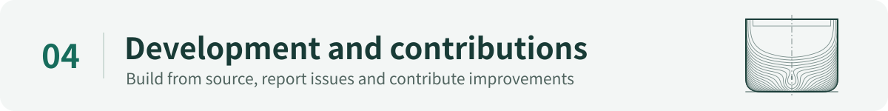

**Build from source** &nbsp; Requires CMake 3.24 or newer, Qt 6.8.3 (MinGW 13.1) and Python 3. Development builds also compile the original Pascal code as a reference program and require the Lazarus / Free Pascal toolchain. See [build, test and migration documentation](docs/BUILDING.md) for commands and test entry points.

**Contribute** &nbsp; Reproducible bug reports, shareable hull models, build reports and documentation improvements are welcome. Read the [contribution guide](CONTRIBUTING.md) before submitting changes. For changes to FBM files, hull geometry, calculations or exports, describe the behavior change and include a reproducible example.

  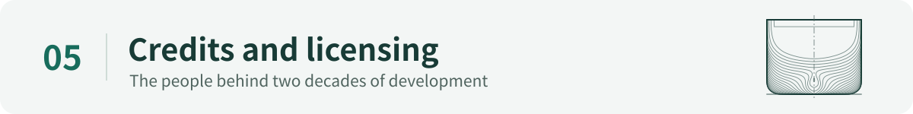

  
   Contributors listed in the FreeShip 26 About window

FreeShip 26 builds on FREE!ship by Martijn van Engeland, FREE!ship Plus by Timoshenko V.F. and FREE!ship Plus in Lazarus by Mark Malakanov. Some geometry code draws on Greg Green’s [ShipCAD](https://github.com/gpgreen/ShipCAD). The original credits and license notices are preserved. See [NOTICE.md](NOTICE.md) for the provenance of each module.

The project is released under the [GNU General Public License, version 3 or later](COPYING) (GPLv3+). The installer ships upstream external tools such as hship, CALCPROP, RVRSSHIP and ADD_MASS as supplied. These tools are separate from the project’s GPL source code. ADD_MASS is limited to educational and non-commercial use. See [external calculation tools](docs/CALCULATION-TOOLS.md).

<a href="#top">Back to top ↑</a>

