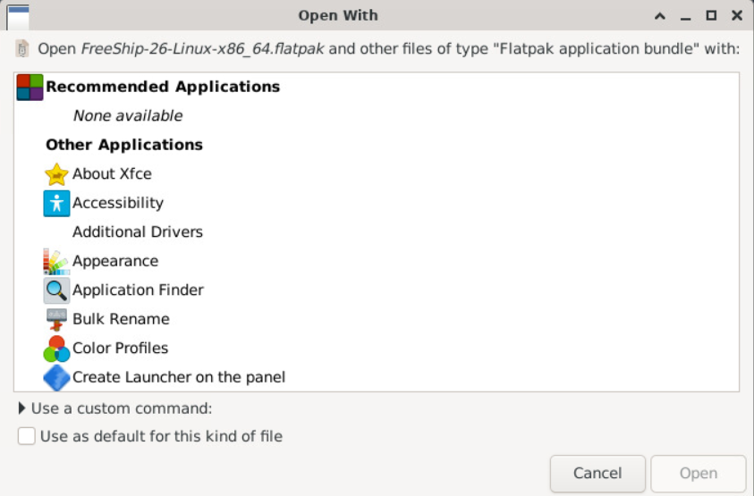

# Download and install on Linux

**[Download FreeShip 26 for Linux (x86_64)](https://github.com/jiangshirong/FreeShip-26/releases/latest/download/FreeShip-26-Linux-x86_64.flatpak)**

After downloading, double-click the `.flatpak` file and follow the installation prompts. Tested on Ubuntu 24.04 and Debian 13.

### If you see the “Open With” window

If double-clicking the file opens the **Open With** window shown below, click **Cancel**.



On Ubuntu 24.04 or Debian 13, open a terminal and run the following command to install GNOME Software with Flatpak support. Enter your password if prompted. If your account cannot use `sudo`, ask an administrator to run this step.

```bash
sudo apt install flatpak gnome-software gnome-software-plugin-flatpak
```

On other distributions, follow the [Flatpak setup instructions for your distribution](https://flathub.org/en/setup) to enable graphical installation.

Double-click the downloaded `.flatpak` file again. If **Open With** still appears, select **Software** and set it as the default for this file type. Click **Install**. When installation finishes, open the applications menu and search for **FreeShip 26**.
