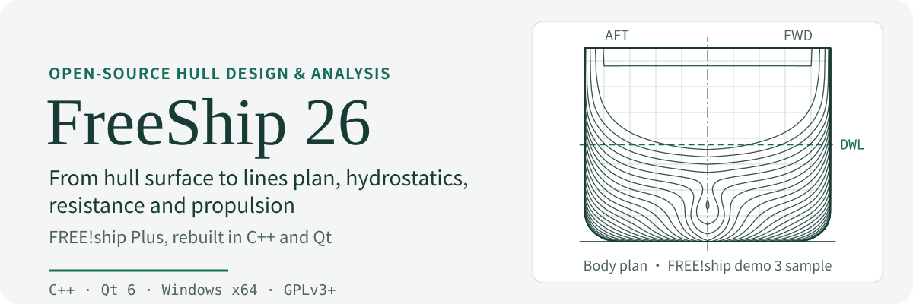
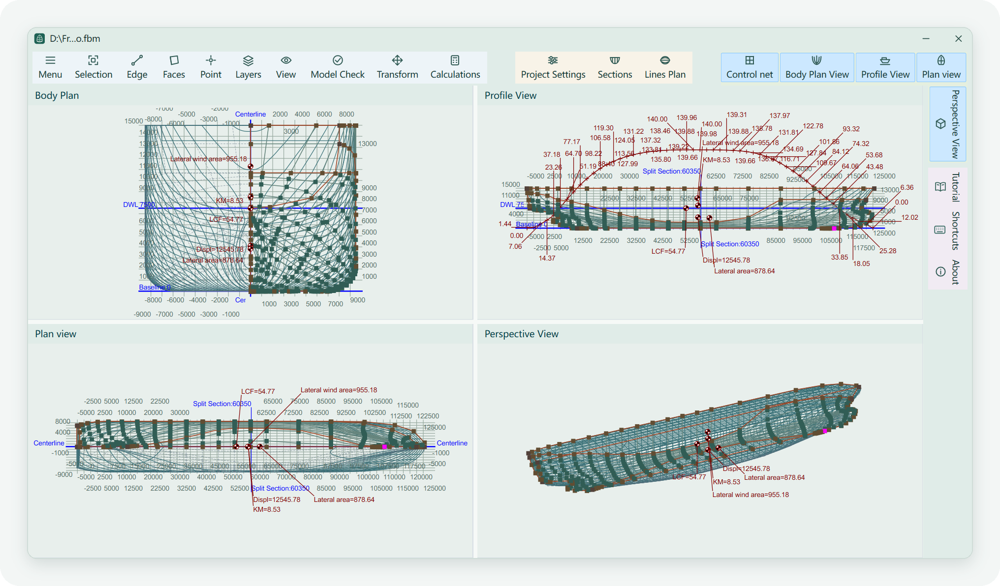
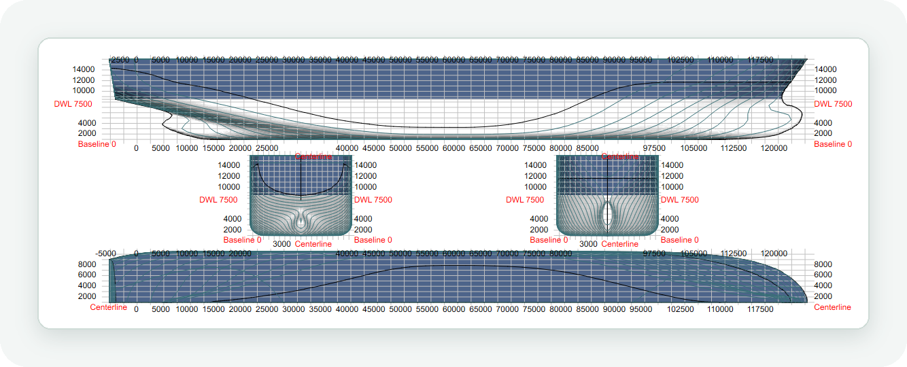
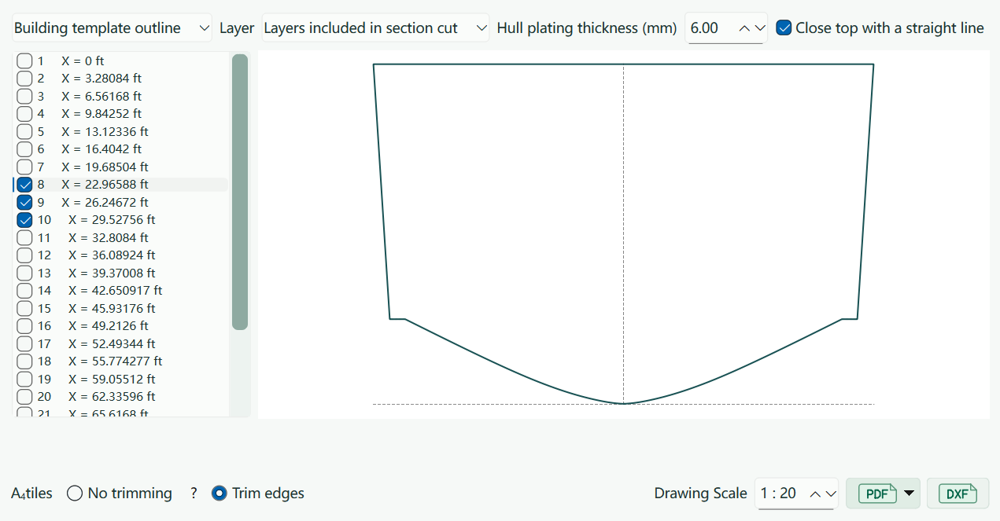
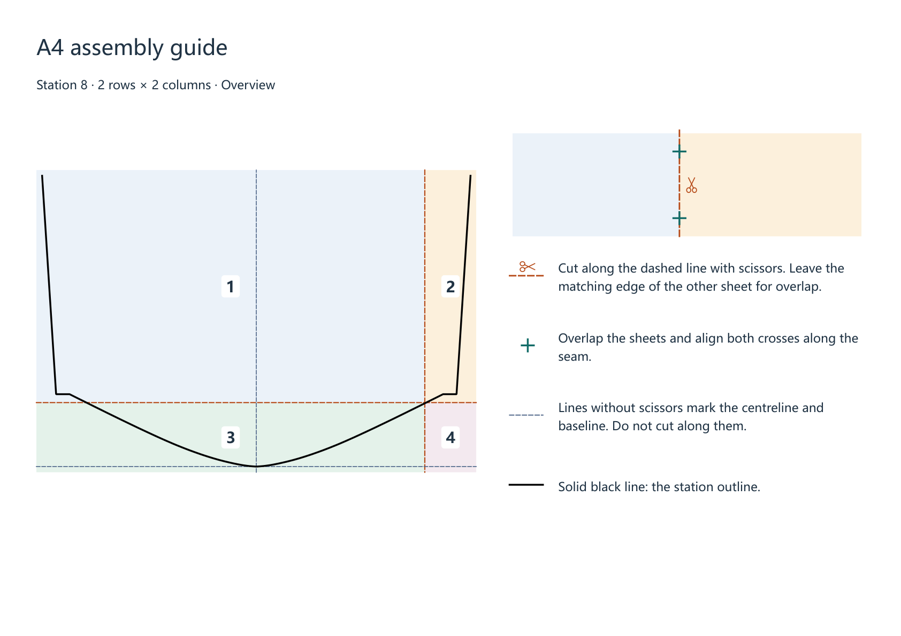
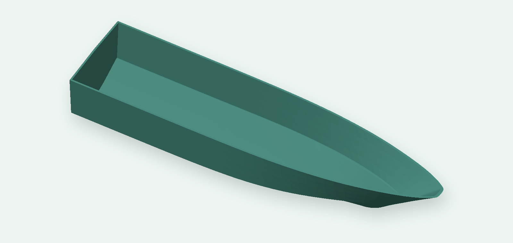
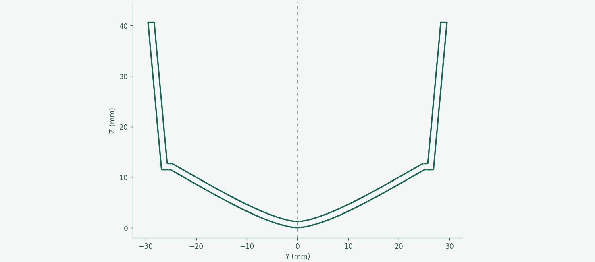
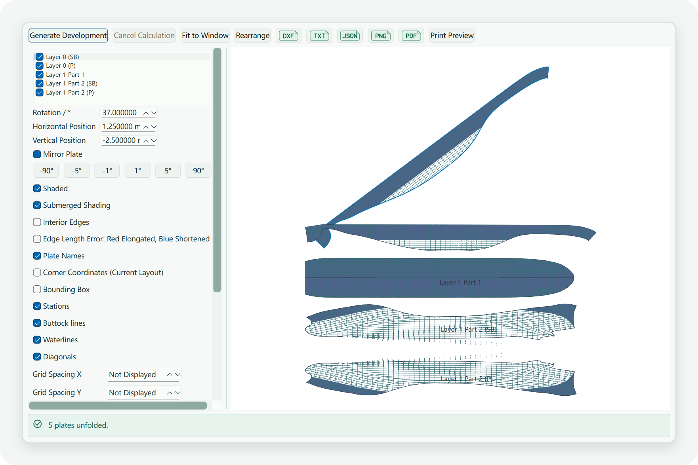
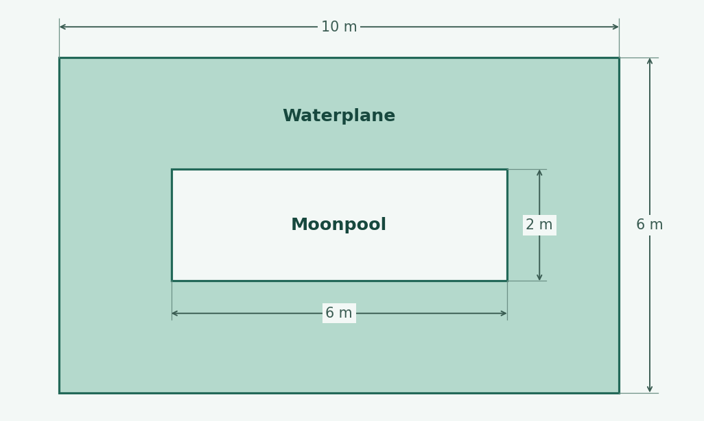
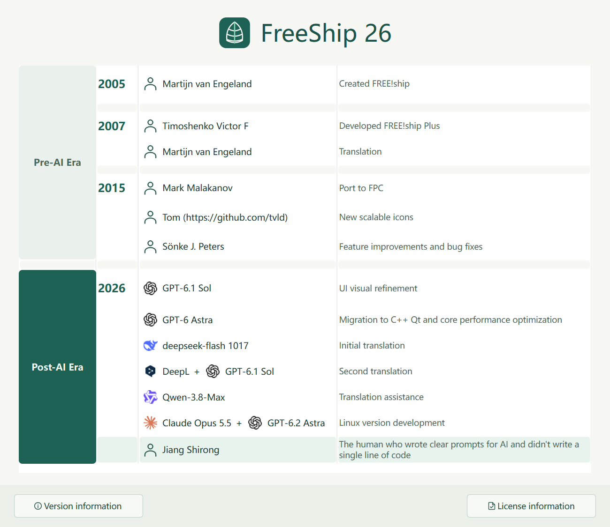

  <a href="README.zh-CN.md">简体中文</a> · <strong>English</strong> · <a href="README.ru.md">Русский</a>

  

FreeShip 26 is an open-source application for hull design and analysis. Edit the hull surface with a control net, inspect the hull lines, and compare loading conditions. Use the same model to produce drawings, develop plates, or make a scale model. FreeShip 26 builds on the FREE!ship Plus modeling workflow, uses C++ and Qt 6, and opens existing FBM hull models.

  <a href="https://github.com/jiangshirong/FreeShip-26/releases/latest/download/FreeShip-26-Windows-x64-Setup.exe"><b>Download for Windows x64</b></a>
  &nbsp;·&nbsp;
  <a href="https://github.com/jiangshirong/FreeShip-26/releases/latest/download/FreeShip-26-Linux-x86_64.flatpak"><b>Download for Linux x86_64 (Flatpak)</b></a>
  &nbsp;·&nbsp;
  <a href="https://github.com/jiangshirong/FreeShip-26/releases/latest">Latest release</a>

  <a href="#features">Modeling and analysis</a> &nbsp;·&nbsp;
  <a href="#output">Drawings and fabrication</a> &nbsp;·&nbsp;
  <a href="#start">Installation and first steps</a> &nbsp;·&nbsp;
  <a href="#improvements">What has improved</a> &nbsp;·&nbsp;
  <a href="#develop">Development and credits</a>

  
   The four-view workspace shows the body plan, profile, plan view, and perspective together.

## Modeling and analysis

### Edit the hull in four views

Create a hull from its principal dimensions or open an existing FBM project. Edit control points, edges, and faces, add creases, mirror or extrude geometry, and organize it into layers. You can also trace a background image in an orthographic view. Inspect the hull shape with station lines, buttocks, waterlines, diagonals, and curvature combs, then generate a complete lines plan from the same geometry.

Open several hull models in tabs within one window. Select multiple files at once and use `Ctrl+Tab` or `Ctrl+Shift+Tab` to switch tabs. An asterisk on a tab indicates unsaved changes to that model.

### Compare loading conditions and intact stability

Set up several loading conditions for the same vessel. Enter weights and tank filling levels for each condition, then compare displacement, draft, trim, and righting-arm (GZ) curves. Specify a heel angle and a minimum GZ at that angle to see the margin against your requirement. Save the conditions in the FBM project and export results as PDF, CSV, TXT, or JSON.

### Inspect above- and below-water geometry and estimate performance

- **Hydrostatics** covers design hydrostatics, draft tables, cross curves of stability (KN), and supplementary results such as Bonjean curves. The **Above-water geometry** table reports the lateral projected area exposed to wind, the projection centroid, and its height above the waterline. With the required geometry or inputs, the table also reports the minimum deck-edge height above the waterline and the longitudinal distance from the forward perpendicular to the centroid.
- **Resistance and propulsion** includes Delft, KAPER, Holtrop, van Oortmerssen, Hollenbach, and Fung–Leibman resistance methods, along with B-series propeller open-water calculations, preliminary propeller selection, and engine matching. Each method has its own applicable hull types and parameter ranges.

> [!NOTE]
> The minimum GZ you enter is a custom comparison criterion. For engineering decisions, verify the results against the applicable rules, tests, or full-scale data.

## Drawings and fabrication

### Generate a complete lines plan

Use the dedicated window to view the profile, body plan, and half-breadth plan. Export the drawing as PNG or DXF.

  
   Complete lines plan generated from the sample hull.

### Print station drawings or make building templates

Select stations in the Sections window and export their drawings. Use the hull section as drawn, or enter the shell plating thickness to generate a building template outline offset inward.

  
   Building template preview with three stations selected and a shell plating thickness of 6 mm.

Export a complete drawing at the chosen scale, tile it across A4 sheets in a PDF, or export a 2D DXF. Templates default to 1:1, and you can select a different drawing scale. Print at **Actual Size / 100%** and check the 100 mm scale line on the sheet. The **No trimming** layout requires a printer that can print borderless on A4 at actual size.

  
   A4 assembly guide exported by FreeShip. The sheets are numbered and marked for trimming and alignment.

### Make a hull shell for 3D printing

In the STL export window, choose **Open hull shell for 3D printing** and set the finished hull length and wall thickness. FreeShip preserves the outer surface, adds thickness inward, and joins the inner and outer skins along the rim. Check the exported STL in your slicer.

  
   Motorboat example with a finished length of 250 mm, rendered from the STL exported by FreeShip.

  
   Cross-section of the same STL. The gap between the two contours shows the wall thickness, and the hull remains open at the top.

### Develop plates

Generate flat plates from developable layers. Move, rotate, or mirror them in the layout and inspect edge length and area errors. Export as DXF, PDF, PNG, TXT, or JSON.

  
   Plate development window. Set each plate’s position and angle on the left and preview the layout on the right.

For file exchange, FreeShip reads and writes FBM, reads FTM, and imports and exports OBJ, STL, and FEF. It also exports DXF, IGES surfaces, offsets, and coordinates. Use FBM to save the complete project.

## Installation and first steps

| Platform | How to install |
| --- | --- |
| **Windows 10/11 x64** | [Download the installer](https://github.com/jiangshirong/FreeShip-26/releases/latest/download/FreeShip-26-Windows-x64-Setup.exe) and double-click to run it. You can choose the interface language in setup. |
| **Linux x86_64** | [Download the Flatpak](https://github.com/jiangshirong/FreeShip-26/releases/latest/download/FreeShip-26-Linux-x86_64.flatpak) and follow the [Linux installation guide](FreeShip-Qt/docs/linux-install.md). Tested on Ubuntu 24.04 and Debian 13. The bundle includes Wine for the bundled calculation tools. |

Both platforms support in-app update checks. The interface is available in Simplified Chinese, English, Russian, Japanese, German, French, and Spanish.

1. Choose **File → Open** to load an FBM or FTM hull. Try a [FREE!ship Plus sample hull](https://github.com/markmal/freeship-plus-in-lazarus/tree/master/Ships) or use **File → New Hull Form…** to create one from its principal dimensions.
2. Drag control points in an orthographic view to change the hull shape. Right-drag to pan and use the wheel to zoom around the pointer. In the perspective view, hold `Ctrl` and drag with the left mouse button to orbit.
3. Use **Lines Plan** on the toolbar to inspect the hull, or open the **Calculations** menu for hydrostatics, stability, resistance, and propulsion. See the [user guide](FreeShip-Qt/docs/USAGE.md) for details.

## What has improved

FreeShip 26 retains FREE!ship Plus’s control-net modeling workflow and FBM project format. The main interface moved to Qt 6. Model editing, surface subdivision, sectioning, lines-plan generation, file I/O, and the main calculation workflows moved to C++. Some specialized methods still use the original external solvers. The upstream fixes below refer to [FREE!ship Plus in Lazarus at commit `1de17e99`](https://github.com/markmal/freeship-plus-in-lazarus/tree/1de17e99fb2b1cc559cdf27c5cafb595a627a641). The performance figures come from testing FreeShip 26 on the same machine before and after optimization.

### Faster interaction with complex hulls

Panning and zooming update the view alone. When a control point moves, the software can reuse unaffected parts of the subdivided surface and sections. Edits limited to notes or report options reuse verified geometry and lines plans. Moving a plate that has already been developed also reuses its drawing.

| Same-machine benchmark | Before | After |
| --- | ---: | ---: |
| Continuous lines-plan pan and zoom, median CPU frame drawing time | 44.56 ms | 9.44 ms |
| Dragging a plate in an already generated dense layout, median event and viewport drawing time | 802.96 ms | 0.45 ms |
| Confirming unchanged project settings, back-end response and output writing | 1,238.3 ms | 53.2 ms |

Each benchmark uses a fixed sample and its own measurement scope. Reusing existing results reduces repeated generation and drawing while preserving calculation precision, curve sampling, and export settings. See the [performance regression notes](FreeShip-Qt/docs/migration/PUBLICATION-PERFORMANCE-AUDIT.md) for the reuse rules and output comparisons for project settings.

### Corrections to calculations, units, and exported geometry

Consider a 10 × 6 m waterplane with a 6 × 2 m moonpool in the middle. The analytical waterplane area is **48 m²**, and its second moment of area about the longitudinal axis is **176 m⁴**. A reference build using the legacy algorithm returned approximately 36 m² and 360 m⁴. The corrected results match the analytical values. The same corrections also cover waterplanes with multiple disconnected contours.

  
   Plan view of the waterplane. The central opening is subtracted when calculating area and second moment of area.

| Operation | How FreeShip 26 handles it |
| --- | --- |
| **Switching between metric and imperial units** | Station, waterline, and buttock positions are converted along with the hull. A station at 10 m becomes approximately 32.81 ft and stays in the same physical location. |
| **Exporting an asymmetric STL** | Faces are mirrored according to each layer’s symmetry setting. A hull modeled on both sides or an asymmetric part keeps its original geometry. |
| **Exporting PAM from an imperial model** | Coordinates are converted using 1 ft = 0.3048 m, correcting the direction of the legacy conversion. |
| **Entering engine inertia for RVRSSHIP** | The application labels and validates inertia in the confirmed unit of kg·m² and uses the propeller shaft reference, avoiding the factor-of-1,000 discrepancy from the old t·m² label. |

See [upstream issues and fixes](FreeShip-Qt/docs/upstream-fixes/README.md) for test cases, conditions, source locations, and regression checks.

### Safer project files and more reliable calculations

- **Opening and saving.** The application switches to a new file after it has loaded and passed geometric checks. A save writes the complete contents to a temporary file before replacing the original. If another session has changed the file since it was opened, FreeShip keeps the current work and prompts you to resolve the conflict.
- **Recovery.** Changes recorded in a recovery copy can be restored after an unexpected exit. Calculation reports read the current model. Geometry changes such as aligning the hull to the baseline require an explicit action.
- **Calculation jobs and reports.** Calculations can run in the background and can be canceled. When calling an external solver, FreeShip gives each job its own working directory and checks the exit status and newly generated output so that a previous job’s results cannot be mistaken for the current results.

### A fuller workflow from design to production drawings

- **Working with alternatives.** Switch between several hull models in the same window, or save several sets of weights and tank filling levels in a single FBM. View the loading comparison, GZ curves, and the results for your custom minimum GZ together.
- **Producing fabrication files from the model.** Offset a station outline inward by the specified shell plating thickness to make a building template. Export a complete drawing or an A4 tiled PDF with assembly instructions. For 3D printing, export an open-top hull shell STL at the specified finished length and wall thickness.
- **Installation, languages, and updates.** Windows setup supports seven languages, and the Qt version is available on Linux as a Flatpak with Wine. The interface, main reports, and update prompts follow the selected language. On the public stable channel, the Windows updater downloaded and reconstructed the new installer from the previous version, and the Linux Flatpak was upgraded in Debian 13. See the [release history](https://github.com/jiangshirong/FreeShip-26/releases).

## Development and credits

See the [Windows build instructions](WINDOWS-BUILD.md) and the [Linux Flatpak build instructions](FreeShip-Qt/tools/flatpak/README.md) to build from source. Reproducible bug reports, FBM examples that can be shared publicly, and documentation improvements are welcome. See the [contribution guide](CONTRIBUTING.md).

FreeShip 26 builds on FREE!ship by Martijn van Engeland, FREE!ship Plus by Timoshenko V.F., and [FREE!ship Plus in Lazarus](https://github.com/markmal/freeship-plus-in-lazarus) by Mark Malakanov. Tom drew the scalable icons, and Sönke J. Peters contributed improvements and fixes. Some geometry code draws on Greg Green’s [ShipCAD](https://github.com/gpgreen/ShipCAD).

  
   Credits from the About window, including Linux development.

This project is released under the [GNU GPL version 3 or later](COPYING). See [NOTICE](NOTICE.md) for the original attributions and third-party sources. Bundled external calculation programs have their own distribution terms. ADD_MASS is restricted to educational and noncommercial use. See [External calculation tools](FreeShip-Qt/docs/CALCULATION-TOOLS.md) for details.

<a href="#top">Back to top ↑</a>

