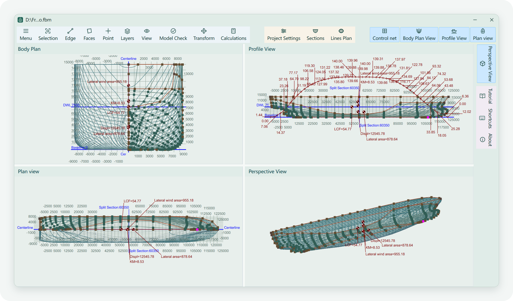
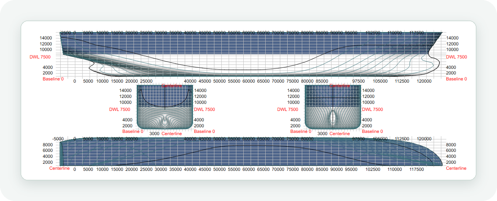
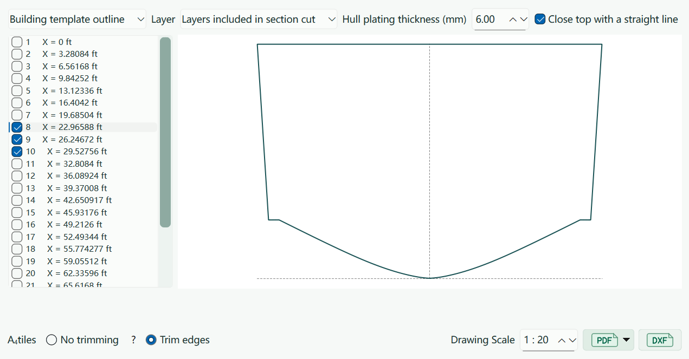
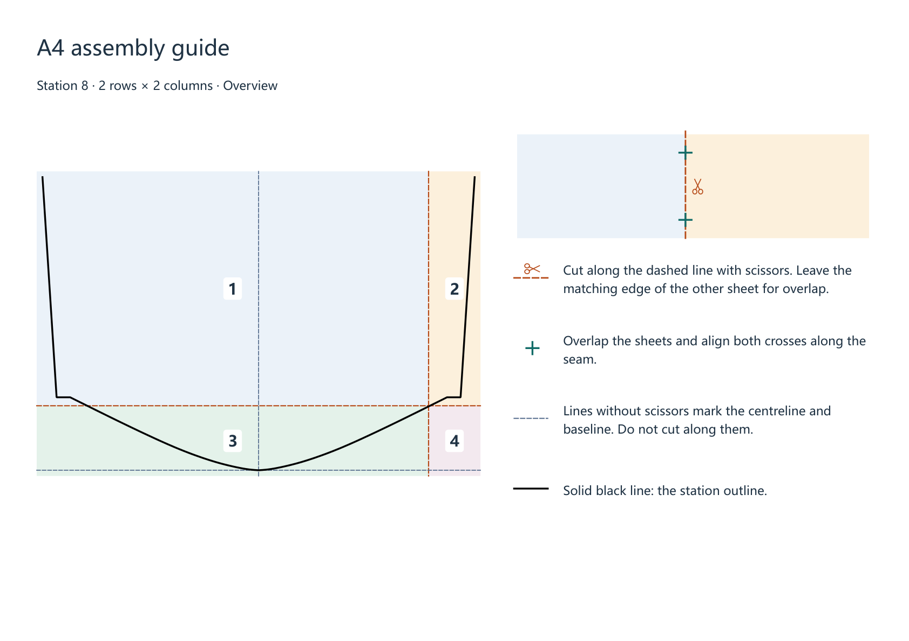
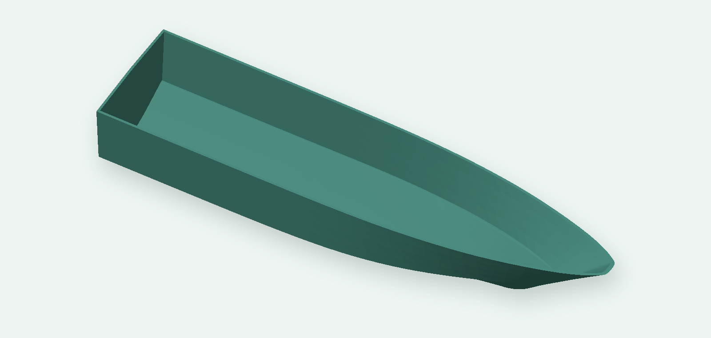
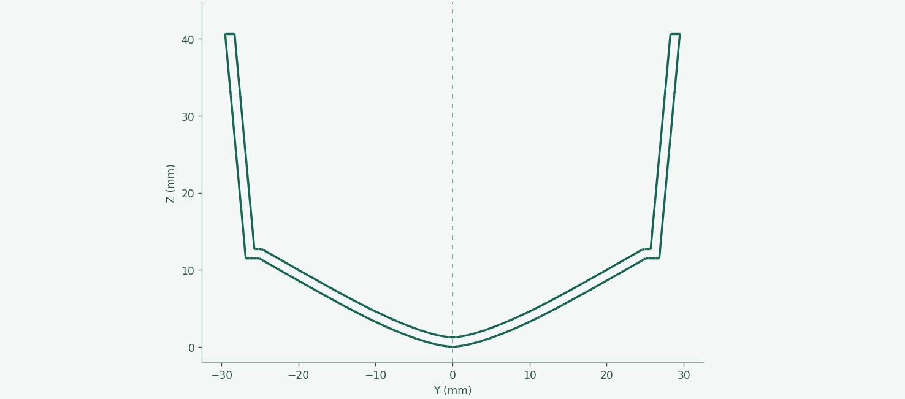
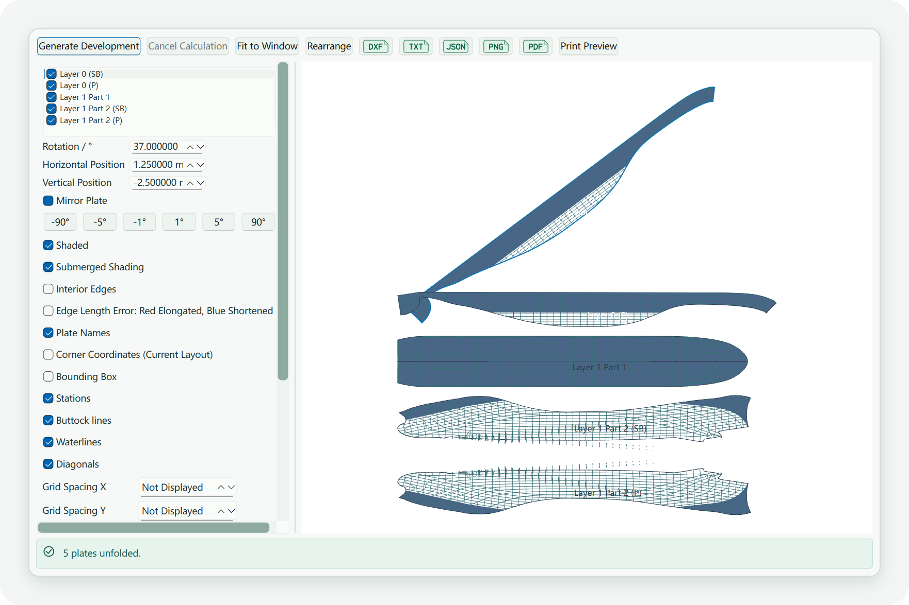
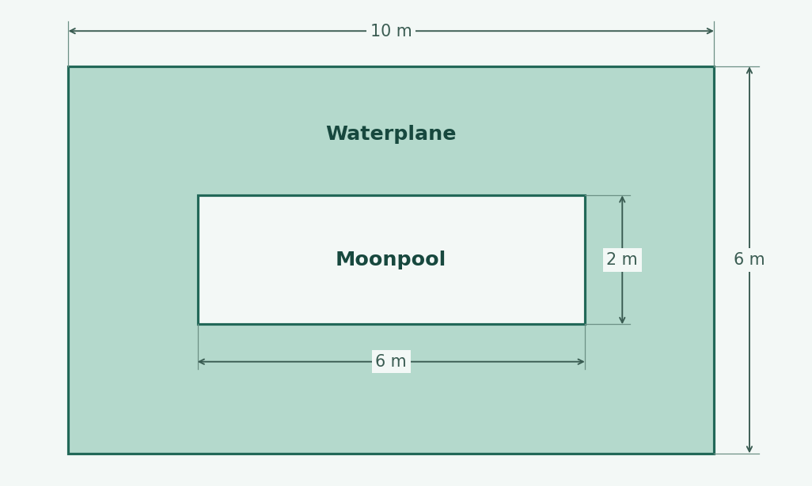
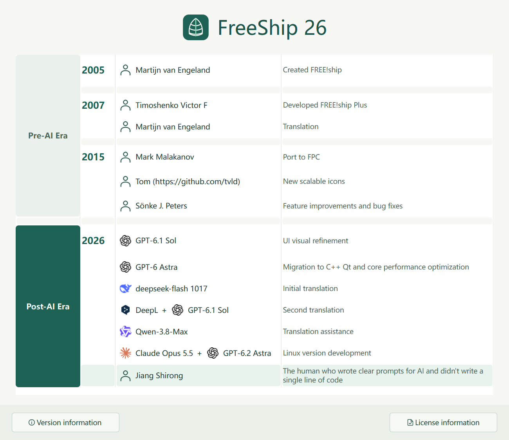

  <a href="README.zh-CN.md">简体中文</a> · <a href="README.md">English</a> · <strong>Русский</strong>

  

FreeShip 26 — программа с открытым исходным кодом для проектирования и анализа корпусов судов. Редактируйте поверхность корпуса с помощью управляющей сетки, проверяйте обводы и сравнивайте условия загрузки. По той же модели можно подготовить чертежи, развернуть листы обшивки или изготовить масштабную модель. FreeShip 26 развивает подход FREE!ship Plus к моделированию, использует C++ и Qt 6 и открывает существующие модели FBM.

  <a href="https://github.com/jiangshirong/FreeShip-26/releases/latest/download/FreeShip-26-Windows-x64-Setup.exe"><b>Скачать для Windows x64</b></a>
  &nbsp;·&nbsp;
  <a href="https://github.com/jiangshirong/FreeShip-26/releases/latest/download/FreeShip-26-Linux-x86_64.flatpak"><b>Скачать для Linux x86_64 (Flatpak)</b></a>
  &nbsp;·&nbsp;
  <a href="https://github.com/jiangshirong/FreeShip-26/releases/latest">Последний выпуск</a>

  <a href="#features">Моделирование и расчёты</a> &nbsp;·&nbsp;
  <a href="#output">Чертежи и изготовление</a> &nbsp;·&nbsp;
  <a href="#start">Установка и первые шаги</a> &nbsp;·&nbsp;
  <a href="#improvements">Что улучшилось</a> &nbsp;·&nbsp;
  <a href="#develop">Разработка и авторы</a>

  
   В рабочей области одновременно видны проекции «Корпус», «Бок», «Полуширота» и перспективный вид.

## Моделирование и расчёты

### Редактирование корпуса в четырёх видах

Создайте корпус по главным размерениям или откройте существующий проект FBM. Редактируйте управляющие точки, рёбра и грани, задавайте линии излома, зеркально отражайте и вытягивайте геометрию, распределяйте её по слоям. В ортогональных видах можно обвести контуры по фоновому изображению. Проверяйте обводы по шпангоутам, батоксам, ватерлиниям, диагоналям и гребёнкам кривизны, затем стройте полный теоретический чертёж по той же геометрии.

В одном окне можно открыть несколько моделей во вкладках. Выберите сразу несколько файлов и переключайтесь между вкладками сочетаниями `Ctrl+Tab` и `Ctrl+Shift+Tab`. Звёздочка на вкладке означает, что изменения модели ещё не сохранены.

### Сравнение условий загрузки и остойчивости неповреждённого судна

Задайте несколько условий загрузки для одного судна. Введите массы и степень заполнения цистерн для каждого условия, затем сравните водоизмещение, осадку, дифферент и кривые плеча статической остойчивости (GZ). Можно указать угол крена и минимальное значение GZ при этом угле, чтобы увидеть разницу между расчётным и требуемым значениями. Условия сохраняются в FBM, результаты можно экспортировать в PDF, CSV, TXT или JSON.

### Надводная и подводная геометрия, сопротивление и движители

- **Гидростатика** включает расчёт на проектной осадке, таблицы по осадкам, пантокарены (KN) и дополнительные результаты, в том числе кривые Бонжана. В таблице «Геометрия над ватерлинией» показаны площадь боковой проекции, подверженной действию ветра, центр площади этой проекции и его высота над ватерлинией. При наличии необходимых исходных данных программа также показывает минимальную высоту кромки палубы над ватерлинией и продольное расстояние от носового перпендикуляра до центра площади.
- **Сопротивление и пропульсивные характеристики** рассчитываются методами Delft, KAPER, Холтропа, ван Оортмерссена, Холленбаха, Фанга — Лейбмана и другими. Доступны расчёт характеристик гребного винта серии B в свободной воде, предварительный подбор винта и согласование его характеристик с двигателем. Область применения и допустимые параметры зависят от метода.

> [!NOTE]
> Указанный вами минимум GZ служит пользовательским критерием сравнения. При принятии инженерных решений сверяйте расчёт с применимыми правилами, результатами испытаний или натурными данными.

## Чертежи и изготовление

### Полный теоретический чертёж

В отдельном окне можно просмотреть проекции «Бок», «Корпус» и «Полуширота» и экспортировать чертёж в PNG или DXF.

  
   Полный теоретический чертёж, построенный по модели корпуса.

### Печать поперечных сечений и изготовление шаблонов

Выберите шпангоуты в окне «Сечения» и экспортируйте их чертежи. Можно вывести контур сечения корпуса или ввести толщину наружной обшивки, чтобы получить смещённый внутрь контур шаблона для постройки.

  
   Предварительный просмотр шаблона. Выбраны три шпангоута и задана толщина обшивки 6 мм.

Чертёж можно экспортировать целиком в выбранном масштабе, разложить на листы A4 в PDF или сохранить в двумерном DXF. По умолчанию шаблон выводится в масштабе 1:1, можно задать другой масштаб. Печатайте в режиме **«Фактический размер / 100%»** и проверяйте масштаб по контрольному отрезку длиной 100 мм. Для раскладки **«Без обрезки»** нужен принтер, способный печатать на A4 без полей в фактическом размере.

  
   Схема сборки из экспортированного FreeShip PDF. На четырёх листах обозначены номера, линии обрезки и метки совмещения.

### Оболочка корпуса для 3D-печати

При экспорте STL выберите **«Открытый корпус для 3D-печати»**, задайте длину готовой модели и толщину стенки. FreeShip сохраняет наружную поверхность, наращивает толщину внутрь и соединяет внутреннюю и наружную поверхности по верхней кромке. Экспортированный STL можно проверить в слайсере.

  
   Корпус катера длиной 250 мм, визуализированный по сетке STL, экспортированной из FreeShip.

  
   Поперечное сечение того же STL. Расстояние между контурами показывает толщину стенки. Сверху корпус остаётся открытым.

### Развёртка листов обшивки

Получайте плоские развёртки из слоёв, отмеченных как разворачиваемые. Перемещайте, поворачивайте и зеркально отражайте листы на раскладке, проверяйте отклонения длин кромок и площади. Возможен экспорт в DXF, PDF, PNG, TXT и JSON.

  
   В окне развёртки слева задаются положение и угол каждого листа, а справа видна раскладка.

Для обмена моделями FreeShip читает и записывает FBM, читает FTM, импортирует и экспортирует OBJ, STL и FEF. Можно также экспортировать DXF, поверхности IGES, таблицы ординат и координаты. Для сохранения проекта целиком используйте FBM.

## Установка и первые шаги

| Платформа | Установка |
| --- | --- |
| **Windows 10/11 x64** | [Скачайте установщик](https://github.com/jiangshirong/FreeShip-26/releases/latest/download/FreeShip-26-Windows-x64-Setup.exe) и запустите его двойным щелчком. В окне установки можно выбрать язык интерфейса. |
| **Linux x86_64** | [Скачайте Flatpak](https://github.com/jiangshirong/FreeShip-26/releases/latest/download/FreeShip-26-Linux-x86_64.flatpak) и следуйте [инструкции по установке в Linux](FreeShip-Qt/docs/linux-install.md). Пакет проверен на Ubuntu 24.04 и Debian 13. В него входит Wine для запуска поставляемых расчётных программ. |

На обеих платформах можно проверять наличие обновлений из программы. Интерфейс доступен на упрощённом китайском, английском, русском, японском, немецком, французском и испанском языках.

1. Загрузите модель FBM или FTM через **«Файл → Открыть»**. Можно попробовать [примеры моделей FREE!ship Plus](https://github.com/markmal/freeship-plus-in-lazarus/tree/master/Ships) или создать корпус по главным размерениям через **«Файл → Новая форма корпуса…»**.
2. Чтобы изменить форму корпуса, перетаскивайте управляющие точки в ортогональном виде. Перетаскивание правой кнопкой сдвигает вид, а колёсико меняет масштаб относительно указателя. В перспективном виде удерживайте `Ctrl` и перетаскивайте левой кнопкой, чтобы вращать модель на экране.
3. Для проверки обводов откройте **«Теоретический чертёж»** на панели инструментов. Гидростатика, остойчивость, сопротивление и пропульсивные расчёты доступны в меню **«Расчеты»**. Подробнее см. [руководство пользователя](FreeShip-Qt/docs/USAGE.md).

## Что улучшилось

FreeShip 26 сохраняет моделирование с управляющей сеткой и формат проектов FBM из FREE!ship Plus. Главный интерфейс перенесён на Qt 6. Редактирование модели, подразделение поверхности, построение сечений и теоретического чертежа, чтение и запись файлов и основные расчётные процедуры перенесены на C++. Часть специализированных методов по-прежнему использует исходные внешние расчётные программы. При разборе унаследованных ошибок за основу взят [FREE!ship Plus in Lazarus на коммите `1de17e99`](https://github.com/markmal/freeship-plus-in-lazarus/tree/1de17e99fb2b1cc559cdf27c5cafb595a627a641). Показатели производительности измерены на одном компьютере до и после оптимизации FreeShip 26.

### Быстрее работать со сложными моделями

При панорамировании и изменении масштаба обновляется только вид. После перемещения управляющей точки программа может повторно использовать неизменившиеся части подразделённой поверхности и сечений. При изменении только примечаний или параметров отчёта используются уже проверенные геометрия и теоретический чертёж. При перемещении готовой развёртки повторно используется её отрисовка.

| Сценарий измерения на одном компьютере | До | После |
| --- | ---: | ---: |
| Непрерывное панорамирование и масштабирование теоретического чертежа, медианное время отрисовки кадра на CPU | 44,56 мс | 9,44 мс |
| Перетаскивание листа в готовой плотной раскладке, медианное время обработки события и отрисовки вида | 802,96 мс | 0,45 мс |
| Подтверждение параметров проекта без изменений, время обработки запроса и записи выходных файлов | 1 238,3 мс | 53,2 мс |

Для каждого сценария использовались фиксированная модель и свой способ измерения. Ускорение достигнуто за счёт устранения повторных построений и отрисовки при сохранении точности расчёта, дискретизации кривых и параметров экспорта. Условия повторного использования результатов при подтверждении параметров проекта и сравнение выходных данных приведены в [отчёте об оптимизации](FreeShip-Qt/docs/migration/PUBLICATION-PERFORMANCE-AUDIT.md).

### Исправления в расчётах, единицах и экспортируемой геометрии

Рассмотрим ватерлинию с вырезом центральной шахты. Внешний контур имеет размеры 10 × 6 м, вырез шахты — 6 × 2 м. Аналитически площадь ватерлинии равна **48 м²**, а её момент инерции относительно продольной оси — **176 м⁴**. Контрольная сборка со старым алгоритмом давала около 36 м² и 360 м⁴ соответственно. Исправленные результаты совпадают с аналитическими значениями. Исправления применимы и к ватерлиниям с несколькими раздельными контурами.

  
   Площадь ватерлинии в плане. Центральный вырез исключается при расчёте площади и момента инерции.

| Операция | Как её выполняет FreeShip 26 |
| --- | --- |
| **Переход между метрическими и британскими единицами** | Положения шпангоутов, ватерлиний и батоксов пересчитываются вместе с размерениями корпуса. Сечение на отметке 10 м находится примерно на отметке 32,81 фута в том же физическом месте. |
| **Экспорт несимметричной модели в STL** | Зеркальное отражение граней учитывает признак симметрии каждого слоя. Геометрия корпуса, построенного с обоих бортов, и несимметричных деталей сохраняется. |
| **Экспорт PAM из проекта в британских единицах** | Координаты переводятся по соотношению 1 фут = 0,3048 м. Исправлено направление преобразования. |
| **Ввод момента инерции двигателя для RVRSSHIP** | Программа указывает и проверяет подтверждённые единицы кг·м² и использует приведение к гребному валу. Это устраняет тысячекратное расхождение, возможное при вводе по старой подписи «т·м²». |

Примеры, условия воспроизведения, участки исходного кода и регрессионные проверки описаны в разделе [«Унаследованные ошибки и их исправления»](FreeShip-Qt/docs/upstream-fixes/README.md).

### Защита проекта и надёжность расчётов

- **Открытие и сохранение.** Программа переключается на новый проект после его чтения и проверки геометрии. При сохранении она сначала полностью записывает временный файл, затем заменяет исходный. Если после открытия другая сессия изменила файл, FreeShip сохраняет текущую работу и предлагает разрешить конфликт.
- **Восстановление.** Изменения, записанные в копию для восстановления, можно вернуть после аварийного завершения. Отчёт читает текущую модель. Выравнивание корпуса по основной линии и другие изменения геометрии выполняются по явной команде пользователя.
- **Расчётные задания и отчёты.** Расчёт может выполняться в фоне с возможностью отмены. По завершении можно сохранить отчёт. Каждому заданию внешней расчётной программы выделяется отдельный рабочий каталог. FreeShip проверяет код завершения и новые выходные файлы, чтобы результат предыдущего задания не был принят за текущий.

### От проектирования и расчётов до чертежей для изготовления

- **Работа с вариантами.** Переключайтесь между несколькими корпусами в одном окне или храните несколько наборов масс и уровней заполнения цистерн в одном FBM. Сравнение условий загрузки, кривые GZ и результаты проверки по заданному минимуму GZ доступны вместе.
- **Подготовка файлов для изготовления по модели.** Поперечные сечения можно сместить внутрь на толщину наружной обшивки и получить контуры шаблонов для постройки. Чертежи сохраняются целиком или разбиваются на страницы A4 с инструкцией по сборке. Для 3D-печати можно экспортировать STL открытой оболочки корпуса с нужной длиной и толщиной стенки.
- **Установка, языки и обновления.** Установщик Windows поддерживает семь языков. Для Linux Qt-версия выпускается как пакет Flatpak с Wine. Интерфейс, основные отчёты и сообщения об обновлениях используют выбранный язык. В публичном стабильном канале проверены загрузка и восстановление нового установщика при обновлении с предыдущей версии Windows-программы и фактическое обновление Flatpak в Debian 13. См. [историю выпусков](https://github.com/jiangshirong/FreeShip-26/releases).

## Разработка и авторы

Для сборки из исходного кода см. [инструкцию для Windows](WINDOWS-BUILD.md) и [инструкцию по сборке Flatpak для Linux](FreeShip-Qt/tools/flatpak/README.md). Приветствуются воспроизводимые отчёты об ошибках, модели FBM, которые можно опубликовать, и улучшения документации. Подробнее см. [руководство для участников](CONTRIBUTING.md).

FreeShip 26 основан на FREE!ship Мартина ван Энгеланда (Martijn van Engeland), FREE!ship Plus Виктора Ф. Тимошенко и [FREE!ship Plus in Lazarus](https://github.com/markmal/freeship-plus-in-lazarus) Марка Малаканова. Tom создал масштабируемые значки, а Sönke J. Peters внёс улучшения и исправления. Часть геометрического кода опирается на [ShipCAD](https://github.com/gpgreen/ShipCAD) Грега Грина.

  
   Список авторов и участников из окна «О программе», включая разработку версии для Linux.

Проект распространяется по [GNU GPL версии 3 или более поздней](COPYING). Сведения об авторах и сторонних компонентах приведены в [NOTICE](NOTICE.md). На поставляемые внешние расчётные программы действуют отдельные условия распространения. ADD_MASS предназначена для учебного и некоммерческого использования. Подробнее см. [описание внешних расчётных программ](FreeShip-Qt/docs/CALCULATION-TOOLS.md).

<a href="#top">Наверх ↑</a>

