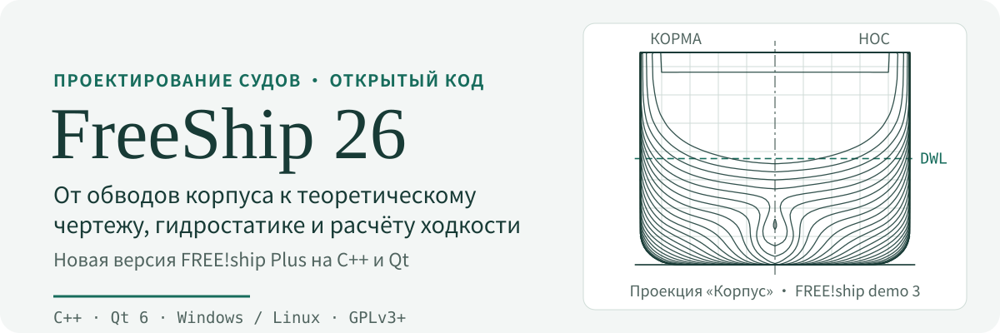
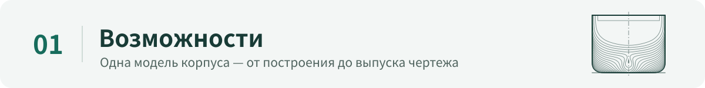
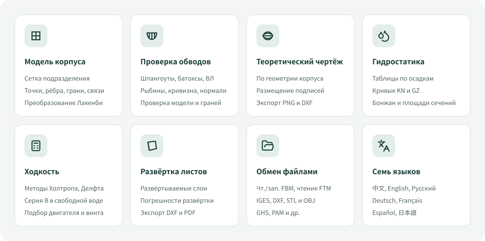
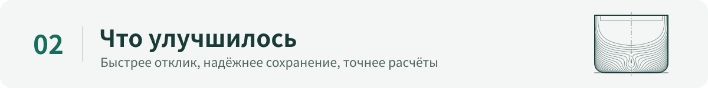
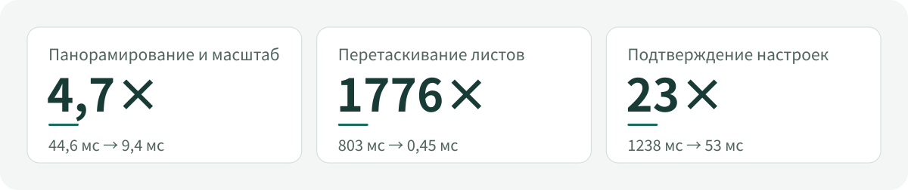
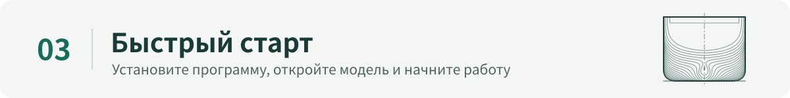
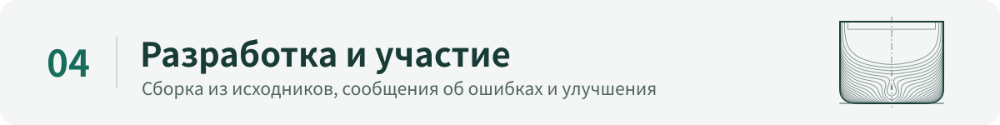
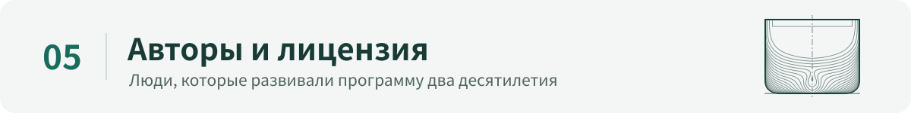

  <a href="README.zh-CN.md">简体中文</a> · <a href="README.md">English</a> · <strong>Русский</strong>

  

  
  
  

  <a href="#features"><b>Возможности</b></a> &nbsp;·&nbsp;
  <a href="#improvements"><b>Что улучшилось</b></a> &nbsp;·&nbsp;
  <a href="#start"><b>Быстрый старт</b></a> &nbsp;·&nbsp;
  <a href="#develop"><b>Разработка и участие</b></a> &nbsp;·&nbsp;
  <a href="#credits"><b>Авторы и лицензия</b></a>

  

FreeShip 26 — программа с открытым исходным кодом для проектирования корпусов судов. Поверхность задаётся компактной сеткой управляющих точек, которую можно редактировать в четырёх видах. Одна и та же геометрия используется для построения теоретического чертежа, расчётов гидростатики, остойчивости, сопротивления и пропульсивных характеристик, развёртки листов и экспорта в CAD.

Проект продолжает разработку [FREE!ship Plus in Lazarus](https://github.com/markmal/freeship-plus-in-lazarus). Интерфейс перенесён на Qt 6, а работа с документами и редактированием, подразделение поверхностей, построение сечений и теоретического чертежа, а также основные расчёты реализованы на C++.

FREE!ship &nbsp;→&nbsp; FREE!ship Plus &nbsp;→&nbsp; FREE!ship Plus in Lazarus &nbsp;→&nbsp; <b>FreeShip 26</b>

  

  

<b>Полный список возможностей</b>

- **Моделирование корпуса.** Редактирование точек, рёбер и граней. Создание рёбер излома, разбиение рёбер, выдавливание и зеркальное отражение. Опорные точки, ограничения на прямолинейность и группы точек. Управление слоями. Создание корпуса, сеточной панели и цилиндра. Перемещение, поворот, масштабирование, преобразование обводов по методу Лакенби и обводка фоновых изображений.
- **Проверка обводов.** Шпангоуты, батоксы, ватерлинии и рыбины. Гребёнки кривизны, отображение нормалей, проверка модели и исправление ориентации граней.
- **Теоретический чертёж.** Полный чертёж в отдельном окне с автоматическим размещением подписей. Экспорт в PNG и DXF.
- **Гидростатика и остойчивость.** Гидростатика при проектной осадке, таблицы по осадкам, кривые KN и GZ, кривые Бонжана, площади поперечных сечений и вес. Экспорт результатов в CSV, TXT, JSON и PDF.
- **Сопротивление и пропульсивные характеристики.** Методы Delft, KAPER, Холтропа, ван Оортмерссена, Холленбаха, Фунга — Лейбмана и другие. Расчёт характеристик винтов серии B в свободной воде, предварительный подбор винта и согласование его работы с двигателем.
- **Развёртка листов.** Построение развёрток для развёртываемых слоёв, размещение листов и проверка погрешностей длин рёбер и площадей.
- **Обмен файлами.** Чтение и запись FBM, чтение FTM. OBJ, STL, FEF, детали FreeShip и VRML. Поверхности IGES, DXF, таблицы ординат и координаты, а также GHS, Archimedes, PAM, Michlet и другие форматы.
- **Языки интерфейса.** 简体中文, English, Русский, Deutsch, Français, Español и 日本語. Выбранный язык сохраняется, предусмотрено быстрое переключение.

Подробнее см. [перечень перенесённых функций](FreeShip-Qt/docs/migration/FEATURES.md) и [руководство пользователя](FreeShip-Qt/docs/USAGE.md).

  
   <b>Теоретический чертёж</b> · Строится по геометрии модели и экспортируется в PNG и DXF

  
   <b>Развёртка листов</b> · Перемещение и поворот листов, просмотр погрешностей, экспорт в DXF, TXT, JSON, PNG и PDF

  

### Меньше повторных расчётов при редактировании

При панорамировании и масштабировании геометрия корпуса сохраняется. При перемещении управляющей точки пересчитываются только затронутые области поверхности и сечения. Теоретический чертёж, сечения и поверхности можно сохранить в локальном кэше и использовать после перезапуска. Уровень подразделения поверхности, дискретизация кривых и точность экспорта сохраняются.

  

### Защита файлов и восстановление несохранённой работы

- **При ошибке сохранения исходный файл сохраняется.** Программа записывает временный файл и заменяет исходный только после успешной записи. При ошибке сохраняются исходный файл и признак несохранённых изменений.
- **При ошибке открытия текущая модель остаётся доступной.** Переход к новой модели происходит после полного чтения и проверки файла.
- **Защита от перезаписи из другого окна.** Перед сохранением программа проверяет, изменился ли исходный файл и занят ли он.
- **Восстановление несохранённых изменений.** Применённые правки записываются в копию для восстановления. После аварийного завершения эту копию можно открыть при следующем запуске.

### Исправления в унаследованном коде

При переносе программы проверен исходный код. Следующие проблемы воспроизводятся в FREE!ship Plus in Lazarus на [коммите `1de17e99`](https://github.com/markmal/freeship-plus-in-lazarus/tree/1de17e99fb2b1cc559cdf27c5cafb595a627a641).

| Условие | Поведение исходной версии | FreeShip 26 |
| --- | --- | --- |
| Ошибка записи при сохранении существующего проекта | Файл проекта может исчезнуть или остаться неполным | Атомарная замена сохраняет исходный файл · [01](FreeShip-Qt/docs/upstream-fixes/catalog.md#u01) |
| Переход между метрической и британской системами единиц | Корпус масштабируется, а числовые координаты сечений остаются прежними | Координаты сечений и связанные параметры пересчитываются вместе · [06](FreeShip-Qt/docs/upstream-fixes/catalog.md#u06) |
| Сечение с шахтой или раздельными контурами корпусов | Ошибки в площади, моментах инерции и метацентрических параметрах | Интегрирование по фактической геометрии корпуса с учётом знаков · [19](FreeShip-Qt/docs/upstream-fixes/catalog.md#u19) |
| Экспорт несимметричного слоя в STL | В файл добавляется лишняя зеркальная поверхность | Экспорт учитывает свойство симметрии слоя · [13](FreeShip-Qt/docs/upstream-fixes/catalog.md#u13) |
| Экспорт модели в британских единицах в PAM | Пересчёт выполняется в обратную сторону. Длина отличается примерно в 10,76 раза | Правильный пересчёт из футов в метры · [21](FreeShip-Qt/docs/upstream-fixes/catalog.md#u21) |
| Зависание или ошибка внешней расчётной программы | Программа продолжает ждать или считывает результаты предыдущего запуска | Отдельные каталоги для задач, ограничение времени ожидания и проверка кода завершения · [11](FreeShip-Qt/docs/upstream-fixes/catalog.md#u11) |

Например, для площади ватерлинии **10 × 6 м** с вырезом под сквозную шахту **6 × 2 м** площадь за вычетом шахты составляет **48 м²**, а поперечный момент инерции площади ватерлинии — **176 м⁴**. Прежний алгоритм давал около 36,0 м² и 360,0 м⁴. Подробности приведены в [описании унаследованных проблем и исправлений](FreeShip-Qt/docs/upstream-fixes/README.md).

  

**1 · Установите программу** &nbsp; Скачайте установщик для Windows 10/11 x64 со страницы [Releases](https://github.com/jiangshirong/FreeShip-26/releases/latest) и запустите его. После установки обновления можно проверять в самой программе. Адаптация для Linux продолжается.

**2 · Откройте модель судна** &nbsp; Через **Файл → Открыть** можно загрузить модели FBM и FTM. Модели FTM сохраняются в FBM. Если своей модели пока нет, откройте одну из [демонстрационных моделей](https://github.com/markmal/freeship-plus-in-lazarus/tree/master/Ships) FREE!ship Plus. На снимках этой страницы использована `FREE!ship demo 3+deck.fbm`. Новый корпус по главным размерениям можно создать через **Файл → Новая форма корпуса**.

**3 · Начните редактирование**

| Действие | Как выполнить |
| --- | --- |
| Выделить управляющие точки | Щёлкните левой кнопкой мыши. Чтобы добавить точки к выделению, удерживайте Ctrl или Shift. В ортогональной проекции можно выделить точки рамкой, начав перетаскивание на пустом месте. |
| Переместить управляющие точки | Перетащите выделенные точки в проекции «Корпус», «Бок» или «Полуширота». |
| Панорамировать / масштабировать | Перетаскивайте правой кнопкой мыши. Прокручивайте колесо для масштабирования относительно указателя. |
| Повернуть перспективный вид | Перетаскивайте левой кнопкой мыши на пустом месте перспективного вида или удерживайте Alt при перетаскивании. |
| Отменить / повторить / сохранить | Ctrl+Z / Ctrl+Y / Ctrl+S |
| Открыть теоретический чертёж | Выберите **Теоретический чертёж** на панели инструментов. |
| Рассчитать гидростатику, сопротивление или пропульсивные характеристики | Используйте меню **Рассчитать**. |

> [!NOTE]
> Результаты программы не заменяют модельных испытаний, натурной проверки или одобрения классификационного общества. При принятии инженерных решений учитывайте область применимости каждого метода.

  

**Сборка из исходников** &nbsp; Требуются CMake 3.24 или новее, Qt 6.8.3 (MinGW 13.1) и Python 3. Сборка для разработчиков также компилирует исходный код на Pascal для сравнительных проверок, поэтому для неё нужен комплект Lazarus / Free Pascal. Команды сборки и запуска тестов приведены в [документации по сборке, тестированию и переносу](FreeShip-Qt/docs/BUILDING.md).

**Как помочь проекту** &nbsp; Приветствуются воспроизводимые сообщения об ошибках, модели, которыми можно поделиться, отчёты о сборке и улучшения документации. Перед отправкой изменений прочитайте [руководство для участников](CONTRIBUTING.md). Если изменение затрагивает файлы FBM, геометрию корпуса, расчёты или экспорт, опишите, что изменилось, и приложите воспроизводимый пример.

  

  
   Участники, указанные в окне «О программе» FreeShip 26

FreeShip 26 опирается на работу авторов FREE!ship (Martijn van Engeland), FREE!ship Plus (Timoshenko V.F.) и FREE!ship Plus in Lazarus (Mark Malakanov). При реализации некоторых геометрических операций использован [ShipCAD](https://github.com/gpgreen/ShipCAD) Грега Грина. Сведения об авторах и лицензионные уведомления сохранены. Происхождение отдельных модулей указано в [NOTICE.md](NOTICE.md).

Проект распространяется на условиях [Стандартной общественной лицензии GNU версии 3 или более поздней](COPYING) (GPLv3+). Внешние расчётные программы hship, CALCPROP, RVRSSHIP, ADD_MASS и другие включены в установщик в том виде, в каком они поставлялись с базовым проектом. Для этих программ действуют отдельные условия распространения. ADD_MASS предназначена только для учебного и некоммерческого использования. Подробнее см. [документацию по внешним расчётным программам](FreeShip-Qt/docs/CALCULATION-TOOLS.md).

ИИ-помощники, участвовавшие в разработке: [Claude Code](https://github.com/anthropics/claude-code) и [Codex](https://github.com/openai/codex).

<a href="#top">К началу ↑</a>

