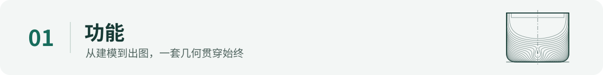
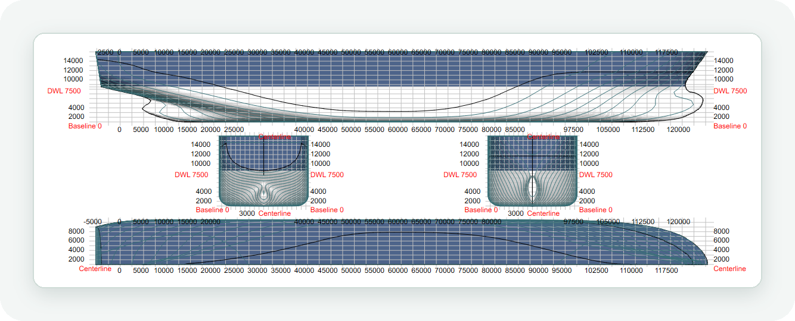
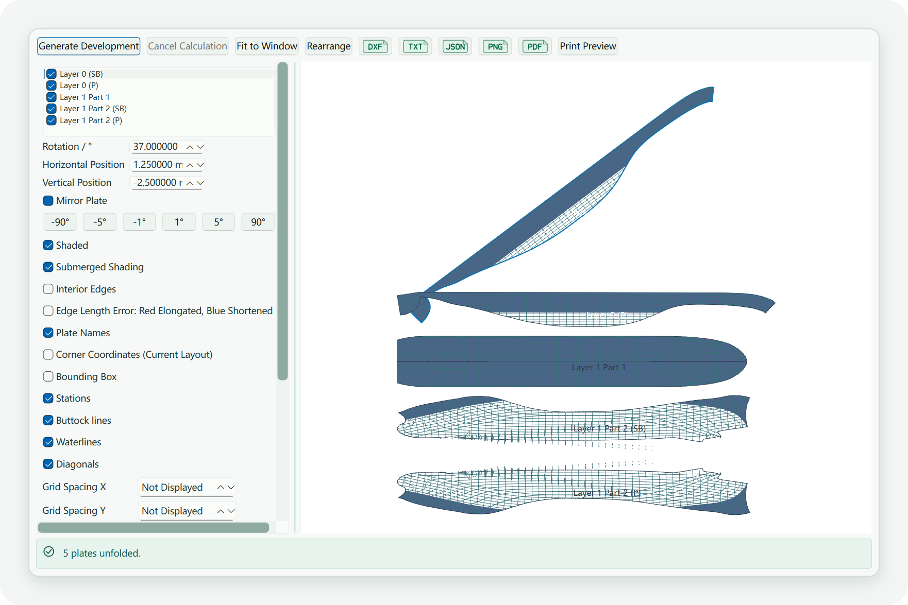
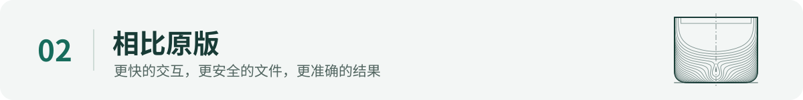
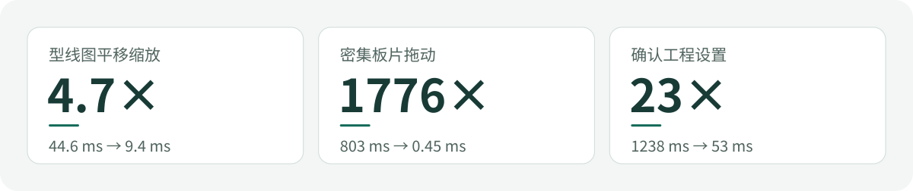
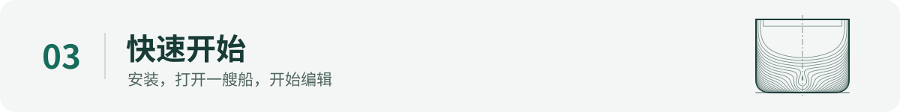
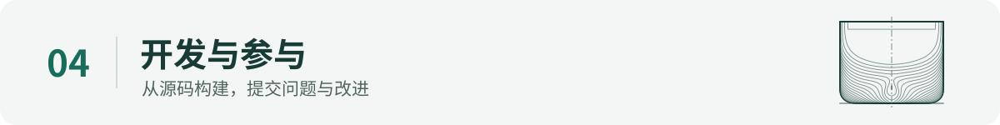
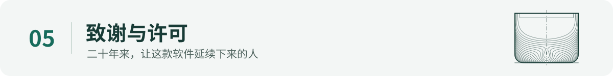
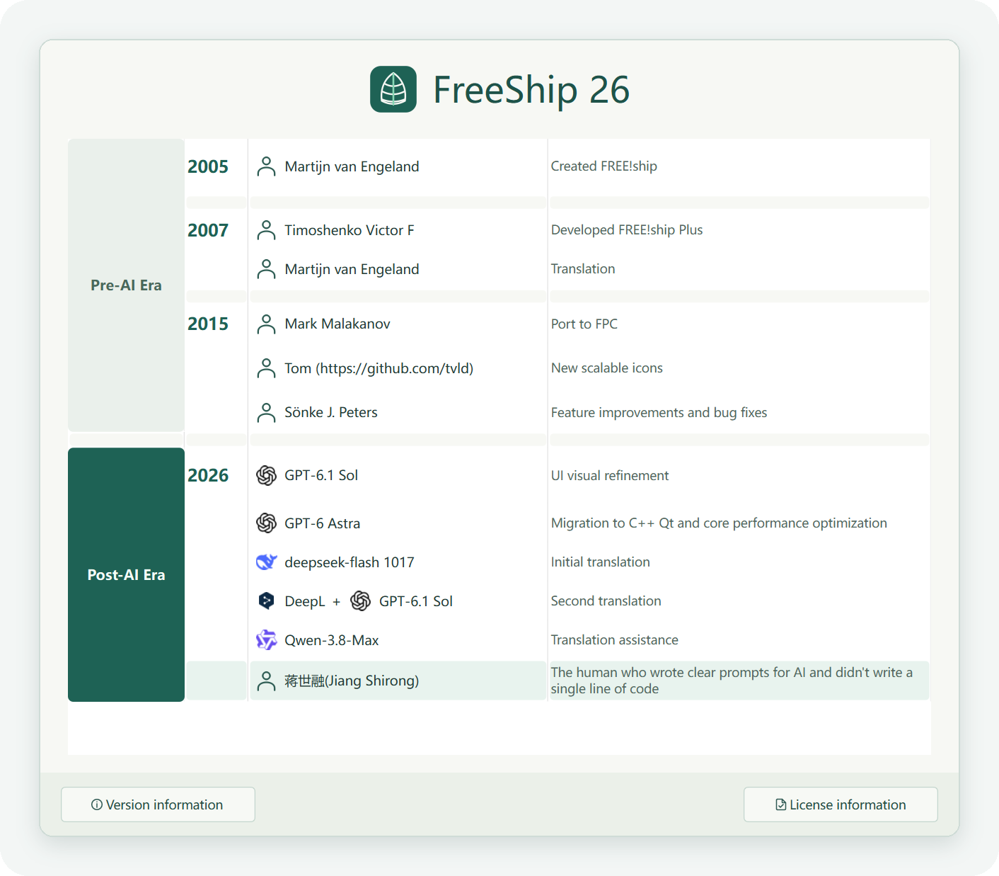

  <strong>简体中文</strong> · <a href="README.md">English</a> · <a href="README.ru.md">Русский</a>

  

  
  
  

  <a href="#features"><b>功能</b></a> &nbsp;·&nbsp;
  <a href="#improvements"><b>相比原版</b></a> &nbsp;·&nbsp;
  <a href="#start"><b>快速开始</b></a> &nbsp;·&nbsp;
  <a href="#develop"><b>开发与参与</b></a> &nbsp;·&nbsp;
  <a href="#credits"><b>致谢与许可</b></a>

  

FreeShip 26 是一款开源的船体设计软件。你用一张轻量的控制网描述船体曲面，在四个视图中编辑；型线图、静水力与稳性、阻力与推进估算、板材展开和 CAD 文件，都从同一份几何直接生成。

它由 [FREE!ship Plus in Lazarus](https://github.com/markmal/freeship-plus-in-lazarus) 迁移而来：界面改用 Qt 6，模型文档、编辑、细分曲面、剖切、型线图和主要计算改由 C++ 实现。

FREE!ship &nbsp;→&nbsp; FREE!ship Plus &nbsp;→&nbsp; FREE!ship Plus in Lazarus &nbsp;→&nbsp; <b>FreeShip 26</b>

  

  

<b>完整功能清单</b>

- **船体建模**：点、边、面编辑；折痕、拆边、挤出、镜像；锚点、直线约束和点组；图层管理；新建船型、网格面板、圆柱；移动、旋转、缩放和 Lackenby 船型变换；背景影像描图
- **形状检查**：横剖线、纵剖线、水线、斜剖线；曲率梳、法向显示、模型检查和面朝向修复
- **型线图**：独立窗口查看完整型线图，文字自动避让；导出 PNG 和 DXF
- **静水力与稳性**：设计静水力、吃水表、稳性曲线（KN、GZ）、Bonjean、横剖面面积和重量；结果可导出 CSV、TXT、JSON、PDF
- **阻力与推进**：Delft、KAPER、Holtrop、van Oortmerssen、Hollenbach、Fung–Leibman 等方法；B 系列敞水计算、螺旋桨初选与主机匹配
- **板材展开**：展开可展图层，排列板片，查看边长和面积误差
- **文件交换**：FBM 读写；FTM 读取；OBJ、STL、FEF、FreeShip 部件、VRML；IGES 曲面、DXF；型值与坐标；GHS、Archimedes、PAM、Michlet 等
- **界面语言**：简体中文、English、Русский、Deutsch、Français、Español、日本語；设置可保存，支持快捷切换

更多说明见 [迁移功能表](FreeShip-Qt/docs/migration/FEATURES.md) 和 [操作说明](FreeShip-Qt/docs/USAGE.md)。

  
   <b>型线图</b> · 由模型几何直接生成，可导出 PNG 和 DXF

  
   <b>板材展开</b> · 调整板片位置和角度，查看误差，导出 DXF、TXT、JSON、PNG、PDF

  

### 交互中不再反复重算整艘船

平移和缩放视图不会重建船体；移动控制点后，只更新受影响的细分区域和剖面；型线图、剖面和曲面结果可以缓存到本地，重启后继续使用。提速没有降低细分层级、曲线采样或导出精度。

  

### 文件和未保存的工作更安全

- **保存失败不损坏原文件**：先写临时文件，成功后再替换；失败时原文件和“未保存”状态都保留。
- **打开失败不清空当前模型**：新文件完整读入并检查通过后，才切换过去。
- **两个窗口不会互相覆盖**：保存前检查原文件是否已被修改或占用。
- **可以找回未保存的修改**：已提交的修改写入恢复副本，异常退出后重启可以恢复。

### 修正了上游代码中的问题

迁移时逐项核对了原代码，下面这些问题在 FREE!ship Plus in Lazarus 的 [固定提交 `1de17e99`](https://github.com/markmal/freeship-plus-in-lazarus/tree/1de17e99fb2b1cc559cdf27c5cafb595a627a641) 中可以复现：

| 触发条件 | 原版的后果 | FreeShip 26 |
| --- | --- | --- |
| 保存已有项目时写入失败 | 正式文件缺失或不完整 | 原子替换，保留原文件 · [01](FreeShip-Qt/docs/upstream-fixes/catalog.md#u01) |
| 公制与英制之间切换 | 船体缩放了，剖面却留在旧数值位置 | 剖面和相关参数同步换算 · [06](FreeShip-Qt/docs/upstream-fixes/catalog.md#u06) |
| 截面带月池或多个分离浮体 | 面积、惯性矩及稳心数值出错 | 按实际船面做有向积分 · [19](FreeShip-Qt/docs/upstream-fixes/catalog.md#u19) |
| 导出非对称图层为 STL | 文件里多出一份镜像面 | 按图层的对称属性输出 · [13](FreeShip-Qt/docs/upstream-fixes/catalog.md#u13) |
| 英制船模导出 PAM | 换算方向反了，长度相差约 10.76 倍 | 按英尺到米正确换算 · [21](FreeShip-Qt/docs/upstream-fixes/catalog.md#u21) |
| 外部计算程序卡住或出错 | 一直等待，或读到上一次的旧结果 | 独立任务目录、超时与退出码检查 · [11](FreeShip-Qt/docs/upstream-fixes/catalog.md#u11) |

以月池为例：10 × 6 m 的水线面扣除 6 × 2 m 的月池，水线面积应为 **48 m²**，横向惯性矩应为 **176 m⁴**；旧算法得到约 36.0 m² 和 360.0 m⁴。完整记录见 [上游问题与修复](FreeShip-Qt/docs/upstream-fixes/README.md)。

  

**1 · 安装** &nbsp; 从 [Releases](https://github.com/jiangshirong/FreeShip-26/releases/latest) 下载 Windows 10/11 x64 安装包运行即可，安装后可以在软件内检查更新。Linux 版正在适配。

**2 · 打开一艘船** &nbsp; “文件 → 打开”可以读取 FBM 和 FTM 船模；FTM 会另存为 FBM。没有现成船模时，可以使用 FREE!ship Plus 随附的 [样例船](https://github.com/markmal/freeship-plus-in-lazarus/tree/master/Ships)（本页截图用的是 `FREE!ship demo 3+deck.fbm`），或用“文件 → 新建船型”按主尺度生成一个新船体。

**3 · 开始编辑**

| 操作 | 方法 |
| --- | --- |
| 选择控制点 | 左键单击；Ctrl 或 Shift 加选，正交视图空白处拖动可框选 |
| 移动控制点 | 在横剖、纵剖或俯视图中拖动所选点 |
| 平移 / 缩放 | 右键拖动 / 滚轮（以鼠标位置为中心） |
| 旋转透视图 | 在透视图空白处左键拖动，或按住 Alt 拖动 |
| 撤销 / 重做 / 保存 | Ctrl+Z / Ctrl+Y / Ctrl+S |
| 型线图 | 工具栏“型线图” |
| 静水力、阻力、推进 | “计算”菜单 |

> [!NOTE]
> 软件的计算结果不能代替船模试验、实船验证或船级社认可，用于工程决策时请结合各方法的适用范围判断。

  

**从源码构建** &nbsp; 需要 CMake 3.24 以上、Qt 6.8.3（MinGW 13.1）和 Python 3；开发包还会编译原 Pascal 源码作为对照程序，因此需要 Lazarus / Free Pascal 工具链。完整命令和测试入口见 [构建、测试与迁移记录](FreeShip-Qt/docs/BUILDING.md)。

**参与** &nbsp; 欢迎提交可复现的问题、可公开的船模算例、构建报告和文档改进，提交前请阅读 [贡献指南](CONTRIBUTING.md)。改动涉及 FBM 文件、船体几何、计算或导出时，请说明行为变化，并附上可复现的样例。

  

  
   软件“关于”窗口里的致谢名单

FreeShip 26 建立在 FREE!ship（Martijn van Engeland）、FREE!ship Plus（Timoshenko V.F.）和 FREE!ship Plus in Lazarus（Mark Malakanov）的工作之上，部分几何代码参考了 Greg Green 的 [ShipCAD](https://github.com/gpgreen/ShipCAD)。原作者的署名和许可证声明全部保留，各模块的来源见 [NOTICE.md](NOTICE.md)。

本项目以 [GNU 通用公共许可证第 3 版或更高版本](COPYING)（GPLv3+）发布。安装包附带的 hship、CALCPROP、RVRSSHIP、ADD_MASS 等外部计算程序来自上游，按原样分发，不属于 GPL 源码；其中 ADD_MASS 仅限教育和非商业用途。详见 [外部计算工具](FreeShip-Qt/docs/CALCULATION-TOOLS.md)。

AI 开发贡献者：[Claude Code](https://github.com/anthropics/claude-code)、[Codex](https://github.com/openai/codex)。

<a href="#top">回到顶部 ↑</a>

