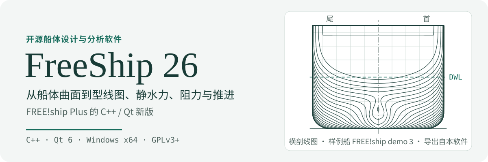
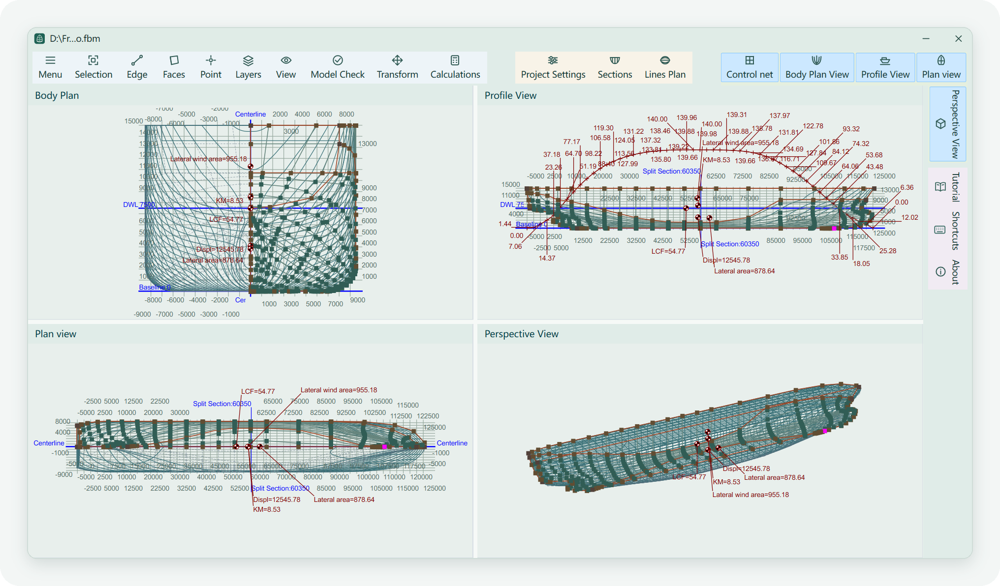
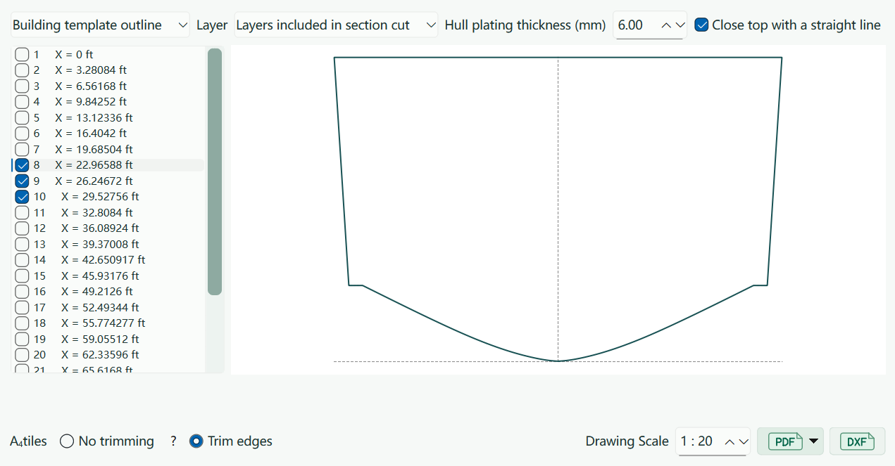
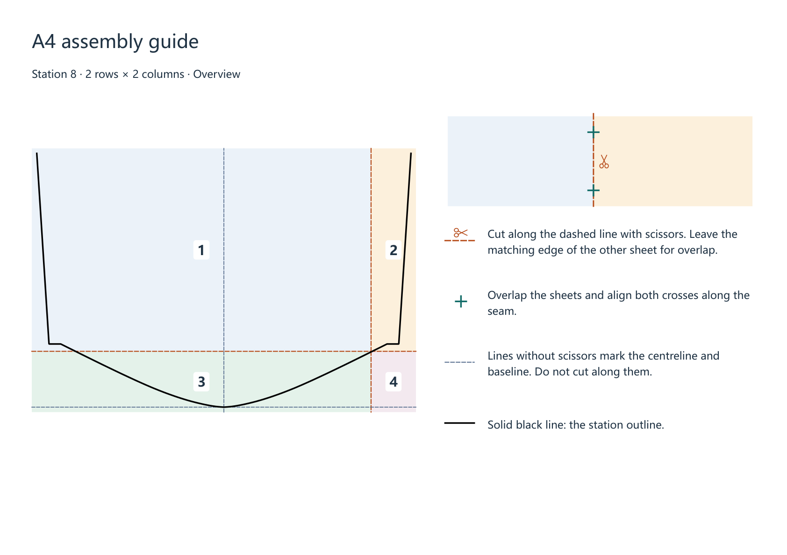
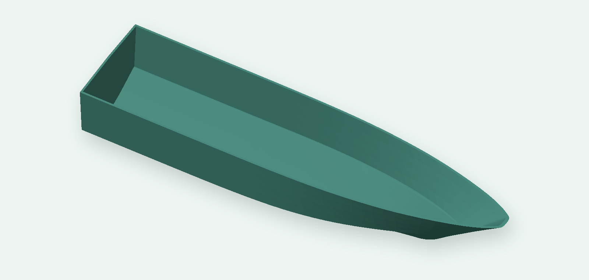
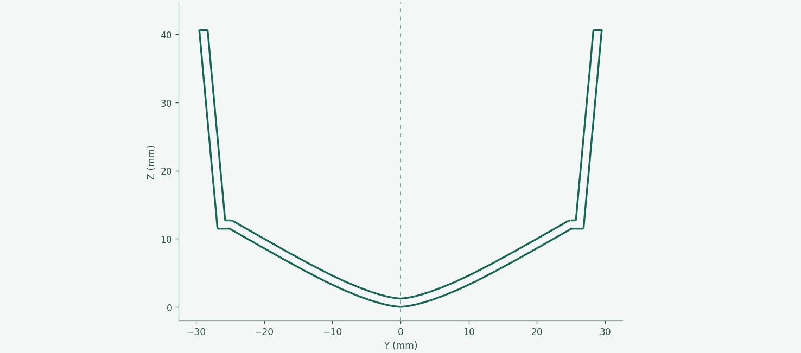
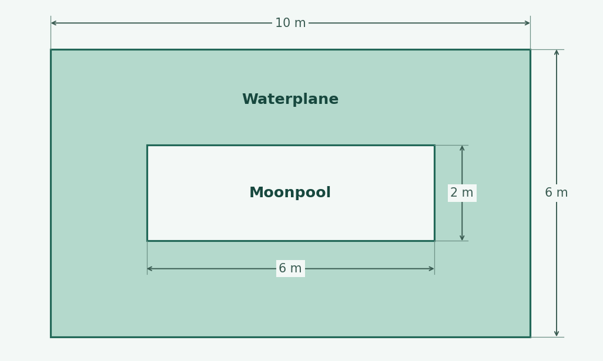
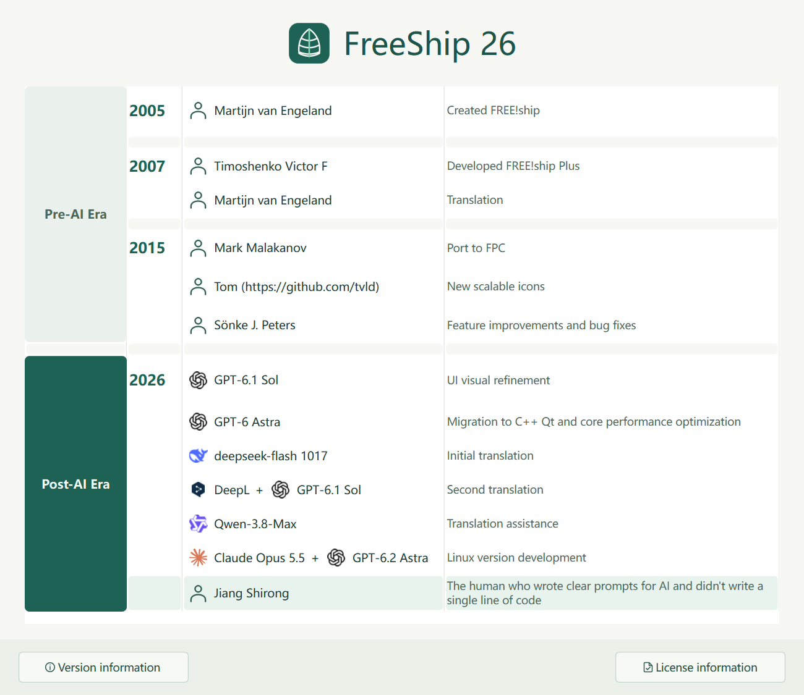

  <strong>简体中文</strong> · <a href="README.md">English</a> · <a href="README.ru.md">Русский</a>

  

FreeShip 26 是一款开源的船体设计与分析软件。你可以用控制网编辑船体曲面、检查型线、比较装载工况，再把同一份船模用来出图、展开板材或制作模型。它延续了 FREE!ship Plus 的建模方式，使用 C++ 和 Qt 6，并支持打开已有的 FBM 船模。

  <a href="https://github.com/jiangshirong/FreeShip-26/releases/latest/download/FreeShip-26-Windows-x64-Setup.exe"><b>下载 Windows x64</b></a>
  &nbsp;·&nbsp;
  <a href="https://github.com/jiangshirong/FreeShip-26/releases/latest/download/FreeShip-26-Linux-x86_64.flatpak"><b>下载 Linux x86_64（Flatpak）</b></a>
  &nbsp;·&nbsp;
  <a href="https://github.com/jiangshirong/FreeShip-26/releases/latest">最新发布</a>

  <a href="#features">建模与计算</a> &nbsp;·&nbsp;
  <a href="#output">出图与制作</a> &nbsp;·&nbsp;
  <a href="#start">安装与上手</a> &nbsp;·&nbsp;
  <a href="#improvements">相比原版</a> &nbsp;·&nbsp;
  <a href="#develop">开发与致谢</a>

  
   FreeShip 26 的四视图工作区，可同时检查横剖、纵剖、俯视和透视效果。

## 建模与计算

### 在四个视图中编辑船体

从主尺度新建船型，或打开已有的 FBM 工程。可以编辑控制点、边和面，使用折痕、镜像、挤出与图层管理，也可以在正交视图中用背景影像描图。通过横剖线、纵剖线、水线、斜剖线和曲率梳检查船形，再由同一份几何生成完整型线图。

一个窗口可以打开多个船模。可以一次选中多个文件，用 `Ctrl+Tab` 或 `Ctrl+Shift+Tab` 切换标签页。标签上的星号表示该模型有未保存的改动。

### 比较装载工况和完整船体稳性

在同一艘船上设置多个装载工况，按工况填写重量和液舱装载率，比较排水量、吃水、纵倾和复原力臂（GZ）曲线。可以指定横倾角和该角度下的最低 GZ，查看计算值与要求值的差。工况可随 FBM 保存，结果可导出为 PDF、CSV、TXT 或 JSON。

### 查看水上、水下几何与估算航行性能

- **静水力**包括设计静水力、吃水表、稳性横截曲线（KN）以及 Bonjean 等附加表。「水线上方几何」表还给出横向受风投影面积、投影形心和形心距水线的高度。有相应几何或输入时，可查看甲板边缘距水线的最小高度及投影形心距艏垂线的纵向距离。
- **阻力与推进**包括 Delft、KAPER、Holtrop、van Oortmerssen、Hollenbach、Fung–Leibman 等阻力估算方法，以及 B 系列螺旋桨敞水计算、桨型初选和主机匹配。各方法有各自的适用船型和参数范围。

> [!NOTE]
> 用户填写的最低 GZ 是自定义比较条件。用于工程决策时，请按适用规范、试验或实船数据复核计算结果。

## 出图与制作

### 出完整型线图

在独立窗口查看纵剖线图、横剖线图和半宽水线图，可导出 PNG 或 DXF。

  
   由样例船生成的完整型线图。

### 打印横剖面或制作样板

在「剖面线」中选择站位并导出横剖面图。可直接取船体横剖线，也可输入外板厚度，生成向内扣厚的造模样板轮廓。

  
   造模样板预览。示例选择了三个站位，并输入 6 mm 外板厚度。

PDF 可按比例整张出图或分成 A4 拼页，也可另行导出二维 DXF。纸样默认按 1∶1 出图，可以指定其他比例。打印时选「实际大小／100%」，用纸样上的 100 mm 校验线检查打印比例。「无需裁剪」拼页需要打印机支持按实际大小无边距打印。

  
   FreeShip 导出的 A4 拼接示意。这个站位分成四张纸，按编号、剪裁线和十字标记拼接。

### 制作 3D 打印船壳

在 STL 导出中选择「3D 打印船壳（敞口）」，输入成品船长和壁厚。软件保留外表面、向舱内加厚，并在舷缘连接内外壁。导出的 STL 可交给切片软件检查。

  
   成品船长为 250 mm 的机动艇样例。按 FreeShip 导出的 STL 网格渲染，可看到保留的顶部开口。

  
   同一个 STL 的横截面。内外两条轮廓之间是船壳厚度，两舷之间保持敞口。

### 展开板材

将可展开图层生成板片，移动、旋转或镜像排列，查看边长与面积误差。可导出 DXF、PDF、PNG、TXT 或 JSON。

  
   板材展开窗口。左侧调整板片位置和角度，右侧预览排布。

与其他软件交换模型时，可读写 FBM、读取 FTM，导入或导出 OBJ、STL、FEF，也可输出 DXF、IGES 曲面、型值和坐标。完整工程建议保存为 FBM。

## 安装与上手

| 平台 | 安装方法 |
| --- | --- |
| **Windows 10／11 x64** | [下载安装程序](https://github.com/jiangshirong/FreeShip-26/releases/latest/download/FreeShip-26-Windows-x64-Setup.exe)，双击运行。安装器可选择界面语言。 |
| **Linux x86_64** | [下载 Flatpak](https://github.com/jiangshirong/FreeShip-26/releases/latest/download/FreeShip-26-Linux-x86_64.flatpak)，按 [Linux 安装说明](FreeShip-Qt/docs/linux-install.md) 操作。已在 Ubuntu 24.04 和 Debian 13 上测试，安装包带有运行附带计算工具所用的 Wine。 |

两个平台均支持在软件内检查更新。界面提供简体中文、英语、俄语、日语、德语、法语和西班牙语。

1. 从「文件 → 打开」载入 FBM 或 FTM 船模。可以先试用 [FREE!ship Plus 样例船](https://github.com/markmal/freeship-plus-in-lazarus/tree/master/Ships)，也可以从「文件 → 新建船型」按主尺度生成船体。
2. 在正交视图中拖动控制点改形。右键拖动平移，滚轮以光标为中心缩放。在透视图中，按住 `Ctrl` 并用左键拖动可旋转视角。
3. 用工具栏的「型线图」检查船形，或在「计算」菜单中运行静水力、稳性、阻力及推进计算。详见 [操作说明](FreeShip-Qt/docs/USAGE.md)。

## 相比原版

FreeShip 26 延续了 FREE!ship Plus 的控制网建模和 FBM 工程格式。主界面迁移至 Qt 6，模型编辑、细分曲面、剖切、型线图、文件读写和主要计算迁移至 C++。仍有专业方法通过原外部求解器运行。下文的上游问题以 [FREE!ship Plus in Lazarus 固定提交 `1de17e99`](https://github.com/markmal/freeship-plus-in-lazarus/tree/1de17e99fb2b1cc559cdf27c5cafb595a627a641) 为对照。性能数据来自 FreeShip 26 的同机优化前后测试。

### 复杂船模操作的响应更快

平移和缩放只更新视图。改动控制点时，细分曲面和剖面可复用未受影响的部分。只修改备注、报告选项等数据时，软件复用已经验过的几何及型线图。移动展开后的板片也能复用该板片的绘制结果。

| 同机测试场景 | 优化前 | 优化后 |
| --- | ---: | ---: |
| 型线图连续平移、缩放，CPU 整帧绘制中位数 | 44.56 ms | 9.44 ms |
| 密集板片已经生成时，拖动事件与视口绘制中位数 | 802.96 ms | 0.45 ms |
| 直接确认未修改的工程设置，后台响应与产物写出 | 1,238.3 ms | 53.2 ms |

测试使用各自的固定样例和测量口径。加速来自减少重复生成和绘制，计算精度、曲线采样和导出设置保持原有标准。工程设置的复用条件及完整产物对照见 [性能回归记录](FreeShip-Qt/docs/migration/PUBLICATION-PERFORMANCE-AUDIT.md)。

### 数值、单位和导出几何有具体修正

以带月池的水线面为例。外轮廓为 10 × 6 m，中间开口为 6 × 2 m。按几何解析值，水线面积应为 **48 m²**，横向水线面惯性矩应为 **176 m⁴**。沿用旧算法的对照构建分别得到约 36 m² 和 360 m⁴，修正后与上述解析值一致。这类修正也覆盖多个分离浮体的轮廓。

  
   水线面俯视图。计算面积和惯性矩时，从外轮廓中扣除中央月池。

| 触发条件 | FreeShip 26 的处理 |
| --- | --- |
| **切换公制与英制** | 横剖线、水线、纵剖线等位置随船体换算。原来的 10 m 站位换算为约 32.81 ft，实际位置保持一致。 |
| **导出非对称 STL** | 按图层的实际对称设置补面。已建好的全船或非对称部件保留原几何。 |
| **用英制船模导出 PAM** | 按 1 ft = 0.3048 m 换算输出坐标，纠正旧换算方向。 |
| **输入 RVRSSHIP 主机惯性矩** | 按核定的 kg·m² 及桨轴基准标注和校验，避免按旧 t·m² 标签录入时产生千倍差异。 |

算例、触发条件、源码位置和回归入口见 [上游问题与修复](FreeShip-Qt/docs/upstream-fixes/README.md)。

### 工程文件和计算过程更可控

- **打开和保存**。新文件读入并通过几何检查后才切换。保存先把完整内容写到临时文件，再替换原文件。若目标在打开后被其他会话改动，软件会保留当前工作并提示处理冲突。
- **异常恢复**。已记录的修改可从恢复副本找回。计算报告按当前模型读取数据，向基线对齐等会改变几何的操作由用户明确执行。
- **计算任务与报告**。计算可在后台运行、取消并保存报告。调用外部求解器时，每次任务使用独立工作目录，检查退出状态和新生成的结果，避免把上一次的输出当作本次结果。

### 从设计、计算到出图的流程更完整

- **多方案工作**。在同一个窗口切换多艘船模，在同一艘船的 FBM 内保存多套重量和液舱装载率。工况对比、GZ 曲线与自定义最低 GZ 的结果可以一起查阅。
- **从船模生成可用的制作文件**。横剖面可以按外板厚度向内扣厚，生成造模样板轮廓，并出整图或带拼接指引的 A4 PDF。用于 3D 打印时，可以按成品船长和壁厚输出敞口船壳 STL。
- **安装、语言和更新**。Windows 安装器支持七语，Qt 版另提供带 Wine 的 Linux Flatpak。界面、主要报告和更新提示都可以随界面语言切换。公开稳定通道已验证 Windows 从旧版下载并重建新版安装包，以及 Linux Flatpak 在 Debian 13 上实际升级。版本变更见 [发布记录](https://github.com/jiangshirong/FreeShip-26/releases)。

## 开发与致谢

从源码构建可参考 [Windows 构建说明](WINDOWS-BUILD.md) 和 [Linux Flatpak 构建说明](FreeShip-Qt/tools/flatpak/README.md)。欢迎提交可复现的报告、可公开的 FBM 算例和文档改进，详见 [贡献指南](CONTRIBUTING.md)。

FreeShip 26 建立在 Martijn van Engeland 的 FREE!ship、Timoshenko V.F. 的 FREE!ship Plus 和 Mark Malakanov 的 [FREE!ship Plus in Lazarus](https://github.com/markmal/freeship-plus-in-lazarus) 之上。Tom 绘制了可缩放图标，Sönke J. Peters 改进功能并修复问题，部分几何代码参考了 Greg Green 的 [ShipCAD](https://github.com/gpgreen/ShipCAD)。

  
   软件「关于」窗口中的贡献名单，包含 Linux 版开发致谢。

项目以 [GPLv3 或更高版本](COPYING) 发布，原作者署名和第三方来源见 [NOTICE](NOTICE.md)。安装包附带的外部计算程序各有分发条件，其中 ADD_MASS 限教育及非商业用途。详见 [外部计算工具](FreeShip-Qt/docs/CALCULATION-TOOLS.md)。

<a href="#top">回到顶部 ↑</a>

